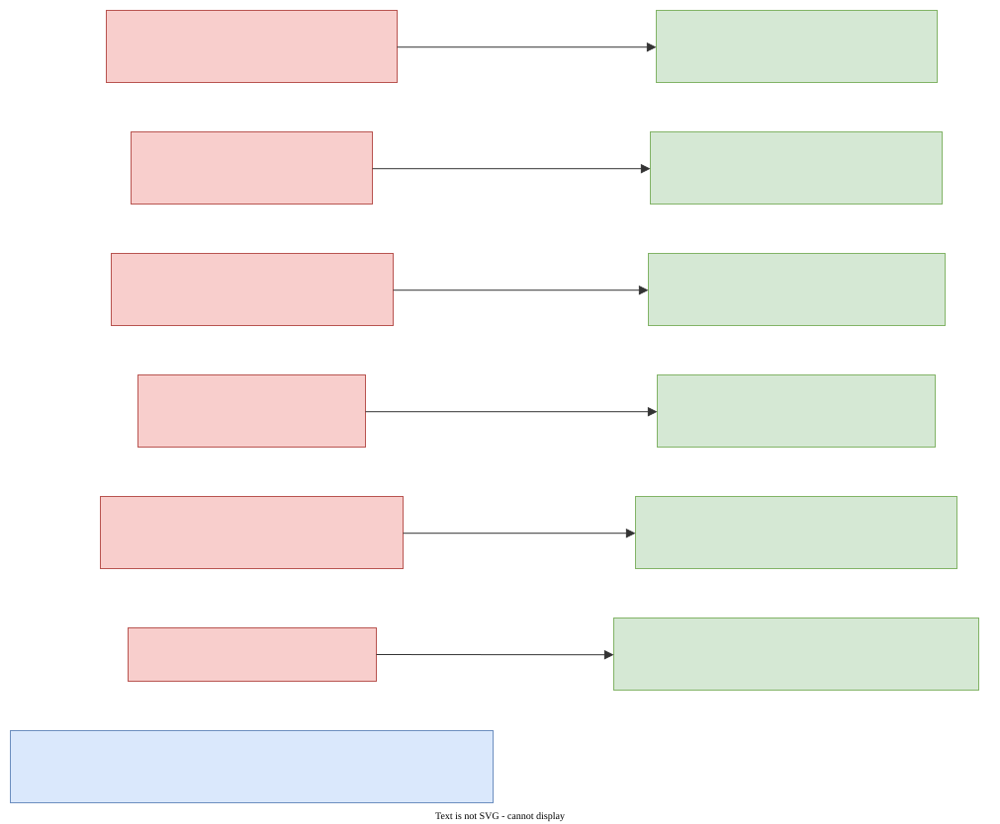
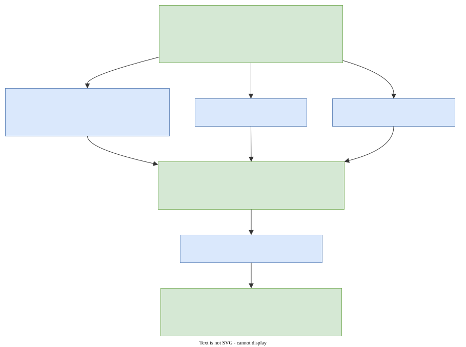
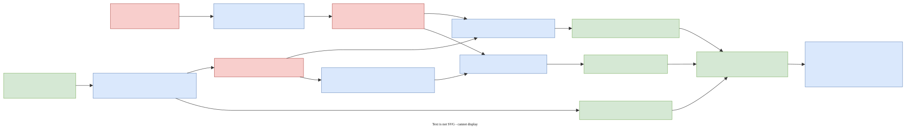
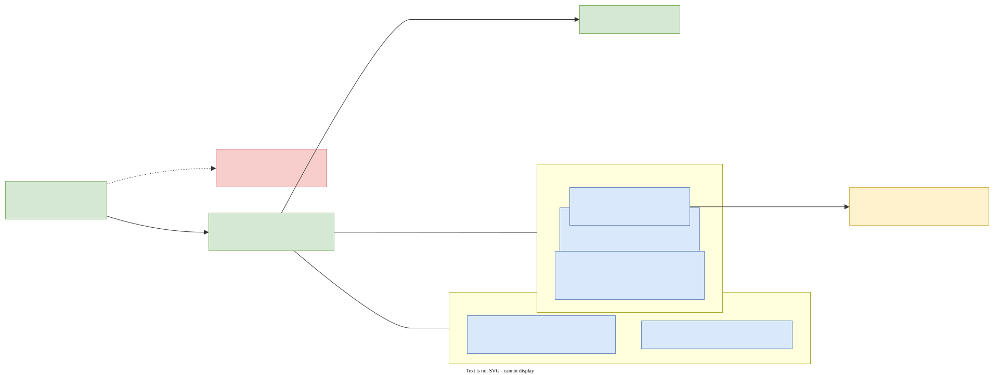
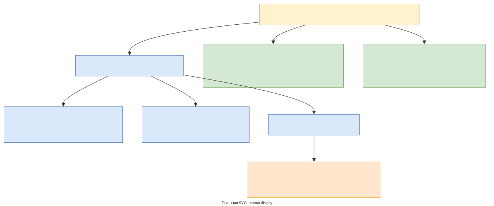
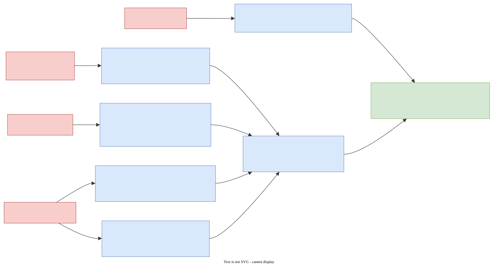

# DAVINCI v3-PQ — Post-Quantum Protocol Specification

**Status:** draft v1.4 · 2026-10-24 · **blinded-slot mainline**: revoting is now an ordinary
slot overwrite over public masked slot vectors — revocation nullifiers, predecessor
consumption, chain counters and the batch pad are **removed** (they existed in drafts ≤1.3),
restoring v2-grade public-data revote hiding; plus nf-sized packages, the all-ν complaint
waiver, adaptive workload-based deadlines, and a Benaloh-style cast-as-intended audit.
Carries forward from v1.3: unified Blake3 profile, per-warden column views (§8.7), ceremony
v2 (§10.3–10.4), early complaints with voter recovery (§9.2), ML-KEM-768-only transport.
v2 remains the deployed protocol. Reviewed: three adversarial soundness rounds + four
improvement design rounds (protocol reviewer, incl. one that **blocked** a candidate quota
design with a concrete attack) + audience-representative sign-off + one external design
review + two adversarial synthesis reviews + three literature surveys incl. a 21-protocol
SoTA comparison; a final consolidated review gates implementation (Phase 0).
**Audience:** engineers who already know [DAVINCI v2](https://spec.davinci.vote). This document only
specifies what *changes*. Everything not mentioned here (settlement flow, grace window, blob
verification via the point-evaluation precompile, census origins, sequencer lifecycle, process
registry mechanics) works exactly as in v2 [DAV2].

---

## 1. Why v3, in one paragraph

Every ballot DAVINCI v2 publishes in Ethereum blobs [EIP4844] is an ElGamal ciphertext over
BabyJubjub. Published blob data can be archived by anyone indefinitely, and ElGamal falls to
Shor's algorithm — so a future quantum computer decrypts **past elections retroactively**
("harvest now, decrypt later"). Integrity is less urgent (a settled chain cannot be rewritten
under Ethereum's finality assumptions), but **ballot privacy must be post-quantum today**.
v3-PQ removes the quantum-vulnerable primitives from the ballot *confidentiality* path: no
shared-key homomorphic encryption, no pairings, no DKG, no Groth16. Ballot secrecy rests on
polynomial secret sharing, hashes, STARKs, and one NIST-standardized KEM (a post-quantum
"public-key lockbox" — all such terms are defined plainly in §2.4). The KEM is never
proven inside the voter's circuit (the batch guest performs encapsulations, and rare complaint
proofs perform decapsulations; see §8.5, §9.2). During the hybrid period voter authentication
still *also* uses ECDSA (§11), and the settlement wrapper and KZG blob commitments remain
inherited non-PQ dependencies (§12.5).

### Changes at a glance

| Component | v2 | v3-PQ |
|---|---|---|
| Ballot confidentiality | ElGamal over BabyJubjub (threshold key) | Shamir shares + PRF masks over KEM transport (§3) |
| Ballot proof | Groth16 over BN254 (circom, trusted setup) | Plonky3 STARK over Goldilocks, browser WASM (§6) |
| Election key | DKG / council ceremony (BabyJubjub) | **None.** Wardens register ML-KEM keys (§4) |
| Tally | Threshold decryption + BSGS search | Lagrange interpolation of θ proven warden sums (§10) |
| Running tally | Homomorphic ciphertext accumulator | Sum of public blinded slot vectors over Goldilocks (§8.4) |
| Silent revoting | Re-encryption of stored ciphertexts | Uniform blinded slot-vector updates — refreshes and overwrites publish identical records (§7, §8.4) |
| Revotes | Slot overwrite + ciphertext subtraction | Slot overwrite + slot-vector delta — **no nullifiers, no predecessor consumption, no revote budget** (§5.3) |
| Voter authentication | ECDSA (secp256k1) | Hash-preimage proof in-STARK; `hybrid` verifies **both**; `hybrid-legacy` admits unenrolled voters on ECDSA (§11) |
| CSP credentials | ECDSA | SLH-DSA (SPHINCS+) [FIPS 205] |
| Batch proof | ZisK, verifies Groth16 (BN254 precompiles) | ZisK [ZISK], verifies ballot STARKs (Blake3 precompile) |
| Protocol hash | Poseidon (circuits) + SHA-256 (state) + Keccak (Ethereum) | **Blake3 everywhere the protocol chooses** (§2); keccak/SHAKE/SHA-2 survive only as fixed islands |
| Tally bound | maxValue·maxVoters ≤ 10^12 (BSGS limit) | ≤ 2^61 (field headroom; no search) |



---

## Protocol intuition — read this first

*This walkthrough is self-contained: you need no prior DAVINCI knowledge. Every term used
loosely here gets a precise definition from §2 onward; the jargon cheat-sheet is §2.4.
Readers who know v2 will recognize the shape — the deltas are marked "(v2: …)".*

### The cast

| Who | What they do | What you have to trust them with |
|---|---|---|
| **You, the voter** | vote from a browser; revote whenever you like | your own device |
| **The organizer** | creates the election: the **census** (the list of eligible voters and their voting weights), the ballot rules, the schedule — and picks which registered wardens form the committee | getting the voter list right, and choosing a committee worth trusting (the privacy guarantee below traces to that choice) |
| **ν key wardens** (say 5) | a committee; each publishes a post-quantum "lockbox" public key up front — anyone can lock a small secret so that only that warden can open it. After the election, any **θ** of them (say 3) jointly produce the result | privacy only: fewer than θ of them must stay honest. They cannot change the result — nobody can. (If fewer than θ show up at the end, the result cannot be produced — the standard committee trade-off) |
| **Sequencers** | anyone who wants to run one (permissionless). They collect votes, bundle them into **batches**, and *settle* each batch — publish it to Ethereum with a cryptographic proof that every rule was followed | nothing for correctness (the proof is checked by the contract). The one you submit to learns when you revote, and could ignore you — in which case you just switch to another; no sequencer can block the election |
| **The smart contract** | the referee's referee on Ethereum: verifies every proof, stores the public state, and at the end computes the result itself | it's Ethereum — the usual assumptions |
| **Observers** | anyone. All published data is enough to replay and re-check the whole election | — |

Each eligible voter owns one fixed **slot** — a position in the public state that holds their
current (hidden) vote. Revoting just writes your slot again; the last write before closing
counts. Revoting is a feature, not an edge case: it is what lets a pressured or coerced voter
quietly change their vote later. (v2 had the same census, slots, sequencers and contract.)

### The trick, with tiny numbers

Everything rests on one 1979-vintage idea — Shamir secret sharing — plus the observation
that *shares add up*. Suppose θ=2, ν=3, and all arithmetic is modulo some large prime.

- **Alice votes 1.** Her browser picks a random line through her vote:
  $f_A(x) = 1 + 4x$. Her three *shares* are $f_A(1)=5$, $f_A(2)=9$, $f_A(3)=13$ — one per
  warden. Any two shares pin down the line and reveal $f_A(0)=1$. One share alone says
  *nothing*: for every possible vote $v$ there is a line through $(0, v)$ and $(1, 5)$, so
  the share 5 is perfectly consistent with Alice voting 0, 1, or anything else.
- **Bob votes 0.** His line: $f_B(x) = 0 + 2x$. Shares: 2, 4, 6.
- Shares are never shown in the clear. Alice hides each one under a **mask** — a random
  number only warden $i$ will be able to recompute, because its key is locked in that
  warden's lockbox. Say her masks are 20, 50, 70: she publishes 25, 59, 83. Bob's masks are
  10, 30, 40: he publishes 12, 34, 46. To everyone else these six numbers are pure static.
- The public **running total** per warden is just the sum of published numbers:
  warden 1: 37, warden 2: 93, warden 3: 129.
- **After the election**, warden 1 opens its lockboxes, recomputes its two masks
  (20 and 10), and subtracts: $37 - 30 = 7$. Warden 2: $93 - 80 = 13$. Those are points of
  the *sum* line $F(x) = f_A(x) + f_B(x) = 1 + 6x$: indeed $F(1)=7$, $F(2)=13$. The
  contract draws the line through $(1,7)$ and $(2,13)$ and reads it at zero: $F(0) = 1$.
  **One yes-vote — and no group of fewer than θ wardens can ever tell whose.** (Warden 1
  did learn one point of each voter's line along the way — which, as above, is consistent
  with any vote.)

Two footnotes to keep the example honest. Real elections use a huge prime modulus, so
"random-looking" means genuinely indistinguishable from noise — the small numbers here are
for readability. And a real ballot is a short *vector* of numbers (one per option — "rate 5
candidates" is five values; voting weights scale them under the election's rules); everything
shown here just happens once per position, and the result is a vector of per-option totals.

No warden ever learns a ballot (one share is noise). No decryption key for "the votes"
exists anywhere, so there is nothing to steal, leak, or break — short of θ wardens
colluding, which is the same committee-trust every threshold scheme has. That's the whole
protocol; the rest is making every step *provable* so nobody has to be trusted for
correctness.


### The same story, phase by phase

**Setup.** The organizer registers the election on the contract: census, ballot rules,
schedule, and which ν registered wardens form the committee. That's it — because wardens'
lockbox keys already exist, there is **no key-generation ceremony and no election
encryption key**. (v2 ran a distributed key generation — DKG — to create a shared key
before every election; that whole phase is gone.)

**Casting.** Your browser splits each ballot value into ν shares, masks them, locks the
mask keys into the wardens' lockboxes, and — right there in the browser — generates a
zero-knowledge proof (a STARK: a proof made only of hashes, no trusted setup) that the
whole construction is honest: the shares encode one valid ballot that follows the election
rules, the masks match their commitments, and you hold the secret key behind your voter
identity — a hash-based key, itself post-quantum (elections may *additionally* accept
classical wallet signatures during migration, §11) — while the batch step below checks that
identity against the census and your slot.
The *package* you send — masked shares, locked boxes, commitments — goes to a
sequencer of your choice over a private channel, proof attached. If you don't trust your
own browser, you can demand it open any candidate package for inspection on a second
device, then discard it and cast a fresh one (§5.2) — a cheating client gets caught.

**Voting period.** Sequencers verify incoming proofs, bundle packages into batches, and
settle each batch: the contract accepts it only with a proof that *every* rule was followed
(this proof is produced by a zkVM — a virtual machine whose entire execution is provable).
The bulky data — packages and slot vectors — rides along in Ethereum *blobs*, cheap bulk
storage attached to the transaction; the contract itself keeps only tiny commitments and
the verified state.

Your slot then holds a public **blinded vector**: your masked shares with an extra layer of
blinding added by the sequencer. Why the extra layer? Consider revoting without it: your
slot's numbers would change from your old package's numbers to your new package's — and
since packages are public, anyone could match the change and see you revoted. So the
sequencer re-blinds — and, crucially, each batch *also* re-blinds a sample of slots whose
owners did nothing, **sized by protocol rule so that revotes don't stand alone** (a single
overwrite travels with sixteen look-alike refreshes — or as many as there are other occupied
slots; in a nearly-empty election there is little crowd to hide in, as in v2). The result:
**a revote
and a routine "refresh" publish byte-identical
kinds of records.** Fresh-looking numbers either way; an observer sees *that* slots changed,
never *which* of the changes were revotes — the hiding is among the batch's touched slots,
which is exactly why the sample rule exists. (v2 achieved the same by re-encrypting stored
ciphertexts; v3 re-blinds stored
vectors — no encryption needed.) A revote's batch simply subtracts the slot's old vector and
adds the new one — the published delta — so the old ballot leaves the total the moment the
new one enters. The blinding isn't lost: every batch leaves the committee a
sealed note — its key split θ-of-ν across the wardens, the same Shamir trick again —
recording which updates were real and how to remove
the blinding at tally time. The running total is the sum of all current slot vectors:
public, continuously updated, and unreadable.

**End of election.** Casting closes; a short *grace window* lets in-flight batches land;
the running total freezes. Then one new deadline (new vs v2): the **complaint deadline**.
Why it exists: the browser's proof checks everything it can see, but it deliberately cannot
look *inside* the lockboxes (proving post-quantum encryption in-proof is the one expensive
step this design avoids). So if some package's lockbox doesn't open to what was promised —
a buggy or malicious client —
the affected warden proves that on-chain and the package is excluded from the count. A
complaint is itself a proof, so a warden cannot abuse it to exclude an honest vote.
Wardens can file complaints *from the moment a package lands*, so an honest voter with a
broken client finds out while voting is still open and simply revotes. The deadline is the
last moment to complain; then the exclusion list freezes. (If all ν wardens attest early
that they're done checking, results can start immediately.)


**Results.** Any θ wardens each do one job: open their lockboxes, strip their masks and the
sequencers' blinding off *their own column* of the frozen total, and publish the resulting
**partial sum** — with a proof that they did exactly that and nothing else. The θ partial
sums are θ points on a single polynomial, and its value at zero *is* the election result.
The contract draws the curve and reads it off — ordinary modular integer arithmetic (the
same "mod a large prime" as the example), on-chain, exact.
(v2 ended with a threshold *decryption* plus a brute-force search to extract the number;
v3's ending is the schoolbook interpolation you saw above.)



### Who sees what — plainly

- **The public / an observer**: all packages, all blinded vectors, the running total, which
  slots changed and when, turnout, the complaint list, the result. Never a ballot, and
  never whether a change was a revote or a refresh.
- **Your sequencer**: that *you* (your slot) revoted in the batches it sealed — the same
  thing the vote-collecting server inevitably sees in v2. Never your ballot or shares.
- **Fewer than θ wardens, even colluding, even with quantum computers, even in 30 years
  from archived data**: each holds shares that are individually pure noise — nothing. (To be
  exact: below θ *raw shares* the protection is pure math; the *archived masked data* is
  additionally guarded by one computational assumption — the ML-KEM lockboxes, a
  post-quantum lattice scheme. That is the single lock a future cryptanalyst would have to
  break.)
- **θ or more colluding wardens**: can reconstruct individual ballots (every threshold
  voting system has exactly this boundary) and, at tally time, jointly learn which slot
  updates were revotes. Choose the committee accordingly.

### What this buys you

- **Nothing to harvest.** The quantum "harvest now, decrypt later" attack dies below θ
  wardens: published shares are information-theoretic noise, and the only cryptography
  guarding the mask keys is lockboxes (ML-KEM) and hashes — both post-quantum. (v2's
  published ElGamal ciphertexts fall to a future quantum computer retroactively.)
- **No shared decryption key exists** — not held by anyone, not generated, not reconstructable.
  Each warden has only its own ordinary keypair. The tally still takes one coordinated
  round among θ wardens (opening the batches' sealed notes together), but no step of it
  ever produces a key that decrypts ballots.
- **Checked, not trusted.** Voter, sequencer and warden each move only with a proof: the
  contract rejects anything else. Integrity needs no honest operator anywhere. (One honest
  asterisk: ballot *secrecy* is what's quantum-proof today; the *integrity* plumbing still
  includes some classical Ethereum-era pieces — the proof wrapper, blob commitments, and
  optional legacy wallet signatures — with a tracked migration path, §12.5. Breaking those
  could forge state while they last; it can never retroactively read ballots.)
- **Exact results.** The tally is integer arithmetic — no decryption failures, no noise
  budgets, no brute-force search at the end.

---

## 2. Notation, parameters and encodings

- $\mathbb{F}$ — the **Goldilocks field**, $p = 2^{64} - 2^{32} + 1$ (the Plonky3 [P3] and ZisK
  native field). All shares, masks and tally arithmetic live here. Canonical encoding of an
  element: 8 bytes little-endian, value < $p$.
- $\nu$ — number of **key wardens**; $\theta$ — tally threshold. **v3.0 supports
  $1 \le \theta \le \nu \le 8$**, enforced at creation and in the pinned profile (DA and
  in-circuit cost are linear in ν — ν=8 halves both vs 16; the protocol structures support
  up to 16, which returns as a future profile once DA/verification optimizations land;
  committee size is unrelated to the 16 *ballot fields*, which stay). Size rosters with the
  availability margin in mind: tolerating $f$ unavailable or faulty wardens through the
  complaint deadline and tally ceremony needs $f < \theta \le \nu - f$ — an 8-of-8 election
  tolerates none — and the ceremony absorbs individual failures by roster margin (§10.4),
  with blinding still requiring ≥ 1 honest *accepted dealer*. The complaint-capacity bound (§9.2) depends
  on admitted casts, not ν: fewer wardens means less aggregate proving/archival redundancy,
  so deadlines and hardware budgets must be revalidated per roster size.
- `nf` — active ballot fields, 1..16, as in v2, immutable per election. **Packages carry
  shares, masks and commitment entries only for fields `1..nf`** (v1.3 fixed everything at
  16-wide; nf-sizing saves `(16−nf)·ν·8` B per package — ~960 B at ν=8/nf=1). Any 16-wide
  logical representation is the zero extension: inactive fields have no per-package
  polynomials, share encodings, mask consumption or commitment entries. The accumulator,
  blinding vectors and tally equations STAY 16-wide via zero extension ($\widehat E_{i,f}=0$,
  $\widehat{\mathrm{mask}}_{i,f}=0$ for $f>nf$; inactive results interpolate to 0). All
  component lengths are derived from authenticated election parameters, never from supplied
  bytes; trailing inactive-field bytes are rejected.
- **KEM** — **ML-KEM-768 [FIPS 203] (ct 1088 B), the only allowed profile** (v1.2's
  ML-KEM-512 option is withdrawn: BSI recommends only the 768/1024 sets, and 512 saved just
  ~2.5 KB per ballot at ν=8; the DA-reduction path is multi-recipient Kyber, §15.5). Browser
  implementations must be pinned and vetted [KEMB]. One *encapsulation* yields `(ct, K)` with
  a 32-byte shared secret `K`; arbitrary payloads are carried KEM-DEM style (encapsulate,
  derive a wrapping key from `K`, then DEM-encrypt — §2.1). **Normative decapsulation rule
  (all paths — warden recovery §10.1, complaint guests §9.2, ceremony recipients §10.4):
  the FO re-encryption check MUST compare the full re-encrypted ciphertext in constant time;
  partial or early-exit comparison enables ML-KEM key recovery [FOCT].**
- **Blake3** — standard Blake3 [B3] is **the protocol hash, everywhere the protocol gets to
  choose**: the ballot STARK's Merkle trees and Fiat–Shamir challenger; all in-circuit
  hashing (PRF masks, commitments, voteID — via a re-laid Blake3 AIR section,
  §6); the census tree; the state SMT; `pkgDigest`/`ctsDigest`; and
  every DEM/PRF/key-derivation role through Blake3's standard *keyed*, *derive_key* and
  *XOF* modes (§2.1). Digests are 32 bytes. Rationale: fastest software hash in the browser
  (~1.4 GB/s in WASM; measured on the prototype: proving 3.24 s → 0.69 s, proofs
  544 → 324 KB), a standard-conformant ZisK precompile (`blake3f`) for every guest
  recomputation, and a conservative, long-studied ARX design (§12.4). One hash = one
  implementation to audit on each platform (AIR, guest, browser, warden).
- **Hash islands the protocol cannot choose**, stated plainly: **keccak256** for values
  Solidity contracts must compute (blob evaluation points $z_b$, the v2 processID prefix,
  the origin-3 running registration commitment of §8.2) and for hybrid-mode Ethereum
  addresses; **SHAKE** inside ML-KEM and **SHA-2** inside SLH-DSA (FIPS-fixed internals of
  black-box primitives); **Poseidon2** inside ZisK's own prover (an inherited proof-system
  dependency — framing in §12.4; [POS2]). Poseidon2 and SHA-256 hold **no
  application-level role** in v3-PQ.
- **256-bit values in circuits** (DEM keys, Blake3 digests crossing into Goldilocks
  arithmetic): encoded as **eight 32-bit limbs**, each range-checked < 2^32. Never as four
  64-bit limbs (not injective: $p^4 < 2^{256}$), and never reduced mod $p$.

### 2.1 DEM (authenticated encryption for warden payloads)

Built from Blake3's standard modes, normative for **every protocol payload** (voter→warden is
pure KEM+PRF and needs no DEM; this DEM covers batch payloads, batch-key share wrapping, and
ceremony deliveries):
- **Key separation**: `k_enc = Blake3.derive_key("davinci v3-pq DEM enc key", K)` and
  `k_mac = Blake3.derive_key("davinci v3-pq DEM mac key", K)` — fixed application context
  strings, exactly the standard derive_key mode. `derive_key` creates *separation, not
  entropy*: `K` must be a ≥256-bit KEM secret or CSPRNG secret.
- **Keystream**: keyed-Blake3 **XOF** — `keystream = Blake3.keyed(k_enc, nonce ‖ AAD).xof()`,
  with the counter being the XOF output offset (bounded: payloads < 2^32 blocks, no offset
  wraparound); ciphertext = plaintext ⊕ keystream. An XOF is a seekable output stream, not
  repeated hashing of previous output.
- **Authentication**: encrypt-then-MAC — `tag = Blake3.keyed(k_mac, nonce ‖ AAD ‖ ciphertext)`;
  receivers verify the **full 32-byte tag before releasing any plaintext**.
- **Uniqueness**: `nonce = Blake3(AAD)`; the AAD is the canonical, length-unambiguous
  serialization of a **DEM context** that always includes a purpose tag, the election
  context, the **batch number or ceremony (session, attempt) identifier**, sender and
  recipient — unique per encryption *including retries* (a ceremony restart is a new attempt
  id ⇒ fresh masks, keys and nonces; the same derived key and nonce never encrypt two
  different plaintexts).

Honest label: these are standard Blake3 modes, but their composition is a
**protocol-specific authenticated-encryption construction — not a standardized AEAD**; the
needed assumption is keyed-Blake3's PRF security (§12.4). A short security-argument appendix
(encrypt-then-MAC composition per Bellare–Namprempre over keyed-Blake3-as-PRF, with the
deterministic AAD-derived nonce justified by the AAD-uniqueness rule above) is a Phase-0
publication gate (§15). AES-256-GCM may be used by clients
for unrelated local storage/transport, never as a substitute encoding of protocol payloads.

### 2.2 Domain-separated contexts

Every derived value uses a purpose-tagged context; nothing is derived without one. Purpose
tags map to Blake3 `derive_key` context strings; the tuple itself is serialized canonically
(fixed order, length-prefixed variable fields).

| Purpose | Context contents |
|---|---|
| `pkgCtx` — the package context tuple | `(protocolVersion, chainID, registry, processID, wardenEpoch, voteID)` — the common prefix below |
| `streamCtx(i)` — mask stream for masked shares | `("v3/mask", pkgCtx, recipient i)` — **one keyed XOF stream per (package, warden)**, no field index: `stream_i = Blake3.keyed(K_i, streamCtx(i)).xof()`, 256 bytes of output; field $f$ uses bytes $[16(f{-}1), 16f)$ via the LE128-mod-$p$ rule below. This is a **normative masking definition** — browser, ballot AIR, batch guest and warden implementations must match it bit-exactly (test vectors required) |
| `hCtx(i)` — share/pad commitment | `("v3/hcommit", pkgCtx, recipient i)` |
| `commitCtx` — package commitment | `("v3/pkgcommit", pkgCtx)` — the `ctx` argument of `pkgCommit` (§5.1) |
| `slotUpdCtx` — slot-update blinding | `("v3/slotupd/zero", …)` and `("v3/slotupd/mask", …)` — the per-touched-slot zero-sharing coefficients and unstructured masks of §8.4, derived in-guest; contexts bind the election tuple, batch number, slot, and (for masks) the recipient index and field. Mask subkeys derive from the authenticated batch key $k_b$ under the mask domain (§8.5) — never from recipient seeds, and zero-sharing randomness is domain-separated from both. Byte-exact derivation (subkey structure and per-coefficient/per-field XOF offsets) is pinned by Phase-0 gate 3; the LE128-mod-$p$ extraction rule below applies. (Batch-seed → $k_b$/encapsulation-randomness derivations are guest-internal, pinned by the program key, and need no published context.) |
| `waiverCtx` — complaint waiver | `("v3/complaint-waiver/1", protocolVersion, chainID, registry, processID, wardenEpoch, wardenSetHash, i, R_cast, Blake3(A_cast))` — the §9.2 all-ν early-close attestation, SLH-DSA-signed |
| `viewCtx` — per-warden column views | `("v3/view/rows", …)`, `("v3/view/payload", …)`, `("v3/view/acc", …)`, `("v3/view/root", …)` — the four §8.7 commitments; each context binds `(protocolVersion, chainID, registry, processID, wardenEpoch, wardenSetHash)` plus the batch number and (where applicable) the recipient index |
| `cerCtx` — ceremony envelopes | `("v3/ceremony/<phase>", pkgCtx-style election tuple, session, attempt, sender, roster hash, dealer-set hash where applicable)` — the signed-envelope context of §10.4; every ceremony signature and DEM context derives from it |
| `slotCtx` — slot derivation | `("davinci-slot-v3", address)` — the Blake3 replacement of v2's SHA-256 `"davinci-slot-v1"` address→slot rule (§8.2). Slot-vector **leaves** use the single tag `"davinci-slotvec-v3"` for every touched slot, real write or refresh alike (§7); there is **no** refresh-specific domain tag — a branch-distinguishing tag would publicly mark refreshes, contradicting §8.4. (Drafts ≤1.3's `"davinci-refresh-v3"` is removed.) |

The package's mask nonce is its **voteID** — public, unique per package, authenticated, and
independent of the masked values (it derives from the secret `k`, §5.2, before any masking),
so wardens can recompute every `streamCtx` from public data with no circularity. (Earlier
drafts derived one PRF output per *field*; that definition contradicted the in-AIR cost
estimates — ≥16 final keyed computations per warden, 256 at ν=16 — and was replaced by the
single per-warden stream above, which needs only one context block plus four 64-byte XOF
output blocks per warden.)

**Byte→field mapping (normative).** Blake3 outputs bytes; masks and other derived field
elements are obtained as **LE128 of 16 XOF bytes, reduced mod $p$** — statistical distance
from uniform ≈ $2^{-96}$ *per element* (pseudorandom/nearly uniform — not exact uniformity, and not a whole-election bound). Never `LE64(8 bytes) mod p`: its distance is
≈ $2^{-32}$, which is not.

### 2.3 Protocol parameters

| Parameter | Value | Why |
|---|---|---|
| Share/tally field | Goldilocks $p$ | native in the ballot AIR and ~native u64 in ZisK guests |
| Registry tally cap | `maxValue · maxVoters ≤ 2^61` | per-field tally stays below $p$ with headroom (weights don't change this: each field is individually bounded by `maxValue`) |
| **Integer-cost profile (enforced)** | `nf · maxValue^costExponent < 2^61`, checked by the registry at creation **and** recomputed overflow-safe in the ballot proof | the cost sum must not wrap mod $p$ (e.g. `costExponent=192` would give $2^{192} \equiv 1$); v2 only *advised* this profile — v3 enforces it |
| Warden evaluation points | $x_i = i$, $i \in 1..\nu$ | Shamir positions, pairwise distinct, nonzero |
| Max votes per batch | profile-dependent (§8.6) | in-guest verification cost + the 32-blob batch cap inherited from v2's batch program (see §8.6) |
| Max refreshed slots per batch | 2048, rule as v2 | unchanged |
| Per-voter casting | **no lifetime bound** (as v2) | the structural rate limit is ≤ 1 real ballot per slot per batch (§8.4); first writes are bounded by `maxVoters`. Review ruled out both a flat lifetime cap (capturable) and a two-pool cap (an attacker exhausting the overwrite pool would permanently block every later escape vote — worse than congestion). Deliberate cast inflation is priced by admission and provisioned by the adaptive deadlines below |
| Accepted-batch bound | `M ≤ admitted casts + 1` | every transition other than the single initialization-only transition of §7.4 must admit ≥ 1 package (registry-enforced on the batch statement's counters); refresh-only batches are not accepted. Bounds the per-warden batch-envelope work (§8.5, §10.1) |
| Adaptive deadlines | `d_complaint = t_freeze + d_0 + α·C + β·M + γ·U` | complaint/ceremony/contribution deadlines are **workload-derived**, computed once at casting freeze from the authenticated terminal counts (C = admitted casts, M = batches, U = total slot touches; `U ≤ C + 2048·M`); coefficients and margins pinned at creation, budgeting worst-case malformed transport + proving + publication + inclusion + archive catch-up + reorgs — never only honest decapsulation. The ceremony's share-bundle and contribution deadlines scale by the same counts (§10.4). Subsequent complaints never extend a computed deadline; the all-ν waiver (§9.2) may shorten it |
| High-stakes FRI profile (named) | blowup 32, **27 queries + 20-bit grinding** ≈ 155 conjectured bits | the pinned "raise the dial" option of §12.4 (~1.5× in-guest verification cost vs the default profile); selecting it is a profile choice, not an ad-hoc edit |
| Ballot STARK profile | Goldilocks, **blowup 32, 18 FRI queries + 16-bit query grinding**, hiding PCS, **Blake3 everywhere** (Merkle/challenger AND the in-AIR hashing section) | ≈106-bit conjectured FRI soundness (§12.4, same heuristic dial as before); chosen verifier-side: −35% in-guest steps and −39% proof size vs blowup-8/34-queries, for ~2.7× prover cost — measured (§8.1). Fallback if browser benchmarks disappoint: blowup 16 / 26 queries. Profile pinned in full by `ballotVKHash`; grinding makes the wasm32 challenger fix (§6) strictly mandatory |
| Commitments | **salted unkeyed Blake3**, domain-separated | hiding from an independent 256-bit CSPRNG salt (or the secret inputs); binding from collision resistance. Keyed-Blake3 is reserved for MACs/PRFs — a MAC is not automatically a hiding/binding commitment |

### 2.4 Terminology for software engineers

Plain definitions, anchored in things an Ethereum engineer already knows. Skim once; the rest
of the document assumes them.

- **KEM** (Key Encapsulation Mechanism; here **ML-KEM**, the standardized Kyber) — a
  public-key *lockbox*: anyone can "encapsulate" against your public key and obtain a fresh
  32-byte shared secret plus a ciphertext; only you (with the private key) can recover that
  secret from the ciphertext. Think of it as the post-quantum replacement for ECDH key
  exchange — except there is no shared-curve math and the two parties never need to be online
  together.
- **PRF** (pseudorandom function) — a keyed hash used as a deterministic random-number
  generator: same key + input ⇒ same output, and without the key the outputs are
  indistinguishable from random. Mentally: `keccak256(key, input)` used the way you'd use a
  seeded RNG. Here PRFs expand a KEM secret into the masks that hide shares.
- **Shamir secret sharing** — split a value into ν pieces by choosing a random polynomial of
  degree θ−1 whose value at x=0 is the secret, and handing out its values at x=1..ν. Any θ
  pieces determine the polynomial (and hence the secret); any θ−1 pieces are statistically
  independent of it — noise, not "hard to crack".
- **Threshold θ-of-ν** — ν parties hold pieces; any θ of them suffice to act (here: tally);
  fewer than θ learn nothing and can block nothing except by being too few.
- **Lagrange interpolation** — given θ points, there is exactly one polynomial of degree
  ≤ θ−1 through them; evaluating it at x=0 recovers a Shamir secret. "Draw the unique curve
  through the points, read it at zero." A few multiplications and additions — cheap even in
  Solidity.
- **STARK** — a zero-knowledge proof system built only from hashes (no trusted setup, no
  elliptic curves, post-quantum). Bigger proofs than Groth16 (hundreds of KB), but
  browser-provable and cheap to verify.
- **AIR** — the constraint system of a STARK: its "circuit".
- **FRI** — the polynomial-checking engine inside a STARK; the reason STARK verification is
  mostly hashing.
- **Hiding PCS** — the polynomial commitment inside the STARK is randomized so the proof
  leaks nothing about private inputs; this is what makes the proof *zero-knowledge* rather
  than merely succinct.
- **Witness** — the prover's private inputs (the ballot, the shares, the keys). Never leaves
  the prover.
- **Nullifier** — a one-way tag published to mark something as spent (the Tornado Cash /
  Semaphore pattern). **v3 deliberately has none**: drafts ≤1.3 used them for revote
  tracking, and adversarial review showed any such voter-derivable public tag is a coercion
  test (§5.3, §12.3). Defined here because the term appears in those discussions.
- **Accumulator** (as used here) — just a running sum vector of field elements maintained by
  the batch program. *Not* an RSA or Merkle accumulator.
- **Blake3** — a modern general-purpose hash: ARX design (add–rotate–xor, the ChaCha/BLAKE/
  BLAKE2 lineage; BLAKE was a SHA-3 finalist), extremely fast in software, with standard
  built-in modes for keyed hashing (MAC), key derivation (`derive_key`) and arbitrary-length
  output (XOF). v3's single protocol hash.
- **DEM / AEAD** — symmetric authenticated encryption (ciphertext + tamper-proof tag), the
  AES-GCM role; v3 instantiates it from Blake3's keyed + XOF modes so one hash covers it and
  zk-proofs about it stay cheap (§2.1).
- **Domain separation** — namespacing every hash/PRF input with a purpose tag and context so
  a value from one context can never be replayed in another — the same reason EIP-712 typed
  signing exists (§2.2).
- **Dealer** — a party that generates a secret and distributes shares of it (used in the
  tally ceremony, §10.3).
- **CSPRNG** — a cryptographically secure random generator (`crypto.getRandomValues`,
  `/dev/urandom`); "fresh CSPRNG randomness" means sampled from this, never derived.

---

## 3. The core idea: tally without a shared decryption key

v2 hides a ballot inside a ciphertext and adds ciphertexts homomorphically. v3 hides a ballot
inside **polynomials** and adds polynomials. If you know Lagrange interpolation, you know the
whole trick:

1. For each ballot field value $b$, the voter picks a random polynomial $f$ of degree
   $\theta-1$ with $f(0) = b$, and computes one **share** per warden: $s_i = f(i)$. Any
   $\theta$ shares reconstruct $b$; any $\theta-1$ shares are statistically independent of
   $b$. Plain Shamir [Sha79]: no curves, just polynomial evaluation in $\mathbb{F}$.
2. Shares are never published in the clear. The voter publishes **masked shares**
   $e_i = s_i + \mathrm{mask}_i$, where the masks are sliced from one keyed Blake3 XOF
   stream per warden (§2.2) and the stream key $K_i$ travels to warden $i$ inside an ML-KEM
   ciphertext. To everyone except warden $i$, $e_i$ is a uniformly random field element.
3. Polynomials add: the per-field sum of every active voter's polynomial is itself a
   degree-$(\theta-1)$ polynomial whose value at 0 is the **tally**. So the protocol only
   ever needs to add public field elements. Each occupied slot holds a public **blinded slot
   vector** $T_s \in \mathbb{F}^{\nu \times 16}$ — the voter's masked shares plus
   sequencer-added blinding layers (§8.4) — and the public **accumulator** is simply
   $A = \sum_s T_s$, updated by each batch's published slot deltas. A revote overwrites the
   slot's vector; a refresh re-blinds it; both publish the same kind of record.
4. At the end, each participating warden decapsulates its KEM ciphertexts, subtracts its
   masks and the escrowed blinding layers from its row, and publishes its **sum-share**
   $S_i$ — with a ZisK proof that it did exactly
   that against on-chain-committed data. Lagrange interpolation of any $\theta$ published
   sum-shares at $x=0$ **is** the tally. Exact field arithmetic: no decryption of any
   aggregate, no noise, no discrete-log search.


(*This section is the intuition; the full computation also handles the exclusion set, the
slot-blinding layers, and a tally-time blinding term — §9–§10.*)

The ballot STARK (§6) makes steps 1–2 trustworthy, the batch proof (§8) step 3, the warden
proofs (§10) step 4. **The zkVM proof chain replaces the homomorphic algebra** — the
structural difference from academic PQ voting designs ([TEV], [PQK]), which obtain the same
guarantee from lattice commitments. (Some public-key encryption is unavoidable for ballots
addressed to offline wardens [IR89]; v3 confines it to KEM transport. Threshold *lattice*
decryption — the known hard part of lattice voting [NOAH] — is avoided entirely: the
threshold lives at the plaintext layer.)

Privacy in one sentence: below $\theta$ colluding wardens, shares are information-theoretically
useless in isolation, and the computational assumptions protecting ballots are ML-KEM, the
PRF/hash, and the zero-knowledge of the STARKs — all post-quantum (full leakage model: §12).

---

## 4. Roles: what changed

- **Organizer, sequencers, provers, observers** — unchanged from v2.
- **Key wardens** no longer run a DKG or hold shares of a secret key. Per *epoch*, each warden
  generates an ML-KEM keypair **and an SLH-DSA-SHA2-128s signing keypair [FIPS 205]** and
  calls the **WardenRegistry** contract with: `H(pk)`, **`H(pk_sig)`**, a URI where the full
  public keys are served (IPFS or HTTPS), and a ZisK **well-formedness proof** (the ML-KEM
  key pair derives from a committed seed and passes an encaps/decaps self-test). The registry
  verifies the proof on-chain. The signing key authenticates the warden's rare protocol
  messages (ceremony envelopes, §10.4); signatures are ~7.9 KB and verification is pure
  hashing — acceptable for per-election-scale message counts. An election pins its committee
  in `wardenSetHash` (config leaf `0x3`, §7): `(ν, θ, epoch, the ν registered (H(pk),
  H(pk_sig)) pairs)`. A voter's client fetches the ν public keys (from their URIs or any
  sequencer), recomputes each hash and the set hash, and verifies it against the on-chain
  value before casting; it refuses to cast otherwise. The registry refuses to create an
  election whose warden set is not fully registered.
  **Archival is a permissionless, untrusted role, not a per-warden duty.** EIP-4844 blobs are
  pruned after ≈18 days, so for any longer election the history must be captured while it is
  live — in native blob mode from **registration/publication time**, not settlement time
  (§8.6). Any party may serve as an archive provider with no registration: all served data is
  authenticated by consumers against the accepted chain commitments (the registry's
  `archiveAcc` manifest chain plus each blob's full commitment/versioned-hash binding —
  recomputing the manifest fold alone does not authenticate returned bytes). The liveness
  assumption is **at least one complete, available archive** spanning the casting period,
  the complaint window, every tally attempt, and the declared retention period — including
  ceremony and complaint publications, not only batch blobs. Wardens SHOULD still retain
  their own column view (§8.7) as resilience, and a deployment profile SHOULD name at least
  one accountable archiver (organizer or warden set) even though providers are untrusted.
  Wardens MAY process incrementally during the voting period (decapsulation and share
  recovery don't need to wait for the end); complaints may also be filed as soon as a package
  settles (§9.2), and at the end the participants run one tally ceremony (§9–§10).
- **Key modes.** *Committee* (lottery over registered operators) and *council*
  (organizer-invited set) map 1:1 from v2 — they only select *which* registered warden keys
  form the set. *Sequencer mode* is the degenerate $\nu = \theta = 1$ case (the sequencer is
  the only warden; ~1 KB per ballot — cheaper than v2). **Locked mode is deferred**: it
  requires an organizer-side share column and a separately reviewed extension of the tally
  equations; it is not part of v3.0.

---

## 5. The ballot package

A vote is one **package**. Its public part goes into blobs; its private part exists only in
the voter's browser. **A revote needs no reference to any earlier package** — it is a fresh
package for the same slot (§5.3).



### 5.1 Public package contents and CanonicalPackage

| # | Field | Size (ν=8, nf=16, ML-KEM-768) | Description |
|---|---|---|---|
| 1 | `version` | 1 B (`0x04`) | package format version |
| 2 | `processID` | 31 B | as v2 |
| 3 | `voteID` | 8 B LE | §5.2; also the package's mask nonce (§2.2) |
| 4 | `E` | ν·nf·8 B = 1,024 B | masked shares for the **nf active fields only** (§2), row-major (warden-major, field-minor), canonical LE |
| 5 | `cts` | ν·1,088 B = 8,704 B | ML-KEM ciphertexts, warden order 1..ν |
| 6 | `h` | ν·32 B = 256 B | commitments $h_i = \mathrm{Blake3}(hCtx(i) \,\|\, s_{i,1..nf} \,\|\, K_i)$ — exactly nf canonical LE8 shares; salted unkeyed Blake3 per §2.3 (the secret $K_i$ and shares are the hiding material here) |
| 7 | `pkgCommit` | 32 B | $\mathrm{Blake3}(\mathrm{commitCtx} \,\|\, slot \,\|\, pk_{\text{voter}} \,\|\, \mathrm{sharesDigest} \,\|\, \mathrm{salt})$ — hiding comes from `salt`, an independent **256-bit CSPRNG commitment salt** kept in the package opening (share entropy alone is NOT enough: given θ−1 shares and a candidate ballot, the whole polynomial is determined) |
| 8 | `hybridSig` | 65 B or absent | hybrid mode only: ECDSA over `pkgDigest`, Ethereum personal-message format (§11); travels voter→sequencer→batch guest only — **never published** (§5.4) |

Per-package size: `72 + ν·(32 + 1088 + 8·nf)` bytes. There is no predecessor digest and no
chain counter (both existed in drafts ≤1.3 and were removed with the nullifier machinery —
§5.3). `CanonicalPackage` = the concatenation of fields 1–7 exactly as listed (fixed order,
sizes derived from the authenticated election parameters, no framing).
**`pkgDigest = Blake3(CanonicalPackage)`** is the package's identity: it is the value stored
at the vote-ID leaf and what complaints reference.
**`sharesDigest = Blake3(h_1 ‖ … ‖ h_ν)`** — despite the name it
binds the shares *through* the per-warden commitments $h_i$ (each AIR-bound to the exact
$(s_i, K_i)$ used in masking, fixed order and count), which is equivalent binding at a
fraction of the in-circuit hashing cost. The ballot STARK (~195 KB at the pinned profile) accompanies the package to
the sequencer but is **not** published in blobs.

### 5.2 Construction (browser, pseudocode)

```text
k         = fresh random scalar (CSPRNG — always; see "Client state" below)
voteID    = N + trunc63(Blake3("v3/voteid" || processID || address || k))
                                                                 # trunc63 = lowest 63 bits;
                                                                 # N = 2^63 (v2's namespace offset)
for f in 1..nf:
    poly_f = random polynomial, degree θ-1, poly_f(0) = ballot[f]   # active fields only
s[i][f]   = poly_f(i)                                            # ν shares per active field
for i in 1..ν:
    (ct[i], K[i]) = MLKEM.Encaps(pk_warden[i])                   # fresh randomness per package, NEVER reused
    stream = Blake3.keyed(K[i], streamCtx(i)).xof(16·nf bytes)   # ONE mask stream per warden (§2.2);
                                                                 # UNCHANGED per-field offsets — field f
                                                                 # always uses bytes [16(f-1),16f)
    for f in 1..nf: e[i][f] = s[i][f] + LE128(stream[16(f-1)..16f]) mod p
    h[i]  = Blake3(hCtx(i) || s[i][1..nf] || K[i])
salt        = fresh 256-bit CSPRNG value                         # hiding salt, kept in the opening
sharesDigest = Blake3(h[1] || .. || h[ν])
pkgCommit   = Blake3(commitCtx || slot || pk_voter || sharesDigest || salt)
ctsDigest   = Blake3(ct[1] || .. || ct[ν])                       # binds the ciphertext bytes (§6)
proof       = BallotSTARK.prove(...)                             # §6
```

ML-KEM encapsulation costs ~1–2 ms per warden in browser WASM [KEMB]; the dominant client
cost is the STARK (§6). **Freshness warning:** encapsulations are fresh per package and per
attempt — including candidate packages that are never admitted. Reused KEM randomness yields
identical ciphertexts (publicly linkable); actual *pad* reuse (same key AND same stream
context) would publish the difference of two sharings, which interpolates to the ballot
difference. Distinct voteIDs give distinct stream contexts for admitted packages, but
clients must keep freshness across retries and rejected submissions too.

**Client state — losing it costs nothing.** All package randomness (`k`, the polynomials,
the KEM randomness, the salt) is **independent CSPRNG randomness — always**. Because a
revote is just a fresh package for the same slot (§5.3), **no predecessor opening is ever
needed again**: a voter who loses every bit of client state simply casts a new package from
any device holding their census secret, and it overwrites the slot. Drafts ≤1.3 had a
deterministic "recovery mode" (deriving randomness from `sk`) to restore revoting after
device loss; with its only justification gone, it is **removed** — which also closes two
coercion channels it created (an `sk` holder could enumerate the voter's voteIDs and
reconstruct their historical ballots). This matches v2 exactly: v2's `voteID` also uses
fresh, underivable randomness per ballot.

**Cast-as-intended (Benaloh audit — normative client flow).** Before submitting, the client
MUST offer an *audit-or-cast* choice: the voter may demand the candidate package's **full
opening** (ballot values, polynomials, `k`, salt, KEM coins) and verify on a second device
that the package encodes the intended ballot — then that package is **permanently
discarded** (its secrets are exposed; the §5.2 freshness rule already forces completely new
randomness per attempt) and the client builds a fresh one, which the voter either audits
again or casts *unaudited*. Any number of audit rounds is allowed; an audited package MUST
never be submitted. This is the standard Benaloh challenge: the client cannot predict which
candidates will be audited, so a cheating client is caught with probability growing in the
number of audits. v2 left cast-as-intended entirely to applications; v3 makes the client
obligation normative.

### 5.3 Revoting: slot overwrites, exactly as v2

v2 overwrote the voter's slot and subtracted the stored ciphertext homomorphically. v3 does
the direct analog over Shamir shares: **a revote is an ordinary fresh package for the same
slot**, and the batch program replaces the slot's public blinded vector, adjusting the
accumulator by the published delta (§8.4). The voter's proof authorizes writing *their own
slot* (identity + census binding, §6/§8.2) — nothing more.



- **No nullifiers, no predecessor consumption, no chain counter, no revote budget.** Drafts
  ≤1.3 enforced a "one-live-chain" rule through published revocation nullifiers; adversarial
  review established that ANY public, voter-derivable (or finite, demandable) spend object
  re-creates a coercion test — a coercer holding the token, or demanding the remaining
  posting rights, detects replacement. The slot-overwrite model has **no
  predecessor-status spend object at all**: the only public effects of a revote are a new
  voteID receipt and a slot-vector update that is byte-indistinguishable from a routine
  refresh.
- Invariants enforced by the batch program: an empty slot admits exactly one **first write**
  per election lifetime of the slot (first writes are counted: $F \le \texttt{maxVoters}$);
  an occupied slot admits **at most one real ballot per batch** (the structural rate limit);
  refreshes never create occupancy; exclusions never reset occupancy (§9.2).
- **No lifetime cast cap — a deliberate decision, as in v2** (which never bounded revotes).
  Review rejected both alternatives: a flat global cap is capturable by an attacker with
  enough admissions ($\min(s,b)\cdot m \ge T$), and a two-pool cap (first-votes vs
  overwrites) is worse — exhausting the overwrite pool would permanently block every later
  escape vote and complaint recovery while casting is still open. Deliberate cast inflation
  is instead bounded structurally (≤1 per slot per batch ⇒ a lone voter adds at most $M$
  casts), priced by admission (STARK proving + sequencer fees + DA per cast — sequencers
  are free to rate-limit, v2's exact posture), and provisioned by the **adaptive
  workload-derived deadlines** of §2.3/§9.2. If a deployment needs a hard ceiling, it
  SHOULD be a per-block settlement rate limit in the profile, never a lifetime admission
  budget. Honest note: v2 wardens did O(1) work regardless of casts; v3 warden work is
  linear in admitted casts — a funded processing commitment sized by the adaptive formula
  is a real liveness requirement (§9.3), and "admission is priced" is NOT a substitute (an
  attacking sequencer pays itself).

Ordering: within a slot, the **last settled overwrite wins** — v2's exact semantics,
including its caveat that ballots sent to different sequencers have no common order (voters
should revote through one sequencer, as v2 advises).

### 5.4 Submission interface (voter → sequencer)

The voter submits to one sequencer, over an encrypted channel as in v2:
`{CanonicalPackage, hybridSig?, ballotProof, censusProof?}` — a revote is byte-identical in
shape to a first vote. The sequencer (and its prover) still **learns which of the packages
it seals are overwrites** (it sees slot occupancy — the same boundary as v2, where the
sealing sequencer learns which updates are overwrites). It never learns ballots, shares,
masks, or `sk`: those stay inside the STARK witness.

**What never enters public data availability:** `hybridSig` (a recoverable signature would
link the package to its Ethereum address), the ballot proof, and the inner proof's public
vector all stop at the voter→sequencer→guest boundary.
Blobs carry only `CanonicalPackage` and the batch-level data of §8.6.

---

## 6. The ballot proof (Plonky3 STARK)

The Groth16 circuit is replaced by a STARK over Goldilocks, proven in the browser via WASM —
the production descendant of the davinci-stark prototype [DST], minus its elliptic-curve
section. No trusted setup.

**Public inputs: the raw public vector.** There is no binding hash (v1.0's `inputsHash` is
removed): the proof exposes the public statement **directly as a pinned, ordered vector of
Goldilocks elements/limbs** — exactly these elements, in this order (the byte/limb layout is
part of the complete proof profile fixed before `ballotVKHash` is pinned, end of this
section): `version` · `processID` · `packedBallotMode` ·
`voteID` · the identity binding (`address` limbs and `pk_PQ`) · `slot` · `authMode` ·
`weight` · all `E` coordinates (ν·nf elements) · all `h_i` (ν × 8×32-bit limbs) ·
`pkgCommit` limbs · `ctsDigest` limbs. There is no `isRevote` flag, no predecessor digest
and no nullifier in the publics — the guest determines first-write vs overwrite from slot
occupancy alone (§5.3). The vector layout is
length-prefixed per (ν, nf) and never truncates. `ctsDigest = Blake3(cts)` is computed *outside*
the circuit and enters as opaque limbs — this **binds** the ciphertext bytes without proving
anything about ML-KEM.

**Statement contract (normative).** The batch program **constructs the expected public
vector itself** — from the canonical package it admits, the authenticated election
parameters, and the authenticated census data (§8.2) — and
verifies the proof against *that* vector. It never verifies a supplied vector and then
processes different package data. Inside the AIR, every value used by ballot validation,
share generation, masking and commitments is constrained equal to
these publics, so an admitted package is byte-for-byte the one the voter's proof authorized.
`censusRoot` is **not** a ballot public input: membership is the batch program's job (§8.2).
Privacy note: the inner proof's public inputs live at the voter→sequencer/guest boundary —
they are **not** published in blobs beyond what the package itself already publishes.

**The proof shows:**
1. **Ballot validity** — v2's ballot protocol (ranges, uniqueness, cost sum vs
   `maxValueSum`/weight, `ballotMode` unpacking), with three normative strengthenings over
   the v2-era prototype: the weight bound is enforced when `maxValueSum = 0`; all comparisons
   use sound borrow-checked integer gadgets (no Goldilocks wraparound); and the cost sum is
   computed overflow-safe under the enforced integer-cost profile (§2.3).
2. **Share consistency** — for every active field, the ν shares lie on one polynomial of
   degree ≤ θ−1 whose constant term is the ballot value (inactive fields simply don't exist
   in the package — §2 zero extension). Cost: ν·nf·(θ−1) multiplications — trivial for the
   AIR.
3. **Mask consistency** — $e_{i,f} = s_{i,f} + \mathrm{mask}_{i,f}$ where the nf masks of
   warden $i$ are the LE128-mod-$p$ slices of the single keyed XOF stream
   $\mathrm{Blake3.keyed}(K_i, \mathrm{streamCtx}(i))$ (§2.2, fixed per-field offsets), with
   the same $(s_i, K_i)$ committed in $h_i$.
4. **voteID derivation** from `(processID, address, k)` (Blake3, §5.2), with all of these
   bound in the public vector.
5. **Authentication** (§11): knowledge of `sk` with `H(sk) = pk_PQ`, where `pk_PQ` is a
   public input that the **batch program** binds to the authenticated census leaf (§8.2) —
   census membership itself is *not* proven in the ballot AIR. For an unenrolled hybrid
   voter (census `pk_PQ = 0` — hybrid-legacy), identity rests on `hybridSig` alone (§11).
   **There is no revote clause**: first votes and revotes prove the identical statement
   (drafts ≤1.3 had predecessor-opening, nullifier and counter clauses here — removed with
   §5.3's redesign, which also removes their witnesses and hashing from the AIR; the
   instrumented-count gate (§15) measures the net shrink, which must be confirmed, not
   assumed — fewer constraints need not cross a trace-padding boundary). Authentication
   relies on the proof system's **knowledge soundness**: the proof must establish that the
   prover *knows* the preimage/witness (bound to this entire authorized package), not merely
   that one exists.

**The in-AIR Blake3 section.** All in-circuit hashing runs in a **re-laid Blake3 section**
(~25–32 rows per compression at the circuit's width). Honest compression budget under the
§2.2 stream-masking definition: per warden ≈ 1 context block + ⌈nf/4⌉ XOF output blocks for
the masks + ~2–4 for $h_i$ (its input is 32 + 8·nf bytes plus context fields); plus ≈ 8 for
`pkgCommit`, `sharesDigest` and voteID (the `NULL`/counter hashing of drafts ≤1.3 is gone)
— **provisionally ≈ 45 compressions at ν=5/nf=16, fewer at smaller nf**, to be fixed by
instrumented counts of the exact canonical encodings (first votes and revotes prove the
same statement). Earlier drafts said ~45/~110 against a per-field masking rule that would
actually have needed ≥ 80/256; the stream rule above is what makes counts this low possible.
It MUST constrain full standard-Blake3 semantics, not merely a compression gadget:
canonical input bytes, exact lengths and zero padding; correct IV / keyed / `derive_key`
initialization per mode; the full 7-round schedule with both feed-forward halves; the
64-byte-block and 1024-byte-chunk structure with correct counters and
`CHUNK_START`/`CHUNK_END`/`ROOT` flags; correct chaining between compressions; XOF
output-block counters (an XOF is a seekable stream, not repeated hashing); outputs
constrained equal to the values consumed elsewhere in the AIR; and selector/phase
constraints that cannot skip or disconnect any check. (The instrumented-count gate of §15
re-counts the budget against the final relation.) Negative test vectors regenerate
otherwise-correct traces with wrong flags, counters, lengths or chaining values.

What the proof deliberately does **not** show: that `ct_i` decapsulates to the committed
$K_i$. Proving ML-KEM in-circuit would drag SHAKE through the AIR. Instead, mismatched
transport is *harmless to integrity* (no tally proof ever runs Decaps — §10.2) and *publicly
excludable* (complaints — §9.2). Proving the encapsulation **in-AIR** (§15.1) removes this
trade-off entirely and is the main tracked upgrade.

**Indicative numbers.** Measured on the prototype [DST]: the Blake3 Merkle/challenger profile
proves in **0.69 s native** (vs 3.2 s for the old Poseidon2 profile) with **~324 KB proofs**;
a standalone Blake3 compression AIR costs ≈3.4 ms/compression at its wide layout. The
full-Blake3 ballot (re-laid in-AIR section) is a **projection, not a measurement**:
**~2–4 s native (ν-dependent; the blowup-32 profile costs ~2.7× the old blowup-8 prover time, bought back for the batch guest — §8.1)**, ~195 KB proofs — to be re-benchmarked once the
re-laid AIR exists (equal cell counts do not guarantee equal proving cost; the degree and
quotient profile must be recomputed). Browser proving is expected at a few × native (mobile
slower — to be benchmarked; the proof uploads once to one sequencer and is never stored
on-chain). Benchmark provenance: all prototype figures in this document come from internal
prototype commits; exact commits, hardware, compiler flags and proof settings will be
published with the reference implementation. Standing adoption gates (from review): fix the
vendored challenger's wasm32 query-sampler bug; production hiding CSPRNG; implement full
Blake3 chunk/tree semantics over the `blake3f` precompile with boundary-length test vectors
(0/63/64/65/1023/1024/1025 B); measure real browser and whole-batch guest costs before
deployment guarantees. Before `ballotVKHash` is pinned, the **complete proof profile** must
be fixed and published: the challenge extension field and its defining polynomial; trace
shapes, maximum constraint degree and quotient construction; FRI folding and final-polynomial
parameters; hiding dimensions and the blinding-randomness source; the complete Fiat–Shamir
transcript (observe/sample schedule, domain-separated initialization, the Merkle-commitment (MMCS) matrix layout and shape
checks, serialization); and the knowledge-soundness assumptions with the claimed quantum
security model.

---

## 7. State tree changes

Same sparse-Merkle-tree structure, depth 64, same namespaces as v2 — now hashed with
**Blake3** (leaf: `Blake3(key_LE8 ‖ value_32 ‖ 0x01)`, node: `Blake3(left ‖ right)`), plus
four changes:



1. **Vote-ID leaves carry the package digest**: `voteID → pkgDigest` (v2 stored 0). This is
   the voter's immutable inclusion receipt, and what complaints authenticate against.
2. **Slot leaves commit to public blinded vectors**:
   `leaf = Blake3("davinci-slotvec-v3" ‖ slot_LE8 ‖ T_s)` where
   $T_s \in \mathbb{F}^{\nu \times 16}$ is the slot's current **blinded vector**, whose
   bytes are published in the batch's blobs (§8.6) — the leaf is verifiable from public
   data alone, so **any sequencer can refresh or overwrite any occupied slot without any
   earlier sealer's secret** (permissionless sequencing preserved; a vanished sequencer
   blocks nothing — this strictly improves on drafts ≤1.3, whose opaque chained leaves
   required predecessor machinery). Overwrites and refreshes produce the same record type
   (§8.4); nothing public marks the difference.
3. **Config namespace**: `0x3` = `wardenSetHash` (§4) instead of an encryption key; `0x4` =
   `Blake3(A)` (the accumulator value itself is published in every batch's blobs); `0x5`
   **reserved under this version** (drafts ≤1.3 kept the revocation-nullifier SMT here —
   removed with §5.3's redesign). **`0x8` (reserved in v2) = `viewsRoot`, the per-warden
   column-view commitment of §8.7**, updated by every transition (`0x6` is `censusOrigin`,
   inherited from v2 — not reusable).
4. **Genesis predicate replaces on-chain genesis computation.** The EVM has no Blake3
   precompile, so the registry no longer computes the genesis root itself. Instead it stores
   the election parameters and an **initialization flag**, and the **first transition's batch
   proof constructs the genesis tree deterministically in-guest** from the registry-supplied
   parameters — the canonical empty tree plus *exactly* the prescribed config leaves, the
   zero accumulator ($A = 0$: no occupied slots) in its prescribed encoding, **the pinned
   empty-view encoding of leaf `0x8` (per-warden `viewAcc[i, genesis]` over canonical
   empty-batch `rowsDigest`/`payloadDigest` encodings — §8.7)**, no slots, no
   packages, correct initial counters — and proves `oldRoot` equals that construction.
   Membership proofs under a prover-chosen root are **never** accepted as a substitute (they
   show presence, not absence of extra state). Registry rules: the genesis branch is
   selected by the stored initialization flag (never caller input); parameters come from
   registry storage, not calldata; the first transition and initialization are recorded
   atomically; thereafter `oldRoot == storedRoot` always, and re-initialization is
   impossible; the outer proof binds the full `(chainID, registry, processID)` (not just
   v2's 4-byte prefix); and an **initialization-only transition** (zero ballots) is an
   explicit path so empty elections can still finalize.

---

## 8. The batch program (ZisK guest)

In one line: the batch program is the referee — it re-checks every vote package, applies the
state updates, and maintains the masked running total.

Same role, same settlement flow, same public-output pattern (`ok`/`failMask`, old/new roots,
counters, census root, blobs digest) as v2. The constraint groups change as follows.



### 8.1 Ballot proof verification — measured cost, honest sizing
Verifies the n ballot STARKs **in-guest**. This cost has now been **measured on the real
emulator** (a ZisK guest running the Plonky3 verifier on an actual ballot proof; internal
prototype — exact commits/hardware/flags to be published with the reference
implementation, §6), and it is
the dominant cost of the v3 batch program — far above the earlier modeled figure, because
hashing turns out to be a minor component: at the pinned profile (§2.3) one verification
costs **≈14.5M guest steps** (22.1M at the former blowup-8/34-query profile), of which
hashing via the `blake3f` precompile is only ~1.5M (4,681 compressions); the rest is FRI
field arithmetic, Merkle path bookkeeping, the symbolic constraint rebuild (1.49M,
**amortized once per batch** since all proofs share one AIR), and proof deserialization.
Two further optimizations are **normative implementation requirements**: Goldilocks
inversions use ZisK `fcall` hints (hint + multiply check, replacing ~1.4k-step software
inversions — the mechanism ZisK already uses for secp256k1/BN254 inverses), and opened rows
are hashed as words, not per-byte streams. **GPU-measured** (RTX 5090,
cargo-zisk 1.3.0-alpha, this exact profile, after a reviewed no-precompile optimization
pass — per-batch setup hoisting, the existing `uint256_inv_mod` fcall as the Goldilocks
inverse hint, word-level hashing, and a differentially-tested fork of the FRI verifier
factoring query-independent sums): per-proof cost fell from 14.45M to **2.62M steps**
(−82%), and proving the verification of 1 / 8 / 32 proofs takes **10.4 / 12.5 / 19.8 s** —
a ≈10 s fixed pipeline plus **≈0.30 s marginal per verification**, i.e. ≈1.6
verifications/s at K=32 and a projected ≈2.7/s at K=128 per GPU. A 256-ballot batch's
verification layer proves in ≈1.5–2 minutes; the fixed pipeline cost, not per-ballot work,
now dominates.
With the amortization and inverse hints above (and a proposed upstream Goldilocks-ext²
precompile), ~1 verification/s/GPU is the modeled target. Practical batch sizes today:
32–128 ballots for v2-like latency, 256 where ~8-minute batches are acceptable; throughput
scales across provers as in v2 — the price of post-quantum ballots is paid in parallelizable
sequencer GPU time, not voter experience. The guest implements Blake3's chunk/tree layout
over the compression syscall; Merkle parents are `BLAKE3(left ‖ right)`. The ballot verifier
configuration (AIR identity, FRI profile, transcript and hash profile) is pinned via
`ballotVKHash` at config leaf `0x7`, as in v2, and the guest constructs each proof's expected
public vector per the §6 statement contract.

### 8.2 Census, authentication, binding
Census membership is verified **here**, as in v2 (not in the ballot AIR): the program
authenticates the census leaf `Blake3(address ‖ weight ‖ pk_PQ)` with a Merkle path under an
accepted root, derives the slot by the census-origin rule, and proves the **join equality**:

$$\text{ballot publics } (\text{identity key},\, weight,\, slot,\, authMode) \;=\; \text{authenticated census values and policy}$$

The census root it checks is bound in the **batch statement** and must be accepted under the
election's origin-specific registry policy — never chosen freely by the prover. `authMode` is
derived from the immutable election auth policy plus the creation-time enrollment snapshot
(§11) and compared against the proof's public input — never prover-chosen. Authentication
then follows the policy: `pq-only` relies on the in-STARK preimage proof alone; `hybrid`
*additionally* verifies `hybridSig` (ECDSA over `pkgDigest`, secp256k1 precompile, recovered
address = census address) for every package; `hybrid-legacy` dispatches per census leaf as
specified in §11. The program recomputes `ctsDigest` and `pkgDigest` from the package body
and constructs the proof's full expected public vector from that body (§6 statement
contract) — so an admitted package is byte-for-byte the one the voter's proof authorized.

**On-chain censuses and the PQKeyRegistry (origin 3).** Contracts cannot hash Blake3
cheaply, so on-chain censuses maintain an incremental **keccak256 running commitment** of
their authorized registrations (one `keccak256(prev, entry)` per registration — Solidity-
native). A permissionless **census-root conversion proof** — a small ZisK guest — attests
"running commitment `c` corresponds to Blake3 lean-IMT root `r`"; the registry verifies it
and stores the accepted `(c, r)` pair, and batches then use `r` under the origin-3 root
policy. No unauthenticated off-chain root ever enters the system.

### 8.3 State transitions
In fixed order, each proven against the previous root, as v2: (1) insert
`voteID → pkgDigest` for every admitted package; (2) apply the **uniform slot updates** of
§8.4 — real writes (first votes and overwrites) and the refresh sample $\mathcal{R}$
(sample-size rule as v2), all publishing new slot vectors; (3) update
`0x4` with the new accumulator digest **and `0x8` with
the new `viewsRoot` (§8.7) — atomically with the rest of the batch state. The
initialization-only transition — the only accepted zero-ballot transition (§2.3, §7 item 4)
— updates `0x8` like any other batch.**

### 8.4 Uniform slot updates and the accumulator
For every touched slot $s$ the guest publishes a new blinded vector:

$$T_s^{\text{new}} = Q_s + Z_s + M_s, \qquad
Q_s = \begin{cases} \widehat{E}_P & \text{real ballot } P \text{ (first write or overwrite;}\\[-2pt]
& \text{zero-extended per §2)} \\ T_s^{\text{old}} & \text{refresh} \end{cases}$$

where, per field $f$, $Z_s$ holds evaluations of a fresh **zero-constant polynomial**
$z_{s,f}(x) = \sum_{j=1}^{\theta-1} a_{s,f,j} x^j$ (degree ≤ θ−1, $z_{s,f}(0)=0$ — so it
never changes the interpolation at 0), and $M_s$ holds fresh **unstructured masks** — both
derived in-guest under the §2.2 `slotUpdCtx` contexts. **A real write and a refresh publish
the same record type**; no public flag, length or framing difference marks the branch. Why
both terms: $M_s$ prevents public parity-check attacks on the Shamir code (an unmasked
codeword-shaped update would vanish under the code's parity checks); $Z_s$ prevents fewer
than θ wardens — who know their own mask components — from equality-testing a candidate base.
Zero shares and per-coordinate deltas are **never published or individually committed**; the
batch proof certifies the relation. Rules: at most **one real ballot per slot per batch**;
real-write and refresh sets disjoint; refreshes only touch occupied slots; first writes
increment the occupancy counter ($F \le \texttt{maxVoters}$).

The accumulator is the plain sum of current slot vectors:

$$A = \sum_{\text{occupied } s} T_s, \qquad
A' = A + \sum_{\text{touched } s} (T_s^{\text{new}} - T_s^{\text{old}})$$

(an empty slot's $T_s^{\text{old}} = 0$). No historical package is ever subtracted — each
occupied slot contributes exactly one current vector, so double counting is structurally
impossible. Drafts ≤1.3 maintained the accumulator over per-package additions/subtractions
with a secret batch pad $B$ hiding the subtracted rows; the uniform update makes the pad
redundant and it is **removed**.

### 8.5 The warden payload (KEM-DEM, proven)
Per batch, the guest: derives a 256-bit batch key $k_b$ and the ML-KEM encapsulation
randomness from the secret batch seed (guest-internal derivation under the pinned program, so
it is as trustworthy as the proof itself); derives the slot-update blinding of §8.4 from
$k_b$ under the dedicated `slotUpdCtx` domains (zero-polynomial randomness and mask subkeys
are domain-separated from each other and from everything else — so tally participants who
reconstruct $k_b$ can re-derive every $Z_s, M_s$ with **no extra transported bytes**);
DEM-encrypts (§2.1) the **operation log** under $k_b$ — one fixed-shape entry per touched
slot, in the public slot-update order: `kind:u8 ‖ admissionIndex:u32` (refresh entries use a
fixed sentinel; real entries reference the admitted package's §8.7 ordinal exactly once;
fixed shape — no length or framing leak); Shamir-shares $k_b$
**coordinate-wise over its 32-bit limbs** θ-of-ν; and for each warden $i$: one in-guest
ML-KEM encapsulation to $pk_i$ → wrapping secret → DEM-encrypts share $i$, and publishes a
salted Blake3 **commitment to each recipient's share** (opening salts travel inside the
respective DEM ciphertexts; these commitments are what lets tally participants validate
forwarded shares in §10.4 without decapsulating each other's ciphertexts). The proof binds
the blinding derivations to the slot updates, the log entries to the public update sequence
and admitted ordinals, every
ciphertext to its registered recipient key and context, and the share commitments to the
shared $k_b$. **Unlike voter transport, a malformed
batch payload is unprovable, not merely complainable** — it would hide an accepted
transition's write/refresh history and blinding from the tally. All of it is published in
the batch's blobs.

### 8.6 Blob layout v3 and honest DA numbers
Blob cells carry 31 payload bytes each (a v3 codec choice — v2 packed typed values; v3 packs
an opaque byte stream per section), 4096 cells per blob ⇒ 126,976 B per blob. Sections, in
order: header · new packages (CanonicalPackage bytes) · slot-update list
(slot index 8 B + the new blinded vector $T_s$, 8·ν·nf B — so a touched slot costs
`8 + 8·ν·nf` B, e.g. 1,032 B at ν=8/nf=16; drafts ≤1.3 published 40-B opaque leaves plus
nullifiers, which no longer exist) · accumulator value $A'$ (ν·nf·8 B; inactive fields are
identically zero and not serialized) · warden payload (§8.5, now including the encrypted
operation log, 5 B/entry).
Byte-exact cell maps live in the davinci-zkvm normative docs, as in v2. One divergence from
v2's blob flow: the evaluation point becomes
$z_b = \mathrm{keccak256}(\text{processID} \,\|\, \text{stateRoot}^{old} \,\|\, \text{blobCommitment}_b) \bmod q_{BLS}$
— keccak because the **registry contract** computes it (Solidity-native; the guest recomputes
it via the keccak precompile, one call per blob — a §2 island).

Per-package size: `72 + ν·(32 + ct_len + 8·nf)` bytes ⇒ at nf=16: **20,040 B** at
ν=16/ML-KEM-768; 10,056 B at ν=8; 6,312 B at ν=5; 1,320 B at ν=1 (all ML-KEM-768 — the only
allowed transport, §2). nf-sizing: 9,096 B at ν=8/nf=1.

| Profile (256 first votes + 256 refreshes, nf=16) | batch bytes | blobs (126,976 B each) | vs v2 (~5 blobs) |
|---|---|---|---|
| **ν=8, ML-KEM-768 (v3.0 max)** | ≈ 3.1 MB | **≈ 25** | ~5× |
| ν=5, ML-KEM-768 | ≈ 2.0 MB | ≈ 16 | ~3.2× |
| ν=1 (sequencer mode) | ≈ 0.4 MB | ≈ 4 | ~0.8× — *≈ v2* |
| ν=16, ML-KEM-768 (future profile) | > 32-blob cap ⇒ smaller batches, or the tracked multi-recipient-Kyber transport (§15.5: package 5,640 B; 256+256 ≈ 2.5 MB ⇒ ≈20 blobs incl. the 2,056-B slot-update vectors) | — | — |

(Overwrite-heavy batches cost more: v2's unchanged sampling rule requires ~2w refreshes for
w overwrites, so 256 overwrites + 512 refreshes ≈ 2.15/3.4 MB ⇒ 17/27 blobs at ν=5/8. The
slot-vector bytes are the price of uniform, publicly-replayable updates — the mechanism that
restores v2-grade revote hiding; ≈0.3–0.5 MB per 512-touch batch over drafts ≤1.3, which is
bought back elsewhere by deleting nullifiers, revote metadata and the pad.)

**The two settlement modes reach the same 32-blob cap — by different mechanisms.**
**L1-blob mode** posts blobs across multiple Ethereum transactions and proves their chain
inclusion on the rollup, as v2's OP-Stack path. **Native blob mode** is no longer limited
to one blob-carrying transaction (EIP-7594's 6 blobs): a state transition may be published
as a **sequence of blob transactions followed by the settlement call**. Each blob
transaction calls `registerBlobs(processID, batchSeq, index)` on the registry, which reads
its own transaction's versioned hashes via the `blobhash` opcode — the only trustworthy
on-chain binding between a versioned hash and an actually-published blob — and records them
— with the registration **block number** — keyed by `(processID, msg.sender, batchSeq,
index)` (never a caller-supplied identity). Rules, all reverting on violation (reviewed;
conditions incorporated):
- **Freshness.** A registration set snapshots the current state root; a root change
  invalidates it immediately (a lost race kills the set, not merely the next
  registration). Settlement must land within a **maximum registration age** safely inside
  the DA-retention window — stored hashes prove *historical publication*, not *present
  availability* — and wardens/observers collect pre-published blobs from registration
  time, not settlement time.
- **Exact manifest.** Indices are batch-global (0..nBlobs−1, ≤ 32), slots immutable and
  non-overlapping once written, `blobhash` values nonzero; the settlement transaction's
  own blobs fill the remaining indices in ascending order (one deterministic merge rule);
  every position the proof's blob count requires must be present in the exact proof-bound
  order — gaps, overlaps, reordering and partial settlement revert. `batchSeq` is per
  `(processID, sender)`, monotonic and non-wrapping; consumed sequence numbers are never
  reusable. Verification, root update and consumption are atomic.
- **Storage lifecycle.** One bounded active manifest per (sender, process); slots are
  reused or explicitly deleted; expired records are permissionlessly cleanable in bounded
  batches; registrants pay registration gas (≈640k gas of fresh SSTOREs for a full
  32-slot manifest), cleanup is deposit/bounty-funded, and no settlement or lifecycle
  path ever iterates over all registrants.
Per-sender keying prevents another sender from occupying this sender's registration slots
— it is not a general anti-griefing claim. For every manifest position the registry
preserves the full binding chain: stored versioned hash → commitment via the
point-evaluation precompile → `z_b = keccak(processID ‖ stateRoot_old ‖ commitment)` with
`stateRoot_old` required to equal the current root → the proof-bound ordered blob digest.
Cross-transaction publication therefore adds **no new KZG assumption**. The first 6 blobs
may still ride the settlement transaction itself; native mode supports every v3.0
profile, and small batches settle exactly as in v2 with zero extra transactions.

**The archive manifest chain.** On every accepted transition the registry folds the batch
into a contract-side running accumulator,
`archiveAcc' = keccak256(archiveAcc ‖ batchNumber ‖ stateRoot_new ‖ blobsDigest)` (keccak: it
is contract-computed — the island rule), and stores `(archiveAcc, batchNumber)`. At the
exclusion freeze this pair is frozen with the tally snapshot. It authenticates the ordered
batch **manifest**; actual blob bytes are authenticated by their commitment/versioned-hash
bindings (§4), and the §8.7 views are bound transitively through each `stateRoot`.

DA is v3's main cost regression and is linear in ν: size committees to the election's
stakes. The tracked reduction path is **multi-recipient Kyber** (§15.5): one shared 960 B
component plus 128 B per warden ⇒ transport 1,984 B at ν=8 (vs 8,704 B), package
10,056 → 3,336 B — a ~3× DA cut with ML-KEM security assumptions. (v1.2 tracked Classic
McEliece here; withdrawn — BSI's 2026-09 guidance advises against it in new developments and
2026 cryptanalysis reduced its margins, while its 0.26–1 MB public keys were a poor browser
fit anyway.)

### 8.7 Per-warden column views (normative)

The batch guest already touches every admitted package; this section makes that work
reusable so warden tally proofs never re-hash full `CanonicalPackage` bytes and never re-fold
the full blob archive (it replaces the per-warden archive re-fold of earlier drafts and
satisfies what v1.2 tracked as upgrade 7). Two ordered record streams exist per warden $i$:

**Base records** — for each admitted package $v$, in canonical admission order (each
package's position in this global order is its **admission ordinal**, referenced by the §8.5
operation log), the `(104 + 8·nf)`-byte

```text
ColumnRecord(v, i) = voteID (8 B) ‖ pkgDigest (32 B) ‖ E[i][1..nf] (8·nf B, canonical LE)
                     ‖ h[i] (32 B) ‖ Blake3(ct[i]) (32 B)
```

(`pkgDigest` is load-bearing: the exclusion set $X$ identifies packages by
digest, so the record certifies the join between identity and row.)

**Update records** — for each touched slot, in the public slot-update order, the
`(8 + 8·nf)`-byte `UpdateRecord(s, i) = slot (8 B) ‖ T_s^{new}[i][1..nf]` — derived from the
published slot-update bytes, never duplicated in DA.

Per batch $b$ the guest computes the domain-separated commitments of §2.2's `viewCtx` family:

- `rowsDigest[b,i]` — hash of the ordered ColumnRecords **and** UpdateRecords of batch $b$
  for warden $i$, with both counts;
- `payloadDigest[b]` — hash of the batch's **complete encrypted §8.5 payload envelope**
  (operation-log ciphertext, tag, context, per-share commitments, wrapping material).
  **Never a digest of the plaintext log — a deterministic plaintext fold is enumerable and
  would leak the write/refresh history;**
- `viewAcc[i,b] = Blake3(viewCtx_acc ‖ i ‖ b ‖ viewAcc[i,b−1] ‖ admittedCount[b] ‖
  touchedCount[b] ‖ rowsDigest[b,i] ‖ payloadDigest[b])`;
- `viewsRoot[b] = Blake3(viewCtx_root ‖ batchCount ‖ totalAdmitted ‖ totalTouched ‖ ν ‖
  ordered (i, viewAcc[i,b]))` — stored at config leaf `0x8` (§7).

Guest obligations: every projected value is derived from the **same** `CanonicalPackage` /
slot update the guest admits and publishes; it computes `pkgDigest` and each ciphertext
digest itself; every admitted package and every touched slot appears exactly once, in
published order, with ordinals identical in all ν views; every accepted batch — including
the initialization-only transition, the only accepted zero-ballot one (§2.3) — folds its
(possibly empty, canonically
encoded) digests; the `0x8` update is atomic with the rest of the batch
state. Cost: ≈ ν·(18 + 3.9) Blake3 compressions per admitted package plus ≈ ν·(1–2) per
touched slot (~110+ at ν=5, ~175+ at
ν=8) plus bounded per-batch work — the ciphertext digests (18 compressions each) dominate.

No new blob bytes are required: observers and archive providers reconstruct every
`ColumnRecord` deterministically from the published `CanonicalPackage` bytes, so views are a
*commitment layout*, not extra published data. The registry retains the per-batch
`(batchNumber, viewsRoot)` checkpoints it has accepted — bounded storage, one slot per batch,
retained until election finalization plus the complaint window, then permissionlessly
cleanable (same lifecycle standard as the §8.6 manifests) — because early complaints (§9.2)
prove against historical accepted checkpoints, not the moving current root.

Regression tests (normative, from review): omit/duplicate/reorder/substitute one record or
batch (both streams); change `pkgDigest` keeping the row; substitute another warden's row,
update record or ciphertext digest; replay a view across
elections/epochs/profiles/recipient indices; omit a payload
(incl. a zero-ballot batch's); derive the operation history differently from the
authenticated payloads; verify
no plaintext log digest appears in any public transcript or continuation state; verify no
public branch flag, length or framing difference between real-write and refresh records; and
check the §10.1 tally identity over layered slots (final base + surviving layers) for all
θ-subsets through overwrite chains and exclusions.

---

## 9. End of election: freeze, complaints, exclusions

The v2 timeline (end → grace window) gains two phases before results:


### 9.1 Casting freeze
When the grace window closes the registry stops accepting transitions (as v2) and the
accumulator freezes as $A_{\text{cast}}$, bound to the frozen final root $R_{\text{cast}}$
(the state root at the casting freeze; this is the $R_{\text{cast}}$ bound by waiver
certificates, §2.2).

### 9.2 Complaints and the exclusion set X — open from admission
**Complaints may be filed from the moment a package settles**, throughout the voting period
and until the complaint deadline after the casting freeze (the deadline's *coefficients and
margins* are election parameters pinned at creation; the deadline itself is computed once at
the freeze — below). This is safe because $X$ is **idempotent and append-only** and complaints
**never touch the accumulator** — no complaint needs to know whether its package was already
counted, and ordering cannot matter. The payoff is voter recovery: an honest voter whose
package carried broken transport (a buggy client) learns while casting is still open and
simply **revotes** — an ordinary slot overwrite (§5.3), no special path (the excluded base is
then no longer any slot's final base, and §10.1's exclusion term removes a slot's whole
layered contribution only when its *final* base is excluded — verified algebraically). In
v1.2 the same voter discovered the exclusion only after casting closed, unrecoverable.

Mechanics: **registered wardens of the election** submit
`submitComplaint(processID, pkgDigest, publicValues, proof)` where the ZisK proof shows
`Decaps(sk_i, ct_i)` yields a key inconsistent with the package's admitted $h_i$ (witness:
the warden's registered key seed; statement bound to the admitted `pkgDigest` and a
**registry-retained accepted checkpoint** — §8.7 — never the moving current root, so settled
batches cannot invalidate a complaint in flight). The decapsulation is fully constrained
in-guest, including implicit rejection and the full-ciphertext constant-time FO comparison
(§2); host-provided hints are not acceptable. A complaint proof MAY cover **many packages at
once** (chunkable, with the full continuation state authenticated between chunks); it proves
that **every reported package is malformed toward the complaining warden — never that
unreported transports are valid** (that would force decapsulation proofs over honest
packages; the final contribution proof independently requires valid openings for everything
it counts). The submitter pays gas.

Normative exclusion semantics: **exclusion never resets slot occupancy, never restores an
earlier package, and never modifies the casting
accumulator.** A voter whose slot's *final base* package ends up in $X$ after casting closes
is not counted — a deliberately malformed last cast is a
provable self-abstention, and a voter+warden coalition retains a bounded post-close
withdrawal option for that voter's own ballot. A package malformed toward warden $i$ that is
*not* excluded still tallies correctly from wardens that can open it (§10.2) — a voter may
even re-supply the opening out-of-band; warden $i$ either complains in time or sits out.

Honest framing of the timing channel: early complaints **improve recoverability without
creating any false-exclusion capability** (a complaint against well-formed transport cannot
be proven), but they add observable signals — complaint timing and the voter's reaction are
public, and a malicious warden can deliberately delay a valid complaint past the point of
recovery or use its timing as a side channel. This is documented leakage, not an integrity
risk (§12.3).

**Capacity is sized to the ACTUAL workload — the adaptive deadline of §2.3**: at casting
freeze the registry computes $d_{\text{complaint}} = t_{\text{freeze}} + d_0 + \alpha C +
\beta M + \gamma U$ from the authenticated terminal counts (admitted casts $C$, batches $M$,
slot touches $U$), with coefficients and margins pinned at creation. The per-warden budget
it must cover: one scan/decapsulation pass over up to $C$ packages, column-view
authentication over both record streams, **a proven decapsulation per reported fault**
(worst case $q_i = C$, up to $νC$ across wardens — batching removes per-complaint
transaction and verification overhead, NOT the decapsulations), plus proof generation,
publication, inclusion, archive catch-up and reorg margin. Subsequent complaints never
extend a computed deadline. There is no per-voter cast bound (§5.3) — the provisioning
scales with what was actually admitted, and deliberate inflation pays for its own admission
while linearly growing a deadline fixed by pinned coefficients. This remains an explicit
liveness assumption (§9.3), not an exceptional path. **Early close:** any party MAY submit
an **all-ν waiver certificate** — one valid `waiverCtx` attestation (§2.2, SLH-DSA-signed)
from EVERY pinned warden index, all bound to the same frozen snapshot — whose acceptance
atomically executes the ordinary exclusion freeze with the then-current $X$ (waivers assert
closure authorization, never that $X$ is empty, and never remove exclusions; θ signatures or
the tally roster are NOT sufficient; a warden MUST NOT sign before completing its scan with
all its complaints settled — an honest-warden obligation the signature does not prove; all
complaint paths, including open chunks, reject after closure; one missing waiver = no
acceleration, the computed deadline stands). At the deadline (or accepted waiver) $X$
freezes on-chain; every tally proof binds the frozen
$(\text{root}, A_{\text{cast}}, X)$ snapshot.

### 9.3 Liveness
The tally needs at least θ wardens (the tally threshold) that complete the scan (and any
complaints) inside the window, complete the ceremony (§10.3–10.4), and publish proven
contributions — plus, as in v2, timely inclusion of their transactions, **plus a funded
processing commitment covering the adaptive workload-derived deadlines (§2.3/§9.2 — warden
work is linear in admitted casts; "admission is priced" is NOT a substitute, since an
attacking sequencer pays itself)**, **plus at least one complete, available archive of the
election's published history** (§4): blobs prune after ≈18 days, so the history must be
captured live (native-mode blobs from registration time); providers are untrusted — all data
is authenticated against the chain commitments — but a sole provider can halt progress by
withholding, so redundancy is operational prudence. Availability must span the casting
period, the complaint deadline, **every** tally attempt, and the declared retention period,
and must include ceremony and complaint publications; reorganizations and archive catch-up
time eat into deadlines and must be budgeted. Missing payload history means the tally cannot
complete. Honest v2 comparison: v2 also requires post-pruning archival for anyone replaying
the election, but v2 wardens tally from one authenticated final accumulator — **v3's
dependence of tally completion on the complete history is strictly stronger**.
Fewer ⇒ results are lost, exactly as v2's "θ of ν wardens take part in decryption".

---

## 10. Tally: warden sums and Lagrange

In one line: this is where the masked running total becomes the election result — in public,
with proofs, and without any decryption key.

### 10.1 What each participating warden computes
After the exclusion freeze, each participating warden $i$:
1. holds its complete **column view** (§8.7) and the batch payload history — fetched from any
   untrusted archive provider and authenticated against the chain commitments, or retained
   locally (§4; work is linear in *total casts*, not final voters, and decapsulation/share
   recovery MAY run incrementally during the voting period);
2. decapsulates its per-package ciphertexts (full-ciphertext constant-time FO comparison,
   §2), regenerates each package's mask stream
   ($\mathrm{Blake3.keyed}(K_{v,i}, \mathrm{streamCtx}(i))$, §2.2), recovers shares
   $s_{v,i,f} = e_{v,i,f} - \mathrm{mask}_{v,i,f}$, and checks each against
   the admitted $h_{v,i}$;
3. joins the **tally ceremony**: the participants exchange batch-payload-key shares via
   **signed, encrypted bundles on the public DA path — plaintext shares never public**
   (§10.4), reconstruct the per-batch payload
   keys (θ shares each), decrypt the payloads — obtaining the **operation log** (which slot
   updates were real writes vs refreshes, and which admitted package each real write
   installed) and re-deriving every blinding layer $Z, M$ from $k_b$ (§8.5), all verified
   against the batch proofs that committed them — and run the
   zero-blinding round producing $G_f$ (§10.3);
4. reconstructs, from the authenticated operation history, each occupied slot's **final base
   package** $P_s$ and its **surviving layer set** $L_s$ (the layers applied at and after
   $P_s$'s installation), then computes:

$$S_{i,f} = A_{\text{cast},i,f}
\;-\; \sum_{s:\,P_s \in X} T_s(i,f)
\;-\; \sum_{s:\,P_s \notin X} \Big( \mathrm{mask}_{P_s,i,f} + \sum_{\ell \in L_s} M_\ell(i,f) \Big)
\;+\; G_f(i)$$

— the $Z$ layers are deliberately **not** subtracted: each $z_{s,f}$ has zero constant term,
so its evaluations fold into the aggregate polynomial without moving its value at 0 (the
warden strips only its own ballot mask and the unstructured $M$ layers). In words: start
from the frozen running total; remove
excluded slots' whole layered vectors; strip your per-ballot mask and the sequencers'
unstructured masks for every counted slot; add your blinding share.

One-line sanity check: for an included slot,
$T_s(i,f) - \mathrm{mask}_{P_s,i,f} - \sum_\ell M_\ell(i,f) = s_{P_s,i,f} + \sum_\ell
Z_\ell(i,f)$ — an evaluation of one degree-(θ−1) polynomial whose constant term is the base
ballot value; summing over included slots and adding $G_f(i)$ (with $G_f(0)=0$) keeps the
interpolation at 0 equal to the exact tally.

5. publishes $S_i$ with a **ZisK proof** whose statement binds: the election, the frozen
   $(\text{root}, A_{\text{cast}}, X)$ snapshot, **the frozen terminal view checkpoint
   `(batchCount, viewsRoot)` of §8.7** — registry-selected, never warden-supplied
   (consistency with a chosen list is not completeness) — its recipient index, and the
   accepted ceremony transcript (§10.3–§10.4); and whose witness contains its KEM key seed
   (authenticating it as warden $i$ against the registered commitment), the
   $(s, K)$ openings **for every counted slot's final base package** (each checked against
   its admitted $h_{v,i}$), the reconstructed payload keys and payload openings, and its
   blinding
   evaluations. The program processes warden $i$'s **column records, update records and the
   authenticated
   batch payloads** — never full `CanonicalPackage` bytes, and never a re-fold of the blob
   archive (the chain of accepted batch proofs already certifies view completeness; the
   registry's `archiveAcc` binds the views transitively through each `stateRoot`) — and
   enforces **complete, exactly-once processing** of the entire operation history (every
   admitted package and every slot update: final-base, superseded, or excluded — nothing
   skipped), with deterministic final-base and surviving-layer selection, reaching the
   frozen terminal `viewsRoot` and
   counts. Payload keys are authenticated by reconstruction from **θ distinct original
   committed share openings** (§8.5) followed by DEM verification — successful decryption
   under an arbitrary supplied key proves nothing; recovered key limbs must satisfy the
   32-bit limb encoding; and the operation history is derived from **all** authenticated
   payloads, never from
   host-supplied flags. (A tally proof opens $h_{v,i}$ — it never hashes actual ciphertext
   bytes; only complaint proofs do.) For scale, chunked proving authenticates its
   **continuation state** — progress ordinal, the running `viewAcc` AND the partial sums —
   between segments; carrying a hash alone does not certify earlier computation, and no
   continuation state may contain a plaintext operation-log digest (§8.7). Honest sizing:
   total authentication work is $O(C + U + M\nu)$ — history-linear, not active-voter-only;
   the secret opening/mask work scales with final bases and surviving layers.
6. `submitTallyShare(processID, i, S_i, publicValues, proof)`; after θ verified shares,
   anyone calls `finalizeResults(processID)`: **the registry performs the Lagrange
   interpolation on-chain** (θ ≤ 16 points over Goldilocks — a few u64 mulmods per field),
   records the per-field results, and emits `ProcessResultsSet`.

Wardens run their **own provers**: the witness contains their secrets, and a shared proving
service used by θ wardens would itself hold reconstruction capability. Untrusted public
*preparation* is fine — anyone may pre-build columns, manifests and lookup structures, since
the proof authenticates their use against the frozen commitments — but nothing holding secret
witnesses may be outsourced. Proving cost scales with total casts. With the §8.7 column
views, the per-package work is ≈3.9 compressions of public view authentication plus **≈9–13
private compressions** (mask-stream regeneration + the $h_{v,i}$ opening; provisional until
serialization is pinned) — a million-cast tally job is on the order of **13–17M compressions
plus payload/ceremony verification and bookkeeping**, versus the >10^8 of v1.2's
full-package re-hashing: **≈6–8× fewer compressions (compression counts, not end-to-end
runtime — an unvalidated projection to be benchmarked before warden hardware guidance is
given)**.

### 10.2 Why malformed voter transport cannot corrupt anything
**Decapsulation never appears in any tally proof** — contributions open the admitted
commitments $h$ instead, and under commitment binding every accepted $S_i$ lies on the same
aggregate polynomial. A voter publishing a bad `ct_i` only deprives warden $i$ of its opening
witness (warden $i$ complains or sits out; the voter could even re-supply the opening
out-of-band, which is safe — correctness is tied to $h$, not to the transport). Every clean
θ-subset interpolates the same tally, because the ballot STARK proved all ν shares lie on one
valid polynomial. Malformed transport is an availability lever against one warden, never an
integrity lever against the election.

### 10.3 The zero-blinding ceremony
In plain terms: before publishing their partial sums, the participating wardens jointly add
noise that cancels out exactly at the finish line (x = 0), so the published sums reveal the
result and nothing else. Why it's needed: published raw, θ sum-shares determine the aggregate
polynomial $F$; any single warden — participant or not — could evaluate it at its own index,
compare with the sum of its decoded per-package shares, and fingerprint the write/refresh
history (which slots were overwritten). The
ceremony prevents that:

1. A `tallySession` is recorded on-chain: session id = `H(processID ‖ root ‖ X ‖ roster ‖ attempt)`, where `attempt` is a **registry-controlled monotonic nonce** incremented on every restart (the id must change even with an identical roster and snapshot); the registry tracks exactly one active attempt and rejects messages and contributions bound to stale attempts. Three sets are distinguished (§10.4): the **roster $P$** (all eligible wardens that join by the roster deadline, $|P| \ge \theta$ — it MAY exceed θ, and should: extra members are failure margin), the **accepted dealer set $D \subseteq P$** (frozen at the dealer deadline, $|D| \ge \theta$ required so at least one accepted dealer is honest under the $f < \theta$ corruption bound), and the **contributor subset $C$** (any θ roster members with valid contributions). Candidate dealers are the roster; blinding evaluations are delivered **only to the frozen roster — never pre-dealt to all ν wardens or to future replacement candidates** (pre-dealing would hand every warden its $G(i)$, letting any single non-participant strip the blinding at its own index and fingerprint the revoked set — a confirmed attack).
2. Each dealer $k$ samples a seed and derives, per field, blinding coefficients
   $c_{k,f,1..\theta-1}$, defining $g_{k,f}(x) = \sum_j c_{k,f,j} x^j$ — **the constant term
   is structurally absent, so $g_{k,f}(0) = 0$ by construction** (this is the
   "zero-certificate": the committed coefficient vector simply has no degree-0 entry).
3. Dealer $k$ publishes (in a session blob): a hiding commitment to its coefficients
   (salted unkeyed Blake3, §2.3); **per-recipient hiding evaluation commitments**
   $cm_{k,i} = \mathrm{Blake3}(g_{k,1..16}(i) \,\|\, r_{k,i})$; the KEM-DEM ciphertexts to each
   co-participant $i$ encrypting $(g_{k,1..16}(i), r_{k,i})$; and a **ZisK dealer proof**
   that the committed coefficients, the evaluation commitments, and the ciphertexts are all
   consistent, under the recipients' **ephemeral session keys** (§10.4) and this session's
   context.
4. Contributions use $G_f(i) = \sum_{k \in D} g_{k,f}(i)$ over the **accepted dealer set
   $D$** — fixed on-chain after the dealer deadline and **immutable thereafter: a dealer
   whose publication is missing or invalid before the deadline simply doesn't enter $D$
   (margin), and once $D$ is frozen, a member's later unresponsiveness never removes its
   polynomial** (removing it would put contributions on different blinded polynomials and
   corrupt the interpolation); every contribution proof binds the same $D$ and session id,
   and **opens the evaluation commitments $cm_{k,i}$** (the recipient learned the opening by
   decapsulating off-circuit — decapsulation still never enters any tally proof). Only if
   $|D| < \theta$ at the deadline does the session restart with fresh masks.

As long as one accepted dealer is honest, no one outside the ceremony — and no
non-participating warden — learns anything about $F$ beyond what the public tally
$F(0)$ itself reveals. Participants do jointly learn the
operation history (which slot updates were overwrites); that is the documented θ-gated
metadata leakage (§12.2).

### 10.4 The batch-key exchange and the session state machine

The batch-payload keys $k_b$ (§8.5) are θ-of-ν shared; **reconstructing them must not leak
them**: publicly releasing enough shares of any $k_b$ reveals that batch's operation log and
blinding — exactly the write/refresh metadata the uniform slot updates exist to conceal. The
ceremony is
**four one-shot signed publications** — no pairwise request/response on the success path:

1. **Join.** Each participating warden joins the session, publishing a **fresh ephemeral
   ceremony ML-KEM keypair for this attempt**, signed with its registered SLH-DSA key (§4).
   **Long-term warden keys MUST NOT be the recipients of ceremony ciphertexts**, and the
   ephemeral secret MUST be destroyed once the tally finalizes (§15's key-destruction
   guidance applies to ceremony keys with highest priority). Why: the bundles below are
   published on a DA path and archived forever — if they were encrypted to lifetime keys, a
   *single* participant's later key compromise would reveal ≥θ shares of every $k_b$, i.e.
   the complete write/refresh history and all blinding, from the public archive alone
   (§12.2).
   Ephemeral keys restore "steal a key later ⇒ learn nothing" for honest-deleting
   participants. Roster $P$ freezes at the join deadline ($|P| \ge \theta$).
2. **Dealer bundles** (§10.3), $D$ frozen at their deadline.
3. **Share bundles.** Each participant publishes ONE signed, authenticated logical bundle
   (envelope context `cerCtx`, §2.2) containing, per co-participant and per batch, the
   KEM-DEM encryption (to the recipient's *ephemeral* key) of its §8.5 share of $k_b$ plus
   that share's commitment salt. Publication is on a **publicly verifiable DA path** so
   missing-message timeouts are objective ("I sent it privately" proves nothing); one
   logical bundle may span multiple transactions/blobs. A recipient **validates every
   received share against the batch's published per-share commitments** (§8.5) before use —
   an invalid opening is simply ignored; any θ valid distinct shares reconstruct each $k_b$
   (recipient decapsulations follow the §2 full-ciphertext constant-time FO rule).
   Signatures give authorship attribution; the protocol still does **not** claim publicly
   verifiable fault attribution for encrypted contents (a signature proves who sent a
   ciphertext, not what it decrypts to; confidential ZK fault proofs are a tracked
   hardening, §15) — faults are absorbed by **margin**, and fault adjudication is never on
   the successful tally's critical path.
4. **Contributions** (§10.1 step 5): any θ valid contributions from roster members, all
   bound to the same snapshot, attempt, and frozen $D$.

Plaintext key shares and reconstructed keys never appear on-chain or in blobs; contribution
proofs reference the payload *openings* (witness), not the keys.

**Session state machine** (contract-side): any registered warden of the election may open a
`tallySession` after the exclusion freeze; roster accepted at the join deadline with
$|P| \ge \theta$; dealer deadline freezes $D$ ($|D| \ge \theta$, immutable — §10.3);
share-bundle deadline; contribution deadline. **A missing or invalid participant at any
stage reduces margin, never forces a restart**; `finalizeResults` accepts θ distinct
roster members' contributions **bound to one accepted session and its frozen dealer set**.
**Restart** — new session id and attempt, fresh blinding and transport randomness (settled
batch keys and pads never change), automatic invalidation of stale-session contributions —
occurs only by **objective deadline rules when θ valid contributions have become
impossible**; no caller may trigger an arbitrary reset. Honest framing: **removing the
election-key DKG does not remove coordinated cryptographic ceremonies — v3 replaces it with
different (smaller, tally-time-only) coordination work**, and the exchange stays interactive
in substance (no PQ primitive lets θ parties privately reconstruct without communicating —
there is no silent-threshold shortcut; the four stages are the minimum).

---

## 11. Census and authentication

- **Census trees** migrate from Poseidon-BN254 to **Blake3** (a breaking format change; same
  lean-IMT structure; membership verified by the batch program, §8.2). Leaf encoding:
  `leaf = Blake3(address ‖ weight ‖ pk_PQ)` with `pk_PQ = H(sk)` for a CSPRNG-generated
  secret, or `pk_PQ = 0` for a not-yet-enrolled voter (hybrid-legacy censuses only).
- **PQ-key enrollment.** The Ethereum wallet signs an enrollment message binding
  `address ↔ pk_PQ`; the signature *authorizes* the binding and is never key entropy (a
  future ECDSA break must not reveal PQ secrets). Enrollment paths per census origin:
  off-chain censuses collect `pk_PQ` at census construction; on-chain/token censuses read a
  global **PQKeyRegistry** contract where voters register once (one transaction, reusable
  across all elections); CSP censuses include `pk_PQ` in the credential.
- **Election auth policy** (immutable registry parameter, fixed at creation):
  - `pq-only`: every leaf must carry `pk_PQ`; authentication is the in-STARK preimage proof
    alone; no ECDSA anywhere in the ballot path.
  - `hybrid`: every leaf must carry `pk_PQ`, and every package is verified on **both**
    authenticators — the in-STARK preimage proof *and* `hybridSig` (ECDSA over `pkgDigest`,
    verified by the batch program). No OR-downgrade exists in this mode.
  - `hybrid-legacy`: like `hybrid`, but leaves with `pk_PQ = 0` are admitted with identity
    resting on ECDSA alone: every package (first vote or revote — identical statements,
    §5.3) is authorized by a mandatory `hybridSig` over its `pkgDigest`, and the STARK's
    PQ-preimage clause is skipped for these voters. (Drafts ≤1.3 needed a self-chosen
    per-election package key `sk_pkg` to chain revotes; with slot-overwrite revoting there
    are no chains and the machinery is removed. A hybrid-legacy package-key commitment from
    an earlier draft is NOT PQKeyRegistry enrollment and never alters an election's
    creation-time authentication snapshot — durable enrollment stays a one-time
    transaction.) The batch program dispatches per
    leaf: `pk_PQ ≠ 0` ⇒ both authenticators against the census key; `pk_PQ = 0` ⇒
    `hybridSig` alone. Anyone can count the legacy-status census members
    (leaf contents are public census data) — though not, of course, which *final* packages
    are theirs beyond what slot-participation already reveals. Ballot *privacy* is fully PQ
    for these voters; the election's **integrity assumptions include ECDSA security for its
    legacy voters** (§12.1). This mode is what makes existing token censuses usable before
    universal enrollment.
- **Enrollment snapshot rule.** A voter's authentication status and key for an election are
  pinned at the election's **creation snapshot**: for on-chain/token censuses the registry
  records the PQKeyRegistry root at the creation block, and membership proofs must present
  the enrollment status under that snapshot regardless of which (newer) eligibility root the
  census contract later accepts. Enrolling *after* an election was created affects
  subsequent elections only — an existing package chain never changes keys mid-election.
- **CSP censuses**: credentials become SLH-DSA signatures [FIPS 205] over the v2 message
  format extended with `pk_PQ`; verification is pure hashing via the SHA-256 precompile
  (SLH-DSA's internal SHA-2 is a FIPS island, §2 — not an application-level hash choice).
- Slot derivation, participation visibility, census origins 1–4 mechanics: as v2, with the
  enrollment additions above. The v2 census invariants (slot uniqueness across the census;
  stable distinct CSP indexes) remain assumptions of integrity.

---

## 12. Security properties, stated plainly

### 12.1 What holds, under what

| Property | Holds if |
|---|---|
| **Tally integrity** | STARK/zkVM soundness (FRI + hashes), binding commitments, correct pinned programs, the settlement chain executes the registry, and the v2 census invariants (unique slots / stable CSP indexes). Then no coalition of voters, sequencers, provers or wardens can shift a tally — including via malformed KEM transport (§10.2). |
| **Ballot privacy** | fewer than θ warden keys compromised **over their whole lifetime** (not just the active epoch), ML-KEM IND-CCA, PRF/hash security, hiding STARKs, and honest voter devices. Below θ, shares in isolation are information-theoretically independent of the ballot. **Post-quantum computational privacy — not "everlasting"**: an unbounded adversary could attack archived KEM transcripts. Claimed only beyond what the published tally and public metadata reveal — in a small electorate, or when overlapping tallies are combined, the tally itself may reveal choices (as in v2). |
| **Revote hiding (public data)** | hiding proofs + PRF/hash security + the sealing sequencer/prover draws the batch seed *and the refresh set* from fresh randomness and keeps them secret (v2's exact trust statement — §8.4's uniform updates are the v3 analog of v2's re-encryption). **No public-data test distinguishes an overwrite from a refresh — even for a coercer holding the voter's identity key and the coerced package's complete opening (§12.3)**; this is the v2-parity property drafts ≤1.3 lacked. Public data still reveals participation per slot, update counts/timing, `numOverwrites`, complaint timing — v2's leakage surface. Sparse cover (few occupied slots) can disclose overwrites, as in v2. |
| **Exact tally** | unconditional arithmetic (mod-$p$ sums, Lagrange). ML-KEM's residual decapsulation-failure probability (≈2^-164 at ML-KEM-768; election-wide union bound over *all* encapsulations: per-ballot, batch shares, ceremony deliveries) is not zero even for proven-correct encapsulations. Each failure degrades gracefully: a per-ballot failure becomes a complaint (filable immediately — §9.2 — so the voter can revote); a batch-key *share* failure is tolerated provided at least θ valid shares remain available (with ν=θ, or only θ responsive wardens, one failed share means that payload cannot be reconstructed and the tally cannot complete — size ν above θ accordingly); a ceremony delivery failure reduces margin, and only an unrecoverable shortfall restarts the session (§10.4). Deliberately malformed batch transport is a different thing entirely — it is unprovable (§8.5), so it cannot appear in an accepted batch. |
| **Liveness** | ≥1 honest sequencer with proving capacity and timely inclusion (as v2), plus ≥θ responsive honest roster members through the ceremony's deadlines with θ valid accessible original shares per batch (§10.4 — margins absorb individual failures), plus **≥1 complete available archive of the published history spanning casting, complaints, every tally attempt and the retention period** (blobs prune in ≈18 days; providers untrusted, data chain-authenticated; missing payload history prevents tally completion — §4, §9.3), plus a funded processing commitment for the workload-derived deadlines (§2.3/§9.2). |

### 12.2 What wardens and insiders learn
θ colluding wardens can reconstruct **every package's ballot** — exactly v2's boundary, where
θ wardens can decrypt every ballot. New, and narrower: the parties that can learn the
**operation history** (which slot updates were overwrites — metadata, not contents) are
defined **cumulatively**: for each
batch, anyone who obtains $k_b$, receives its plaintext onward, or **accumulates θ distinct
valid original shares of $k_b$ — including shares received across different session
attempts** (fresh blinding cannot revoke knowledge already obtained; two incomplete attempts
can cumulatively suffice). In a delivered share exchange to a roster of size $m$, **every
roster recipient** — not only the final θ contributors — gains reconstruction capability,
and any one of them can leak the history onward. Because share bundles are DA-published
(§10.4), compromise of a recipient's ceremony decryption key would reveal the complete
operation history and blinding from
the permanent public archive — which is why ceremony keys are **ephemeral per attempt and
destroyed after finalization** (§10.4): for honest-deleting participants, a later key theft
reveals nothing. Non-participating wardens and the public learn nothing about the history
(uniform slot updates §8.4 + blinding §10.3 close those channels, given ≥1 honest accepted
dealer and
blinding delivered only to the frozen roster — §10.3). The sequencer/prover that seals a
vote learns which of its own updates are overwrites (§5.4) — as in v2.

### 12.3 The honest coercion statement
v3 restores v2's informal posture (no formal receipt-freeness; revotes hidden among
refreshes) **at parity for public revote obfuscation**: there is **no predecessor-status
spend object** — no nullifier, no ticket, no counter — so no public, deterministic test
tells a coercer whether a coerced ballot was later replaced. Drafts ≤1.3 lacked exactly
this; the review history (a demandable-ticket attack blocked the first quota design) is why
the final rule is: *no public, finite, voter-derivable spend objects of any kind*. The
claims below were adversarially derived and simulation-checked; wording is deliberately
exact.

| Coercer's access | Defensible claim |
|---|---|
| Public data only | No package-content equality test identifies overwrite vs refresh (hiding assumptions). Participation, counts, updated-slot sets, timing, complaints and tally leakage remain — v2's surface. Sparse cover can disclose overwrites, as in v2. |
| Captured unsubmitted authorization (a signed/proven but unsent package) | Its admission does not depend on whether an earlier package remains current — holding it reveals nothing about later revotes. Submitting it actively overwrites the voter's ballot; that is impersonation, not detection, and is not prevented (as in v2). |
| Identity key, or the coerced package's complete opening | Cannot derive a later-replacement status test from that material alone. A disclosed opening can still prove the historical package's admission and contents. Key possession permits impersonation. **Honest v2 delta:** v2's sealer-side re-encryption meant no published ciphertext corresponded to a voter's opening, so even *historical* content was unprovable from public data; v3 publishes the voter-built package verbatim, so historical-content provability is inherent to the design. What is preserved — and is the coercion-relevant boundary — is that no material proves the package is still the *counted* ballot, and the voter can always revote after disclosure. The operational rules below (opening-export warnings; no UI claim that derivation proofs are harmless) exist for exactly this channel. |
| Adaptive demands for future authorizations | A demanded finite list is never exhaustive: the voter can always generate fresh randomness and another authorized ballot afterward — there is no committed finite universe (ticket or counter) to enumerate. |
| Full device snapshot BEFORE the escape vote | Protection requires fresh entropy after the snapshot and an uncompromised later submission path; merely continuing an extracted PRNG state is insufficient. |
| Continuous compromise, or disclosure of the escape package's opening | **Not protected** — the coercer recognizes or proves the later admission. Best achievable here is cancellation (the Hirt–Sako axiom); the nullification failsafe is tracked (§15). |
| Sealing insider, or an operation-log reconstruction recipient (§12.2) | **Not protected** — these parties learn the write/refresh history and can leak it. The sealing-sequencer boundary is v2's own; the θ-gated log recipients are v3's addition. |

Also unaddressed, in v2 and v3 alike: **forced abstention** (per-slot participation is
public) and first-write visibility. This is **not receipt-freeness or formal coercion
resistance**; the claims are conditional on §12.1's hiding/PRF assumptions, honest
escape-vote sealing, and independent future voter randomness (which is why deterministic
recovery derivation was removed — §5.2).

Additional documented leakage: complaint timing (§9.2 — a malicious warden can time a valid
complaint as a signal or delay it past recovery) and waiver/readiness timing (§9.2's early
close is observable metadata).

**Operational requirements for clients and deployments**: fresh CSPRNG package randomness
always (§5.2); explicit warnings before exporting identity keys or package openings; **no UI
or API claim that any derivation proof is harmless**; private authenticated submission to a
sequencer the voter trusts; honest "included" vs "finally counted" status indication (a
vote-ID receipt proves inclusion, not final counting).

**Remaining roadmap** (§15 Track-2): nullification failsafes (full-extraction class →
cancellation), trapdoor-chain depth precedence (last-minute coercion; protected-credential
assumptions), fake credentials (the strongest class). The literature's structural dichotomy,
recorded: duplicate resolution must either be keyed inside the batch program
(sealing-sequencer trust — v2's own posture, which v3 now follows) or moved to the θ-warden
tally; no known primitive gives public exactly-once enforcement that the involved voter
cannot be forced to re-derive.

### 12.4 Proof-system notes
The pinned ballot STARK profile targets **≈106-bit** *conjectured* FRI soundness (18 queries × log₂32 + 16 grinding bits; ethSTARK heuristic
[ETHS]) — an explicit engineering dial (queries × log-blowup + grinding), to be raised for
high-stakes deployments, and **not** claimed as 128-bit PQ security. The Blake3
Merkle/challenger layer uses **full** Blake3 (7 rounds is the standard, not a reduction) with
256-bit digests: ~128-bit classical collision resistance — adequate for the classical target
above — while generic *quantum* collision bounds on any 256-bit hash are ~2^85 query bounds
(BHT is the generic quantum collision-search algorithm — a query-count bound under heavy memory assumptions, not a practical attack cost); the profile is therefore justified against the
classical conjectured target, not claimed as ≥102-bit end-to-end quantum security (the same
caveat applies to a Poseidon2 profile). The ~2^85 figure concerns **collision resistance —
commitments and binding**; it does not mean 256-bit *keys* have 85-bit confidentiality
(generic quantum key search is the Grover ~2^128 regime). The v2-era prototype's
three known defects (weight-bound bypass at `maxValueSum=0`; wraparound-prone comparators;
weak hiding-PCS blinding RNG with a constant fallback seed) are normatively fixed in v3
(§6, statement item 1; 256-bit CSPRNG blinding seed, fail-closed).

**Where Poseidon2 still lives, honestly.** Blake3 replaces Poseidon2 in application hashing
and the ballot proof system. Poseidon2 remains an **inherited ZisK proof-system dependency**:
a break there may compromise accepted state transitions and tally integrity, and can thereby
compromise privacy *during protocol execution* (e.g. forged transitions could overwrite
slots without authorization and mislead honest wardens into revealing a skewed aggregate).
Passive confidentiality of archived ballot transport and masking no longer relies on
application-level Poseidon2. "Repairable" means future executions can migrate to a repaired
verifier — not that past disclosures or finalized decisions can be undone. Why the move: the
Poseidon2 cryptanalysis landscape is young and moving — round-estimate revisions [TOSC25],
the EF Poseidon attack-reward program [PINIT], and the FreeLunch family of algebraic attacks
on arithmetization-oriented primitives [FL24] — while Blake3 carries long-standing ARX
analysis. This is a conservatism call, not a response to any full-round break.

**Every published proof must be hiding, not merely sound.** The ballot STARK is not the only
proof carrying secrets: batch proofs (the batch seed, $k_b$, the §8.4 blinding derivations
and the operation-log plaintext), complaint proofs —
**including chunked complaint proofs and their authenticated continuation states** (warden
key seeds, decapsulation outputs), dealer proofs (blinding coefficients), warden
contributions **and their chunk continuations** (KEM seeds, shares, payload keys) and
key-registration proofs all have sensitive witnesses. Each proof
profile must therefore be verified to be **zero-knowledge/hiding**, not only sound. Known
status: the BN254 PlonK wrapper applies explicit blinding; the hiding of ZisK's *native*
VADCOP-final STARK path (ZisK's last recursion stage, the proof the wrapper wraps) is **unverified** — which makes "drop the wrapper for direct STARK
verification" (§15) a **privacy question, not only a cost change**.

### 12.5 Out of scope / inherited
EIP-4844 KZG commitments (Ethereum's own PQ roadmap), organizer/sequencer Ethereum accounts,
hybrid-mode ECDSA (by construction), and the BN254 PlonK wrapper around ZisK proofs. These
classical dependencies are **integrity-critical — and an integrity failure during execution
can compromise privacy (§12.4)**; what they cannot do — provided the published proof paths
retain their required hiding and the KEM/PRF assumptions hold — is retroactively decrypt
archived ballots (breaking a proof system's *soundness* does not by itself recover
witnesses). The wrapper is replaceable by direct on-chain STARK verification (indicative public
data point: ~5–6 MGas for a WHIR/FRI verifier on the EVM [WHIR]; not a measured cost for ZisK
proofs; and a privacy-gated change, §12.4) — tracked as the final migration phase.

---

## 13. Cost summary

| Metric | v2 | v3-PQ (estimates unless marked measured) |
|---|---|---|
| Browser proving | seconds (Groth16, 35.5 MiB key download) | projected ~2–4 s native (ν-dependent, re-laid full-Blake3 AIR at the blowup-32 profile, §6 — needs recalculation/benchmark against the §2.2 stream-masking counts; no key download; the Blake3-trees prototype measured 0.69 s native at blowup 8) |
| Ballot upload to sequencer | ~2 KB | ~20 KB package + ~195 KB proof (proof not stored on-chain) |
| DA per ballot | ~2 KB | ≈1.3–20 KB depending on ν (§8.6 table; ML-KEM-768 only) |
| DA per slot touch (refresh OR overwrite) | ~1–2 KB | `8 + 8·ν·nf` B (1,032 B at ν=8/nf=16; 648 B at ν=5/nf=16) — the price of publicly-replayable uniform updates |
| Batch proving | 2.3–4.0×10^8 steps | **+ ≈0.30 s GPU per ballot for in-guest STARK verification (measured on RTX 5090 after the optimization pass: 32 verifications proven in 19.8 s; 2.62M steps each, §8.1)** — 256-ballot batches ≈ 2–3 min total; state-tree hashing −30%/byte vs v2's SHA-256; commitment recomputations +13% vs a Poseidon2 precompile |
| Tally | θ partial decryptions of one accumulator + BSGS | history-linear warden jobs over column views, O(C+U+Mν) authentication + per-final-base secret work (§8.7/§10.1: ~13–17M+ compressions per 1M casts; unvalidated projection) + one ceremony + on-chain Lagrange |
| Ceremony DA | — (DKG runs pre-election) | 4 signed publications per participant (~157/251 KB of SLH-DSA signatures at m=5/8) + share bundles ≈ m(m−1)·(1120 + 96·M) B — ≈7.5/21.1 MB at m=5/8 for 1M casts in 256-cast batches |
| Registry tally cap | 10^12 | 2^61 |

### 13.1 Positioning against the literature (honest)

A 21-protocol, 17-property comparison against the academic and deployed state of the art
(Helios, Belenios, ElectionGuard, Civitas/JCJ, VoteAgain, DeVoS, VoteXX, MACI, Kryvos,
PQKryvos, T-EVOLVE, CRISP, Swiss Post, Estonia IVXV, and others; maintained with the research
artifacts) supports this positioning: **v3-PQ is the most complete post-quantum-private
design for permissionless on-chain voting** — as of late 2026 the only specified protocol
combining PQ ballot privacy, permissionless proof-enforced execution, multi-field ballots,
hidden revoting, and no shared decryption key; each near rival misses at least one pillar
(CRISP: no permissionless entry; FHE-based designs: operator consensus instead of proofs;
PQKryvos/T-EVOLVE: no revoting, trusted bulletin board; MACI: not PQ, trusted coordinator).
What the comparison does NOT support is an unqualified "top protocol" claim: the field
weights formal analysis, cast-as-intended deployment experience and audits, where v3-PQ is a
draft — those are precisely the Phase-0 gates (§15), plus the §5.2 Benaloh flow. Known
property gaps vs specific systems, kept honestly: participation privacy (DeVoS's dummy
updates), everlasting privacy (open for the whole PQ complaint-based line), hidden tallies /
non-additive methods (PQKryvos — out of scope by design here), and formal machine-checked
analysis (Belenios, Swiss Post).

---

## 14. Errors and edge cases (normative)

- **voteID collision** (admission finds the leaf occupied): resample `k` and re-cast — as
  v2.
- **Slot-write race** (two sequencers hold packages for the same slot): the first settles;
  the loser **rebases** — it re-targets the same package at the slot's new public vector
  (no predecessor opening exists to invalidate) and seals it in a later batch, subject to
  the ≤1-real-ballot-per-slot-per-batch rule. Last settled write wins (§5.3). Voters who
  revote rapidly should use one sequencer, as v2 advises. **v2's coverage-history rule
  carries over unchanged and is normative here**: a batch that re-seals a package whose
  earlier batch was published but not settled MUST also refresh every slot that the earlier
  batch touched and this batch does not write (the sequencer keeps the same coverage history
  as v2) — otherwise intersecting the two published touch sets singles out the real-write
  slots, defeating §8.4's uniformity.
- **Slot's final base excluded** ($P_s \in X$): the client detects it (public $X$, watchable
  from the moment of casting — §9.2) and informs the voter. **While casting is open,
  recovery is an ordinary overwrite** (§5.3 — no special path). After the casting freeze, no
  recovery within the election.
- **Warden key unavailable at cast time**: the client refuses to cast (it cannot build a
  complete package); election creation already requires all ν keys registered (§4).
- **Ceremony participant failure**: absorbed by margin — a missing/invalid dealer before the
  dealer deadline simply doesn't enter $D$; after $D$ freezes, failures reduce the
  contributor margin (§10.4). Restart (fresh masks, new attempt) only when θ valid
  contributions become impossible; if no attempt can reach θ, the tally is lost — counted
  under liveness (§9.3).

---

## 15. Tracked upgrades

1. **In-AIR verifiable encapsulation** — prove **FIPS 203 ML-KEM-768 `Encaps` inside the
   ballot STARK**, retiring the complaint mechanism entirely (transport correctness becomes
   part of admission). Estimated [est]: FIPS-exact ≈ +4M trace cells, +1.5–4 s native prover;
   fallback: K-PKE-768 with Blake3-derived coins (≈ +1.2M cells, +0.5–1 s) **plus a written
   IND-CCA argument** (FIPS 203 §3.3 forbids bare K-PKE; the FO-binding lemma of
   Takahashi–Zaverucha supplies the key step). **Never prove encryption with non-FO-derived
   coins** (decryption-failure oracles). Batch-guest verification deltas must be recomputed
   against the measured 2.62M-step baseline (§8.1) before choosing the variant. (v1.2
   tracked "RLWE-LPR" here — withdrawn: Ring-LWE over Goldilocks needs n ≥ 4096 and ≥6 KB
   ciphertexts; dedicated lattice-VE schemes carry 19 KB proofs or relaxed decryption.)
2. **PQ coercion-hardening ladder** (§12.3) — what remains AFTER the blinded-slot mainline
   (adopted in v1.4 as §5.3/§8.4; design history: a Merkle-cast-ticket quota was proposed
   and then **rejected by adversarial review** — a coercer demands the remaining ticket tags
   and watches the public spend tree, so any public finite per-voter posting right is itself
   a coercion test; the quota-free design replaced it):
   a. **Nullification failsafe** (VoteXX-style Shamir-shared flags): converts full key
      extraction from total loss into vote cancellation — the best achievable outcome for
      that class (Hirt–Sako).
   b. **Trapdoor-chain depth precedence** (deepest-position-wins at tally): adds
      last-minute-coercion resistance but admits a "cast at maximum depth" adaptive demand,
      presumes a protected credential store, and forces tally-time winner selection —
      separate, deeper research.
   c. **Fake credentials** (JCJ lineage) with warden-held rosters: strongest target,
      heaviest machinery (deniable enrollment + a reviewed filtering trust model: insider
      secrecy, a PQ verifiable mix, or malicious-secure MPC — a zkVM proof alone does not
      hide filtering from its prover).
   d. **Compositional hiding argument for the blinded-slot layer** (formalization work, not
      a mechanism): a written game-based argument covering disclosed old openings, repeated
      updates, public proofs/continuations, and the final tally — feeding the ePrint
      submission (gate 7 below).
3. **Locked mode** as a separately specified and reviewed extension (§4).
4. Direct on-chain STARK verification (drop the PlonK wrapper) once rollup gas permits —
   **gated on establishing the native proof path's hiding, not only its cost** (§12.4).
5. **Multi-recipient Kyber transport** (KKPP20-style FO-mKEM [MMK]): one shared 960 B
   component + 128 B per warden ⇒ package 10,056 → 3,336 B at ν=8 (~3× DA cut) and 5,640 B
   at ν=16 (a 256-vote + 256-refresh batch ≈ 2.5 MB ⇒ ≈20 blobs — package bytes alone are
   ≈12, but slot-update vectors cost 2,056 B per touch at ν=16 — bringing the 16-warden
   profile inside the 32-blob cap, §8.6); also the cheapest
   in-AIR circuit for item 1. **Gated on**: (i) warden-key well-formedness/distinctness
   proofs covering the pinned scheme's honest-key requirements (malicious keys break lattice
   multi-recipient schemes; a 2025 proof-free fix was broken within a year; §4's
   seed-derived keygen proof is the intended vehicle), and (ii) verified **per-recipient
   shared-secret independence** (a common secret across wardens would let a single warden
   unmask every column — fatal). (v1.2 tracked Classic McEliece here — withdrawn, §8.6.)
6. **Proof-certified per-warden exclusion bitsets** for adversarial-extreme elections: each
   admission carries a public immutable **ordinal** — position = (settled batch number,
   in-batch admission index), assigned at settlement, bound to `pkgDigest` identically in
   every §8.7 column view (a bit never denotes different packages in different bitsets);
   per-warden bitset commitments $X_i$ updated only by their own warden's complaint proofs
   (monotone: set bits are preserved; every new bit justified), published as authenticated
   delta bitmaps; the election's $X$ = the union. Collapses 1M exclusions from a 32 MB
   digest list (≈512M gas of calldata) to a 125 KB bitmap. Deferred from v3.0: typical
   elections see ~0 exclusions, the per-package and chunked-batch complaint paths (§9.2)
   already exist, and item 1 retires the whole mechanism; adopt only if the Phase-0
   prototype shows complaint gas/DA is binding.
7. **Confidential ceremony fault proofs**: ZK proofs binding a signed ceremony ciphertext,
   the recipient's ephemeral key, correct decapsulation/DEM processing and the §8.5 share
   commitment, outputting *which envelope entry is faulty* without revealing plaintext —
   publicly attributable misbehavior for slashing/eligibility policy. Deferred from v3.0:
   margin (§10.4) already keeps faults off the tally's critical path; this is
   accountability, not liveness.
8. **Per-election warden keys** as an operational-lifecycle option: the §12.1 *lifetime*
   key-compromise assumption means rotating epochs does not protect old ballots if old
   secrets survive; per-election keys plus specified destruction (including backups) make the
   retention story auditable. (Ceremony keys are already ephemeral per attempt — §10.4.)

### Phase-0 gates (normative — pass before `ballotVKHash` is pinned)

1. Re-laid full-Blake3 ballot AIR: instrumented compression counts (first votes and revotes
   prove one statement; the net AIR shrink from removing the predecessor/nullifier clauses
   must be **measured, not assumed** — fewer constraints need not cross a trace-padding
   boundary); measured native + browser proving (desktop and
   a 2023 mid-range phone; pass: browser p50 ≤ 10 s, else adopt the fallback FRI profile);
   **per-nf test vectors** (packages, h_i, digests, views) for all nf = 1..16, incl.
   mask-prefix equality at nf boundaries and rejection of trailing inactive bytes.
2. wasm32 challenger query-sampler fix + production hiding CSPRNG, with negative tests.
3. **Byte-exact pinned encodings + negative test vectors** for every new structure:
   ColumnRecord + UpdateRecord, `viewAcc`/`viewsRoot`, slot vectors and the §8.4 blinding
   KDFs, the operation-log envelope, ceremony bundle envelope, waiver certificates, chunk
   continuation states (the §8.7, §9.2 and §10.4 test lists are normative), **the Blake3
   census leaf encoding (`address ‖ weight ‖ pk_PQ` field widths and endianness, incl. the
   `pk_PQ = 0` legacy case)**, **and the §5.3
   slot-update vectors**: no public branch flag or length difference between real writes and
   refreshes; fresh blinding across retries/forks; zero-constant sharing checks; replay
   rejection without predecessor state; overwrite after total client-state loss; duplicate
   real-write atomic rejection; whole-lineage exclusion with no occupancy reset; θ-subset
   tally invariance through overwrite chains.
4. **Hiding/zero-knowledge verification for every new published proof path**: chunked
   complaint proofs and warden-contribution chunks added to the §12.4 list; the VADCOP-final
   hiding question filed upstream with ZisK (feeds item 4 above); plus the §15.2d
   compositional hiding argument for the blinded-slot layer.
5. DEM security-argument appendix published (§2.1).
6. The named high-stakes FRI profile (§2.3) documented alongside the default; adaptive
   deadline coefficients (§2.3) calibrated from measured scan/proving rates, with
   deadline-overflow and maximum-refresh workload tests; waiver replay/subset rejection
   tests; scaled ceremony deadlines.
7. **ePrint submission of the MSA construction** (masked-share accumulator + blinded slot
   state + zero-blinding tally) for public peer review — the protocol's main novelty
   debt.
8. Prototype-derived deployment limits: full batch proving cost, warden tally throughput,
   complaint throughput under adversarial all-malformed load (worst case remains linear in
   reported faults — §9.2), last-minute malformed floods, ceremony wall-clock,
   electorate/committee/deadline/hardware
   envelopes — measured under funded adversarial load, not modeled.

**First implementation target (from the external design review).** A complete, reproducible
**3-of-5, ML-KEM-768 end-to-end election prototype** — browser casting through settlement,
complaints, exclusions, the ceremony, warden proofs, and on-chain finalization —
with these measured gates: the complete 16-field ballot relation including overwrites,
production hiding randomness, the exact pinned proof profile verified inside ZisK, full
batch proving cost, complaint throughput under adversarial load, and the complete warden
tally job (archive authentication included). Browser latency/memory and deployment limits
(electorate sizes, committee sizes, deadlines, hardware) are derived from those measurements
— not from component benchmarks.

---

## 16. References

- [DAV2] Vocdoni, *DAVINCI protocol specification v2*. https://spec.davinci.vote
- [FIPS 203] NIST, *Module-Lattice-Based Key-Encapsulation Mechanism Standard (ML-KEM)*, 2024. https://doi.org/10.6028/NIST.FIPS.203
- [FIPS 205] NIST, *Stateless Hash-Based Digital Signature Standard (SLH-DSA)*, 2024. https://doi.org/10.6028/NIST.FIPS.205
- [Sha79] A. Shamir, *How to Share a Secret*, CACM 22(11), 1979.
- [DST] Vocdoni, *davinci-stark: Plonky3 ballot proof prototype*. https://github.com/vocdoni/davinci-stark
- [P3] Polygon Zero, *Plonky3*. https://github.com/Plonky3/Plonky3
- [ZISK] Polygon, *ZisK zkVM*. https://github.com/0xPolygonHermez/zisk
- [POS2] L. Grassi et al., *Poseidon2: A Faster Version of the Poseidon Hash Function*, ePrint 2023/323.
- [TOSC25] *Poseidon and Neptune: Gröbner Basis Cryptanalysis Exploiting Subspace Trails*, IACR ToSC. https://tosc.iacr.org/index.php/ToSC/article/view/12244
- [FL24] A. Bariant et al., *The Algebraic FreeLunch: Efficient Gröbner Basis Attacks Against Arithmetization-Oriented Primitives*, CRYPTO 2024 (ePrint 2024/347).
- [PINIT] Ethereum Foundation, *Poseidon Initiative — cryptanalysis attack reward program*. https://www.poseidon-initiative.info
- [B3] J. O'Connor, J.-P. Aumasson, S. Neves, Z. Wilcox-O'Hearn, *BLAKE3: one function, fast everywhere*. https://blake3.io
- [ETHS] StarkWare, *ethSTARK Documentation*, ePrint 2021/582.
- [EIP4844] V. Buterin et al., *EIP-4844: Shard Blob Transactions*, 2022.
- [IR89] R. Impagliazzo, S. Rudich, *Limits on the Provable Consequences of One-Way Permutations*, STOC 1989.
- [NOAH] M. Dahl et al., *Noah's Ark: Efficient Threshold-FHE Using Noise Flooding*, WAHC/CCS 2023.
- [TEV] J. Alizadeh, *Threshold Post-Quantum E-Voting from Lattice Commitments*, ePrint 2026/2500.
- [PQK] N. Huber et al., *PQKryvos: Post-Quantum Secure E-Voting With Flexible Ballot Formats and Public Tally-Hiding*, PoPETs 2026.
- [MMK] J. Katsumata, K. Kwiatkowski, F. Pintore, T. Prest, *Scalable Ciphertext Compression Techniques for Post-Quantum KEMs and their Applications* (multi-recipient Kyber), ePrint 2020/1107; and *mKyber* follow-ups, ePrint 2022/1046.
- [FOCT] *Careless to Compare: ML-KEM Key Recovery from Partial Fujisaki–Okamoto Re-encryption Comparison*, ePrint 2026/1682.
- [TZ21] A. Takahashi, G. Zaverucha, *Verifiable Encryption from MPC-in-the-Head*, ePrint 2021/1704 (App. B: FO binding).
- [HS00] M. Hirt, K. Sako, *Efficient Receipt-Free Voting Based on Homomorphic Encryption*, EUROCRYPT 2000 (the cancellation axiom for full extraction).
- [JCJ] A. Juels, D. Catalano, M. Jakobsson, *Coercion-Resistant Electronic Elections*, WPES 2005.
- [VXX] D. Chaum et al., *VoteXX: Extreme Coercion Resistance*, ePrint 2022/1212 (nullification).
- [TDC] J. Erdmanis, *Trapdoor-Chain Vote Precedence*, E-Vote-ID 2026 (depth-based precedence; smartcard-assisted).
- [KTV] R. Küsters, T. Truderung, A. Vogt, *A Game-Based Definition of Coercion-Resistance and its Applications*, CSF 2010 (the δ-CR framework used in §12.3).
- [KEMB] *ML-KEM WebAssembly implementations and benchmarks*. https://github.com/dchest/mlkem-wasm
- [WHIR] *EVM Verification of WHIR over a 31-bit Field*, ethresear.ch, 2025.
