# DAVINCI v3-PQ — Post-Quantum Protocol Specification

**Status:** draft v1.6 · 2026-11-10 · **audit round**: closes the gaps found by an
independent audit of v1.5 and removes what v1.5 left without a consumer. Revoting is now
**hidden writes** (§5.3, §8.4): a batch publishes its packages and its first-write slots,
and nothing else about slots; which slot each package wrote travels only in a θ-gated
encrypted write log. The blinded slot vectors, their blinding layers, the accumulator and
the refresh sample of drafts ≤1.5 are **removed**, and with them the sampling rule, the
coverage-history rule and the trust in a sequencer's decoy randomness. Census trees are
**v2's, unchanged** (§8.2, §11): post-quantum voter keys live in a separate key map, and
both census-conversion proofs of v1.5 are removed. Gaps closed: θ and the context
parameters are public inputs of the ballot proof (§6); the tally roster is fixed by a
**roster proof** and the session id is derived after it (§10.4); restart deadlines and
timeouts are contract-decidable (§10.4); the CSP issuer key is pinned (§11); batch payload
randomness is bound to the batch content (§8.5). Carries forward from v1.5: the direct
share-sum tally (§10.1), early stage completion, account-authorized on-chain messages with
SLH-DSA never verified on-chain, bundle-key share bundles, the ν=θ=1 fast path, named
deadline profiles, the chunked-proving contract (§2.5); from earlier drafts: slot-overwrite
revoting with no nullifiers and no revote budget, nf-sized packages, the Benaloh
cast-as-intended audit, the unified Blake3 profile, per-warden column views (§8.7), early
complaints with voter recovery (§9.2), ML-KEM-768-only transport.
v2 remains the deployed protocol. **Review status, stated plainly:** every review round
so far except one was run by AI reviewer agents under a single coordinator (a
protocol-architect model for adversarial design review, a second model as independent
verifier and auditor), not by third parties. Those rounds: three adversarial soundness
rounds and five improvement design rounds on earlier drafts (one of which blocked a
candidate quota design with a concrete attack); an audit of the integrated v1.5 text; for
this revision, two adversarial design rounds on the change set, then one security read and
one transcription-and-numbers audit of the integrated v1.6 text; three literature surveys
including a 21-protocol comparison; and a reader-persona pass on the intuition section.
The one exception is an external design review of an early draft (v1.1). No human
cryptographer has reviewed v1.6; a consolidated external review and the Phase-0 gates
(§15) stand between this document and implementation.
**Annex A** reports measured proof-of-concept results (real GPU proving, gas) for the main
cost drivers, and lists what is still extrapolated or unmeasured.
**Audience:** engineers who already know [DAVINCI v2](https://spec.davinci.vote). This document only
specifies what *changes*. Everything not mentioned here (settlement flow, grace window, blob
verification via the point-evaluation precompile, census origins, sequencer lifecycle, process
registry mechanics) works exactly as in v2 [DAV2].

---

## 1. Why v3, in one paragraph

Every ballot DAVINCI v2 publishes in Ethereum blobs [EIP4844] is an ElGamal ciphertext over
BabyJubjub. Published blob data can be archived by anyone indefinitely, and ElGamal falls to
Shor's algorithm, so a future quantum computer decrypts **past elections retroactively**
("harvest now, decrypt later"). Integrity is less urgent (a settled chain cannot be rewritten
under Ethereum's finality assumptions), but **ballot privacy must be post-quantum today**.
v3-PQ removes the quantum-vulnerable primitives from the ballot *confidentiality* path: no
shared-key homomorphic encryption, no pairings, no DKG, no Groth16. Ballot secrecy rests on
polynomial secret sharing, hashes, STARKs, and one NIST-standardized KEM (a post-quantum
"public-key lockbox"; §2.4 defines all such terms plainly). The KEM is never
proven inside the voter's circuit (the batch guest performs a few encapsulations per batch,
and rare complaint proofs perform decapsulations; see §8.5, §9.2). During the hybrid period voter authentication
still *also* uses ECDSA (§11), and the settlement wrapper and KZG blob commitments remain
inherited non-PQ dependencies (§12.5).

### Changes at a glance

| Component | v2 | v3-PQ |
|---|---|---|
| Ballot confidentiality | ElGamal over BabyJubjub (threshold key) | Shamir shares + PRF masks over KEM transport (§3) |
| Ballot proof | Groth16 over BN254 (circom, trusted setup) | Plonky3 STARK over Goldilocks, browser WASM (§6) |
| Election key | DKG / council ceremony (BabyJubjub) | **None.** Wardens register ML-KEM keys (§4) |
| Tally | Threshold decryption + BSGS search | Lagrange interpolation of θ proven warden sums (§10) |
| Running tally | Homomorphic ciphertext accumulator | **None.** Nothing is accumulated in public; wardens sum their recovered shares at the end (§10.1) |
| Silent revoting | Re-encryption of stored ciphertexts, with a refresh sample as cover | **Hidden writes**: an overwrite publishes nothing about its slot; no refreshes, no cover sample (§5.3, §8.4) |
| Revotes | Slot overwrite + ciphertext subtraction | Slot overwrite recorded in an encrypted write log, with **no nullifiers, no predecessor consumption, no revote budget** (§5.3) |
| Census | Merkle tree of (address, weight); CSP credentials | **Unchanged tree**; post-quantum voter keys in a separate key map (§11) |
| Voter authentication | ECDSA (secp256k1) | Hash-preimage proof in-STARK against a key from the PQ key map; `hybrid` verifies **both**; `hybrid-legacy` admits voters proven unenrolled on ECDSA (§11) |
| CSP credentials | ECDSA | SLH-DSA (SPHINCS+) [FIPS 205] |
| Batch proof | ZisK, verifies Groth16 (BN254 precompiles) | ZisK [ZISK], verifies ballot STARKs (Blake3 precompile) |
| Protocol hash | Poseidon (circuits) + SHA-256 (state) + Keccak (Ethereum, census) | **Blake3 everywhere the protocol chooses** (§2); keccak/SHAKE/SHA-2 survive only as fixed islands |
| Tally bound | maxValue·maxVoters ≤ 10^12 (BSGS limit) | ≤ 2^61 (field headroom; no search) |

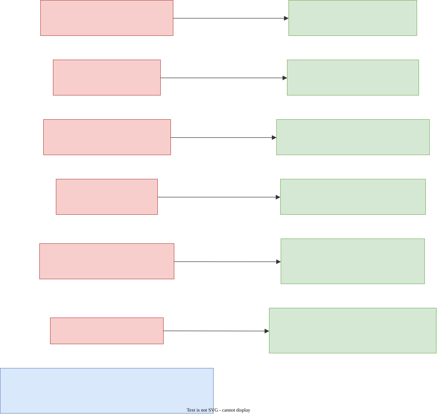

---

## Protocol intuition (read this first)

*This walkthrough is self-contained: you need no prior DAVINCI knowledge. Every term used
loosely here gets a precise definition from §2 onward; the jargon cheat-sheet is §2.4.
Readers who know v2 will recognize the shape; the deltas are marked "(v2: …)".*

### The cast

| Who | What they do | What you have to trust them with |
|---|---|---|
| **You, the voter** | vote from a browser; revote whenever you like | your own device |
| **The organizer** | creates the election: the **census** (the list of eligible voters and their voting weights), the ballot rules, the schedule, and which registered wardens form the committee | getting the voter list right, and choosing a committee worth trusting (the privacy guarantee below traces to that choice) |
| **ν key wardens** (say 5) | a committee; each publishes a post-quantum "lockbox" public key up front, meaning anyone can lock a small secret so that only that warden can open it. After the election, any **θ** of them (say 3) jointly produce the result | privacy only: it holds as long as fewer than θ of them collude. They cannot change the result; nobody can. (If fewer than θ show up at the end, the result cannot be produced, the standard committee trade-off) |
| **Sequencers** | anyone who wants to run one (permissionless). They collect votes, bundle them into **batches**, and *settle* each batch: publish it to Ethereum with a cryptographic proof that every rule was followed | nothing for correctness (the proof is checked by the contract). The one you submit to learns when you revote, and could ignore you, in which case you just switch to another; no sequencer can block the election |
| **The smart contract** | the referee's referee on Ethereum: verifies every proof, stores the public state, and at the end computes the result itself | it's Ethereum, with the usual assumptions |
| **Observers** | anyone. All published data is enough to replay and re-check the whole election | — |

Each eligible voter owns one fixed **slot**, a position in the public state that records
that they have voted. Revoting just writes your slot again; the last write before closing
counts. Revoting is deliberate: it is what lets a pressured or coerced voter
quietly change their vote later. (v2 had the same census, slots, sequencers and contract.)

### The trick, with tiny numbers

Everything rests on one idea from 1979, Shamir secret sharing, plus the observation
that *shares add up*. Suppose θ=2, ν=3, and all arithmetic is modulo some large prime.

- **Alice votes 1.** Her browser picks a random line through her vote:
  $f_A(x) = 1 + 4x$. Her three *shares* are $f_A(1)=5$, $f_A(2)=9$, $f_A(3)=13$, one per
  warden. Any two shares pin down the line and reveal $f_A(0)=1$. One share alone says
  *nothing*: for every possible vote $v$ there is a line through $(0, v)$ and $(1, 5)$, so
  the share 5 is perfectly consistent with Alice voting 0, 1, or anything else.
- **Bob votes 0.** His line: $f_B(x) = 0 + 2x$. Shares: 2, 4, 6.
- Shares are never shown in the clear. Alice hides each one under a **mask**: a random
  number only warden $i$ will be able to recompute, because its key is locked in that
  warden's lockbox. Say her masks are 20, 50, 70: she publishes 25, 59, 83. Bob's masks are
  10, 30, 40: he publishes 12, 34, 46. To everyone else these six numbers are pure static.
- **After the election**, warden 1 opens its lockboxes and recomputes its masks (20 for
  Alice, 10 for Bob), which gives it back its two shares: $25 - 20 = 5$ and $12 - 10 = 2$.
  It adds them: $5 + 2 = 7$. Warden 2 does the same: $9 + 4 = 13$. Those are points of
  the *sum* line $F(x) = f_A(x) + f_B(x) = 1 + 6x$: indeed $F(1)=7$, $F(2)=13$. The
  contract draws the line through $(1,7)$ and $(2,13)$ and reads it at zero: $F(0) = 1$.
  **One yes-vote, and no group of fewer than θ wardens can ever tell whose.** (Warden 1
  did learn one point of each voter's line along the way, which, as above, is consistent
  with any vote.)

Two footnotes. Real elections use a huge prime modulus, so
"random-looking" means genuinely indistinguishable from noise; the small numbers here are
for readability. And a real ballot is a short *vector* of numbers, one per option ("rate 5
candidates" is five values; voting weights scale them under the election's rules). Everything
shown here just happens once per position, and the result is a vector of per-option totals.

No warden ever learns a ballot (one share is noise). No decryption key for "the votes"
exists anywhere, so there is nothing to steal, leak, or break, short of θ wardens
colluding, which is the same committee-trust every threshold scheme has. That's the whole
protocol; the rest is making every step *provable* so nobody has to be trusted for
correctness.


### The same story, phase by phase

**Setup.** The organizer registers the election on the contract: census, ballot rules,
schedule, and which ν registered wardens form the committee. That's it: because wardens'
lockbox keys already exist, there is **no key-generation ceremony and no election
encryption key**. (v2 ran a distributed key generation, DKG, to create a shared key
before every election; that whole phase is gone.)

**Casting.** Your browser splits each ballot value into ν shares, masks them, locks the
mask keys into the wardens' lockboxes, and, right there in the browser, generates a
zero-knowledge proof (a STARK: a proof made only of hashes, no trusted setup) that the
whole construction is honest: the shares encode one valid ballot that follows the election
rules, the masks match their commitments, and you hold the secret key behind your voter
identity, a hash-based key that is itself post-quantum (elections may *additionally* accept
classical wallet signatures during migration, §11), while the batch step below checks that
identity against the census and your slot.
The *package* you send (masked shares, locked boxes, commitments) goes to a
sequencer of your choice over a private channel, proof attached. If you don't trust your
own browser, you can demand it open any candidate package for inspection on a second
device, then discard it and cast a fresh one (§5.2); a cheating client gets caught.

**Voting period.** Sequencers verify incoming proofs, bundle packages into batches, and
settle each batch: the contract accepts it only with a proof that *every* rule was followed
(this proof is produced by a zkVM, a virtual machine whose entire execution is provable).
The bulky data, the packages themselves, rides along in Ethereum *blobs*, cheap bulk
storage attached to the transaction; the contract itself keeps only tiny commitments and
the verified state.

What does a batch reveal about *who* voted? Only this: the first time your slot is
written, the batch lists it, so turnout is public (as in v2). After that, **a revote
publishes nothing about your slot at all**. The new package appears in the batch like any
other, but which slot it belongs to is not written anywhere public. So an observer sees
*that* some number of revotes happened in a batch, not *whose*: a revote hides among
every voter who has already voted. (v2 hid a revote among a random sample of other slots
that it re-encrypted as cover. v3 needs no cover, because a revote leaves no public mark
to cover.)
The link between packages and slots is not lost: every batch leaves the committee a
sealed note (its key split θ-of-ν across the wardens, the same Shamir trick again)
recording which slot each package wrote. At tally time the committee opens the notes,
finds each slot's last package, and reads its shares straight from the lockboxes.

**End of election.** Casting closes; a short *grace window* lets in-flight batches land;
the state freezes. Then one new deadline (new vs v2): the **complaint deadline**.
Why it exists: the browser's proof checks everything it can see, but it deliberately cannot
look *inside* the lockboxes (proving post-quantum encryption in-proof is the one expensive
step this design avoids). So if some package's lockbox doesn't open to what was promised,
from a buggy or malicious client,
the affected warden proves that on-chain and the package is excluded from the count. A
complaint is itself a proof, so a warden cannot abuse it to exclude an honest vote.
Wardens can file complaints *from the moment a package lands*, so an honest voter with a
broken client finds out while voting is still open and simply revotes. The deadline is the
last moment to complain; then the exclusion list freezes. (If all ν wardens attest early
that they're done checking, results can start immediately.)


**Results.** Any θ wardens each do one job: open their lockboxes, use the recovered mask
keys to read *their own column* of every counted ballot's shares, and publish the **sum of
those shares** (plus a pinch of jointly-made blinding that vanishes at the finish line),
with a proof that they did exactly that and nothing else. The θ partial
sums are θ points on a single polynomial, and its value at zero *is* the election result.
The contract draws the curve and reads it off, in ordinary modular integer arithmetic (the
same "mod a large prime" as the example), on-chain, exact.
(v2 ended with a threshold *decryption* plus a brute-force search to extract the number;
v3's ending is the schoolbook interpolation you saw above.)

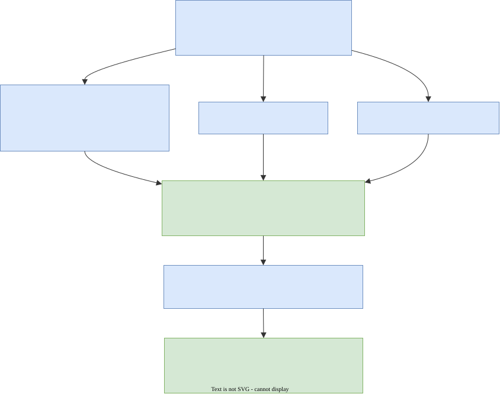

### Who sees what

- **The public / an observer**: all packages, which slots have voted at least once and
  when (turnout), how many revotes each batch contained, the complaint list, the result.
  Never a ballot, and (outside the degenerate cases of §12.1, such as a batch holding a
  single vote) not which package belongs to which slot or which voters revoted.
- **Your sequencer**: that *you* (your slot) revoted in the batches it sealed, the same
  thing the vote-collecting server inevitably sees in v2. Never your ballot or shares.
- **Fewer than θ wardens, even colluding, even with quantum computers, even in 30 years
  from archived data**: about ballots, nothing: each holds shares that are individually
  pure noise. (To be
  exact: below θ *raw shares* the protection is pure math; the *archived masked data* is
  additionally guarded by one computational assumption, the ML-KEM lockboxes, a
  post-quantum lattice scheme. That is the single lock a future cryptanalyst would have to
  break.) About *who revoted*, one caveat: the tally itself has the participating wardens
  open the sealed notes together, so after it every one of them knows which slot each
  package wrote (§12.2).
- **θ or more colluding wardens**: can reconstruct individual ballots (every threshold
  voting system has exactly this boundary) and can read the sealed notes at any time.
  Choose the committee accordingly.

### What this buys you

- **Nothing to harvest.** The quantum "harvest now, decrypt later" attack dies below θ
  wardens: what is published is masked shares, and the only cryptography guarding the
  masks is lockboxes (ML-KEM) and hashes, both post-quantum; even with the masks removed,
  fewer than θ shares are information-theoretic noise. (v2's
  published ElGamal ciphertexts fall to a future quantum computer retroactively.)
- **No shared decryption key exists**: not held by anyone, not generated, not reconstructable.
  Each warden has only its own ordinary keypair. The tally still takes one coordinated
  ceremony among θ wardens (opening the batches' sealed notes together), but no step of it
  ever produces a key that decrypts ballots.
- **Checked, not trusted.** Voter, sequencer and warden each move only with a proof: the
  contract rejects anything else. Integrity needs no honest operator anywhere. (One caveat:
  ballot *secrecy* is what's quantum-proof today; the *integrity* plumbing still
  includes some classical Ethereum-era pieces, namely the proof wrapper, blob commitments, and
  optional legacy wallet signatures, with a tracked migration path, §12.5. Breaking those
  could forge state while they last; it can never retroactively read ballots.)
- **Exact results.** The tally is integer arithmetic: no decryption failures, no noise
  budgets, no brute-force search at the end.

---

## 2. Notation, parameters and encodings

- $\mathbb{F}$ — the **Goldilocks field**, $p = 2^{64} - 2^{32} + 1$ (the Plonky3 [P3] and ZisK
  native field). All shares, masks and tally arithmetic live here. Canonical encoding of an
  element: 8 bytes little-endian, value < $p$.
- $\nu$ — number of **key wardens**; $\theta$ — tally threshold. **v3.0 supports
  $1 \le \theta \le \nu \le 8$**, enforced at creation and in the pinned profile (DA and
  in-circuit cost are linear in ν; ν=8 halves both vs 16. The protocol structures support
  up to 16, which returns as a future profile once DA/verification optimizations land;
  committee size is unrelated to the 16 *ballot fields*, which stay). Size rosters with the
  availability margin in mind: tolerating $f$ unavailable or faulty wardens through the
  complaint deadline and tally ceremony needs $f < \theta \le \nu - f$ (an 8-of-8 election
  tolerates none; the registry rejects $\theta = \nu$ for $\nu \ge 2$ unless creation sets
  an explicit override flag), and the ceremony absorbs individual failures by roster margin (§10.4),
  with blinding still requiring ≥ 1 honest *accepted dealer*. The complaint-capacity bound (§9.2) depends
  on admitted casts, not ν: fewer wardens means less aggregate proving/archival redundancy,
  so deadlines and hardware budgets must be revalidated per roster size.
- `nf` — active ballot fields, 1..16, as in v2, immutable per election. **Packages carry
  shares, masks and commitment entries only for fields `1..nf`** (v1.3 fixed everything at
  16-wide; nf-sizing saves `(16−nf)·ν·8` B per package, ~960 B at ν=8/nf=1). Any 16-wide
  logical representation is the zero extension: inactive fields have no per-package
  polynomials, share encodings, mask consumption or commitment entries. Sum-shares and
  results stay 16-wide via zero extension (inactive fields are identically 0). All
  component lengths are derived from authenticated election parameters, never from supplied
  bytes; trailing inactive-field bytes are rejected.
- **KEM** — **ML-KEM-768 [FIPS 203] (ct 1088 B), the only allowed profile** (v1.2's
  ML-KEM-512 option is withdrawn: BSI recommends only the 768/1024 sets, and 512 saved just
  ~2.5 KB per ballot at ν=8; the DA-reduction path is multi-recipient Kyber, §15 item 5). Browser
  implementations must be pinned and vetted [KEMB]. One *encapsulation* yields `(ct, K)` with
  a 32-byte shared secret `K`; arbitrary payloads are carried KEM-DEM style (encapsulate,
  derive a wrapping key from `K`, then DEM-encrypt, §2.1). **Normative decapsulation rule
  (all paths: warden recovery §10.1, complaint guests §9.2, ceremony recipients §10.4):
  the FO re-encryption check MUST compare the full re-encrypted ciphertext in constant time;
  partial or early-exit comparison enables ML-KEM key recovery [FOCT].**
- **Blake3** — standard Blake3 [B3] is **the protocol hash, everywhere the protocol gets to
  choose**: the ballot STARK's Merkle trees and Fiat–Shamir challenger; all in-circuit
  hashing (PRF masks, commitments, voteID, via a re-laid Blake3 AIR section,
  §6); the state SMT; `pkgDigest`/`ctsDigest`; the column views; and
  every DEM/PRF/key-derivation role through Blake3's standard *keyed*, *derive_key* and
  *XOF* modes (§2.1). Digests are 32 bytes. Rationale: fastest software hash in the browser
  (~1.4 GB/s in WASM; measured on the prototype: proving 3.24 s → 0.69 s, proofs
  544 → 324 KB), a standard-conformant ZisK precompile (`blake3f`) for every guest
  recomputation, and a conservative, long-studied ARX design (§12.4). One hash = one
  implementation to audit on each platform (AIR, guest, browser, warden).
- **Hash islands the protocol cannot choose**: **keccak256** for values
  Solidity contracts must compute (blob evaluation points $z_b$, the v2 processID prefix,
  `archiveAcc`, the session id, and the **census trees and the PQ key map**, which on-chain
  censuses and the key registry maintain in contracts, §8.2/§11) and for hybrid-mode
  Ethereum addresses; **SHA-256** for v2's address→slot rule, under which v2's on-chain
  census contracts enforce slot uniqueness (§8.2); **SHAKE** inside ML-KEM and **SHA-2**
  inside SLH-DSA (FIPS-fixed internals of black-box primitives); **Poseidon2** inside
  ZisK's own prover (an inherited proof-system dependency; framing in §12.4; [POS2]).
  Poseidon and Poseidon2 hold **no application-level role** in v3-PQ. (Drafts ≤1.5 planned
  a Blake3 census format reached through conversion proofs from a Poseidon tree; the
  v2 batch program's source in fact verifies a Keccak tree, so the census stays as it is
  and the conversions are removed.)
- **256-bit values in circuits** (DEM keys, Blake3 digests crossing into Goldilocks
  arithmetic): encoded as **eight 32-bit limbs**, each range-checked < 2^32. Never as four
  64-bit limbs (not injective: $p^4 < 2^{256}$), and never reduced mod $p$.

### 2.1 DEM (authenticated encryption for warden payloads)

Built from Blake3's standard modes, normative for **every protocol payload** (voter→warden is
pure KEM+PRF and needs no DEM; this DEM covers batch payloads, batch-key share wrapping, and
ceremony deliveries):
- **Key separation**: `k_enc = Blake3.derive_key("davinci v3-pq DEM enc key", K)` and
  `k_mac = Blake3.derive_key("davinci v3-pq DEM mac key", K)`, with fixed application context
  strings, exactly the standard derive_key mode. `derive_key` creates *separation, not
  entropy*: `K` must be a ≥256-bit KEM secret or CSPRNG secret.
- **Keystream**: keyed-Blake3 **XOF**. `keystream = Blake3.keyed(k_enc, nonce ‖ AAD).xof()`,
  with the counter being the XOF output offset (bounded: payloads < 2^32 blocks, no offset
  wraparound); ciphertext = plaintext ⊕ keystream. An XOF is a seekable output stream, not
  repeated hashing of previous output.
- **Authentication**: encrypt-then-MAC. `tag = Blake3.keyed(k_mac, nonce ‖ AAD ‖ ciphertext)`;
  receivers verify the **full 32-byte tag before releasing any plaintext**.
- **Uniqueness**: `nonce = Blake3(AAD)`; the AAD is the canonical, length-unambiguous
  serialization of a **DEM context** that always includes a purpose tag, the election
  context, the **batch number or ceremony (session, attempt) identifier**, sender and
  recipient. It is unique per encryption *including retries* (a ceremony restart is a new attempt
  id ⇒ fresh masks, keys and nonces; the same derived key and nonce never encrypt two
  different plaintexts).

These are standard Blake3 modes, but their composition is a
**protocol-specific authenticated-encryption construction, not a standardized AEAD**; the
needed assumption is keyed-Blake3's PRF security (§12.4). A short security-argument appendix
(encrypt-then-MAC composition per Bellare–Namprempre over keyed-Blake3-as-PRF, with the
deterministic AAD-derived nonce justified by the AAD-uniqueness rule above) is a Phase-0
publication gate (§15). AES-256-GCM may be used by clients
for unrelated local storage/transport, never as a substitute encoding of protocol payloads.

### 2.2 Domain-separated contexts

Every derived value uses a purpose-tagged context; nothing is derived without one. Purpose
tags map to Blake3 `derive_key` context strings; the tuple itself is serialized canonically
(fixed order, length-prefixed variable fields).

| Purpose | Context contents |
|---|---|
| `pkgCtx` — the package context tuple | `(protocolVersion, chainID, registry, processID, wardenEpoch, voteID)`, the common prefix below |
| `streamCtx(i)` — mask stream for masked shares | `("v3/mask", pkgCtx, recipient i)`: **one keyed XOF stream per (package, warden)**, no field index. `stream_i = Blake3.keyed(K_i, streamCtx(i)).xof()`, 256 bytes of output; field $f$ uses bytes $[16(f{-}1), 16f)$ via the LE128-mod-$p$ rule below. This is a **normative masking definition**: browser, ballot AIR, batch guest and warden implementations must match it bit-exactly (test vectors required) |
| `hCtx(i)` — share commitment | `("v3/hcommit", pkgCtx, recipient i)` |
| `commitCtx` — package commitment | `("v3/pkgcommit", pkgCtx)`, the `ctx` argument of `pkgCommit` (§5.1) |
| `sealCtx` — batch sealing | `("v3/seal", protocolVersion, chainID, registry, processID, wardenEpoch, wardenSetHash, batch number, oldRoot, the package count, the admitted pkgDigests in voteID order)`: bound into every batch DEM AAD and into the derivation of **all** batch payload randomness (§8.5), so equal derivation inputs give a byte-identical payload and no key or nonce ever covers two different plaintexts |
| `viewCtx` — per-warden column views | `("v3/view/rows", …)`, `("v3/view/firstwrites", …)`, `("v3/view/payload", …)`, `("v3/view/acc", …)`, `("v3/view/root", …)`: the five §8.7 commitments (encoding version 2: no update records); each context binds `(protocolVersion, chainID, registry, processID, wardenEpoch, wardenSetHash)` plus the batch number and (where applicable) the recipient index |
| `ectx`, `snap` — election context and frozen snapshot | `ectx = (protocolVersion, chainID, registry, processID, wardenEpoch, wardenSetHash)`. `snap = (R_cast, xDigest, batchCount, viewsRoot)`, frozen at the exclusion freeze, where `xDigest` is the registry's running **keccak256** fold of the exclusion set (`xDigest' = keccak256(xDigest ‖ pkgDigest)` on each new exclusion; the registry rejects a duplicate), contract-computed like every value the registry must derive |
| `joinCtx` — ceremony join | `("v3/join", ectx, snap, attempt, senderIndex, ephemeralPK)`: what a join envelope's SLH-DSA signature covers (§10.4). It contains the ephemeral key and deliberately no session id and no roster |
| `cerCtx` — ceremony messages after the roster freeze | `("v3/ceremony/<phase>", ectx, snap, sessionId, attempt, sender, dealer-set hash where applicable)`: every dealer bundle, share bundle, bundle-key wrap and contribution binds it (§10.3, §10.4). `sessionId = keccak256("v3/session", ectx, snap, attempt, Π)` is computed by the registry when the proven roster `Π` freezes |
| `slotCtx` — slot derivation | For Merkle census origins 1-3: **v2's rule, byte for byte**, `SHA-256("davinci-slot-v1" ‖ address)` reduced as v2 does, because v2 requires on-chain census contracts to reject a registration whose slot is already taken under exactly this rule (§8.2; gate 9 confirms the deployed ones do); a different rule would void that uniqueness check. CSP: `slot = 16 + idx`, as v2. Slot leaves hold a constant marker (§7) |

The package's mask nonce is its **voteID**: public, unique per package, authenticated, and
independent of the masked values (it derives from the secret `k`, §5.2, before any masking),
so wardens can recompute every `streamCtx` from public data with no circularity. (Earlier
drafts derived one PRF output per *field*; that definition contradicted the in-AIR cost
estimates, ≥16 final keyed computations per warden and 256 at ν=16, and was replaced by the
single per-warden stream above, which needs only one context block plus four 64-byte XOF
output blocks per warden.)

**Byte→field mapping (normative).** Blake3 outputs bytes; masks and other derived field
elements are obtained as **LE128 of 16 XOF bytes, reduced mod $p$**, at statistical distance
from uniform ≈ $2^{-96}$ *per element* (pseudorandom/nearly uniform: not exact uniformity, and not a whole-election bound). Never `LE64(8 bytes) mod p`: its distance is
≈ $2^{-32}$, which is not.

### 2.3 Protocol parameters

| Parameter | Value | Why |
|---|---|---|
| Share/tally field | Goldilocks $p$ | native in the ballot AIR and ~native u64 in ZisK guests |
| Registry tally cap | `maxValue · maxVoters ≤ 2^61` | per-field tally stays below $p$ with headroom (weights don't change this: each field is individually bounded by `maxValue`) |
| **Integer-cost profile (enforced)** | `nf · maxValue^costExponent < 2^61`, checked by the registry at creation **and** recomputed overflow-safe in the ballot proof | the cost sum must not wrap mod $p$ (e.g. `costExponent=192` would give $2^{192} \equiv 1$); v2 only *advised* this profile, v3 enforces it |
| Warden evaluation points | $x_i = i$, $i \in 1..\nu$ | Shamir positions, pairwise distinct, nonzero |
| Max votes per batch | profile-dependent (§8.6) | in-guest verification cost + the 32-blob batch cap inherited from v2's batch program (see §8.6) |
| Per-voter casting | **no lifetime bound** (as v2) | the structural rate limit is ≤ 1 ballot per slot per batch (§8.4); first writes are bounded by `maxVoters`. Review ruled out both a flat lifetime cap (capturable) and a two-pool cap (an attacker exhausting the overwrite pool would permanently block every later escape vote, which is worse than congestion). Deliberate cast inflation is priced by admission and provisioned by the adaptive deadlines below |
| Accepted-batch bound | `M ≤ admitted casts` | every accepted transition must admit ≥ 1 package (registry-enforced on the batch statement's counters); there is **no zero-ballot transition** (an election with zero accepted transitions finalizes by the §9.1 short-circuit). Bounds the per-warden batch-envelope work (§8.5, §10.1) |
| Adaptive deadlines | `d_complaint = t_freeze + d_0 + α·C + β·M` | complaint and ceremony stage **durations** are workload-derived, computed once at casting freeze from the authenticated terminal counts (C = admitted casts, M = batches; the per-touch term of drafts ≤1.5 is gone with the refresh sample, and write-log work is part of α); coefficients and margins come from an **immutable, versioned deadline profile** in the registry, referenced at creation (optionally scaled by a bounded multiplier never below the profile's calibrated safety floor, overflow-checked; registry updates never alter an existing election's deadlines), budgeting worst-case malformed transport + proving + publication + inclusion + archive catch-up + reorgs, never only honest decapsulation. Profiles are calibrated once at Phase 0 (gate 6), never per election. The ceremony's stage durations scale by the same counts; each tally attempt turns them into absolute deadlines from its own start (§10.4). Subsequent complaints never extend a computed deadline; a stage can close early, when all expected participants have published (§9.2, §10.4), which never moves anyone's deadline earlier |
| High-stakes FRI profile (named) | blowup 32, **27 queries + 20-bit grinding** ≈ 155 conjectured bits | the pinned "raise the dial" option of §12.4 (~1.5× in-guest verification cost vs the default profile); selecting it is a profile choice, not an ad-hoc edit |
| Ballot STARK profile | Goldilocks, **blowup 32, 18 FRI queries + 16-bit query grinding**, hiding PCS, **Blake3 everywhere** (Merkle/challenger AND the in-AIR hashing section) | ≈106-bit conjectured FRI soundness (§12.4, same heuristic dial as before); chosen verifier-side: −35% in-guest steps and −39% proof size vs blowup-8/34-queries, for ≈2.45× prover cost (measured single-threaded on the prototype circuit, 2.0× in WASM; Annex A.4). Fallback if browser benchmarks disappoint: blowup 16 / 26 queries, grinding unchanged at 16 bits (measured in Annex A.4: ≈35% faster, half the memory, 34% larger proofs). Profile pinned in full by `ballotVKHash`; the wasm32 challenger fix (§6) is a prerequisite for **any** browser proving with this transcript, with or without grinding (measured: unpatched wasm32 proving panics at every profile, Annex A.4) |
| Commitments | **salted unkeyed Blake3**, domain-separated | hiding from an independent 256-bit CSPRNG salt (or the secret inputs); binding from collision resistance. Keyed-Blake3 is reserved for MACs/PRFs: a MAC is not automatically a hiding/binding commitment |

### 2.4 Terminology for software engineers

Plain definitions, anchored in things an Ethereum engineer already knows. Skim once; the rest
of the document assumes them.

- **KEM** (Key Encapsulation Mechanism; here **ML-KEM**, the standardized Kyber) — a
  public-key *lockbox*: anyone can "encapsulate" against your public key and obtain a fresh
  32-byte shared secret plus a ciphertext; only you (with the private key) can recover that
  secret from the ciphertext. Think of it as the post-quantum replacement for ECDH key
  exchange, except there is no shared-curve math and the two parties never need to be online
  together.
- **PRF** (pseudorandom function) — a keyed hash used as a deterministic random-number
  generator: same key + input ⇒ same output, and without the key the outputs are
  indistinguishable from random. Mentally: `keccak256(key, input)` used the way you'd use a
  seeded RNG. Here PRFs expand a KEM secret into the masks that hide shares.
- **Shamir secret sharing** — split a value into ν pieces by choosing a random polynomial of
  degree θ−1 whose value at x=0 is the secret, and handing out its values at x=1..ν. Any θ
  pieces determine the polynomial (and hence the secret); any θ−1 pieces are statistically
  independent of it: noise, not "hard to crack".
- **Threshold θ-of-ν** — ν parties hold pieces; any θ of them suffice to act (here: tally);
  fewer than θ learn nothing and can block nothing except by being too few.
- **Lagrange interpolation** — given θ points, there is exactly one polynomial of degree
  ≤ θ−1 through them; evaluating it at x=0 recovers a Shamir secret. "Draw the unique curve
  through the points, read it at zero." A few multiplications and additions, cheap even in
  Solidity.
- **STARK** — a zero-knowledge proof system built only from hashes (no trusted setup, no
  elliptic curves, post-quantum). Bigger proofs than Groth16 (hundreds of KB), but
  browser-provable and cheap to verify.
- **AIR** — the constraint system of a STARK: its "circuit".
- **FRI** — the polynomial-checking engine inside a STARK; the reason STARK verification is
  mostly hashing.
- **Hiding PCS** — the polynomial commitment inside the STARK is randomized so the proof
  leaks nothing about private inputs; this is what makes the proof *zero-knowledge* rather
  than merely succinct.
- **Witness** — the prover's private inputs (the ballot, the shares, the keys). Never leaves
  the prover.
- **Nullifier** — a one-way tag published to mark something as spent (the Tornado Cash /
  Semaphore pattern). **v3 deliberately has none**: drafts ≤1.3 used them for revote
  tracking, and adversarial review showed any such voter-derivable public tag is a coercion
  test (§5.3, §12.3). Defined here because the term appears in those discussions.
- **Write log** — the per-batch encrypted record of which slot each package wrote. Its key
  is split θ-of-ν among the wardens, so before the tally nobody below θ can read it; the
  tally's share exchange lets every participating warden read it (§8.5, §12.2).
- **Blake3** — a modern general-purpose hash: ARX design (add–rotate–xor, the ChaCha/BLAKE/
  BLAKE2 lineage; BLAKE was a SHA-3 finalist), extremely fast in software, with standard
  built-in modes for keyed hashing (MAC), key derivation (`derive_key`) and arbitrary-length
  output (XOF). v3's single protocol hash.
- **DEM / AEAD** — symmetric authenticated encryption (ciphertext + tamper-proof tag), the
  AES-GCM role; v3 instantiates it from Blake3's keyed + XOF modes so one hash covers it and
  zk-proofs about it stay cheap (§2.1).
- **Domain separation** — namespacing every hash/PRF input with a purpose tag and context so
  a value from one context can never be replayed in another, the same reason EIP-712 typed
  signing exists (§2.2).
- **Dealer** — a party that generates a secret and distributes shares of it (used in the
  tally ceremony, §10.3).
- **CSPRNG** — a cryptographically secure random generator (`crypto.getRandomValues`,
  `/dev/urandom`); "fresh CSPRNG randomness" means sampled from this, never derived.

### 2.5 Chunked proving (one contract for every chunked proof path)

Complaint proofs (§9.2) and warden contributions (§10.1) MAY be proven in segments. One
normative contract covers every such path:

- **Authenticated continuation.** Each segment's statement binds the predecessor's complete
  continuation state: the progress ordinal, every running value (`viewAcc`, partial
  sums, counters, and for the tally the slot → latest-package map) and the typed, versioned
  state schema of its path. Carrying a hash alone
  does not certify earlier computation; the linkage is authenticated execution (the segment
  proves it resumed from exactly that state under the same pinned program and statement
  context), never merely a chained digest.
- **Hiding.** Continuation states are witness material: they MUST NOT contain a plaintext
  write-log digest (§8.7) or any secret-derived value in the clear; any commitment to
  low-entropy state such as the slot map MUST be salted; and every chunked
  path is in scope of the §12.4 hiding verification (Phase-0 gate 4).
- **Shape.** Everything an outsider can see of a chunked proof (the number of segments,
  their sizes, progress counters, execution-length metadata) MUST be a function of the
  declared public workload alone, never of secret state. For the tally this matters: the
  secret opening work depends on which packages are final bases and which of those are
  excluded, so a prover that emitted one segment per fixed amount of *executed* work could
  reveal, at a segment boundary, whether an excluded package was still its slot's final
  base. Implementations pad to a public bound, or keep intermediate segments private
  behind one fixed-shape final proof. Salted commitments and a hiding proof system do not
  cover this on their own.
- **Completeness.** Only the final segment's statement asserts the whole claim; partial
  segments assert nothing externally. Open chunks are rejected after their path's closing
  event (e.g. the exclusion freeze, §9.2).

§9.2, §10.1 and §12.4 reference this contract instead of restating it; path-specific state
schemas and negative tests remain per path (Phase-0 gate 3).

---

## 3. The core idea: tally without a shared decryption key

v2 hides a ballot inside a ciphertext and adds ciphertexts homomorphically. v3 hides a ballot
inside **polynomials** and adds polynomials. If you know Lagrange interpolation, you know the
whole trick:

1. For each ballot field value $b$, the voter picks a random polynomial $f$ of degree
   $\theta-1$ with $f(0) = b$, and computes one **share** per warden: $s_i = f(i)$. Any
   $\theta$ shares reconstruct $b$; any $\theta-1$ shares are statistically independent of
   $b$. Plain Shamir [Sha79]: no curves, just polynomial evaluation in $\mathbb{F}$.
2. Shares are never published in the clear. The voter publishes **masked shares**
   $e_i = s_i + \mathrm{mask}_i$, where the masks are sliced from one keyed Blake3 XOF
   stream per warden (§2.2) and the stream key $K_i$ travels to warden $i$ inside an ML-KEM
   ciphertext. To everyone except warden $i$, $e_i$ is a uniformly random field element.
3. Polynomials add: the per-field sum of every counted voter's polynomial is itself a
   degree-$(\theta-1)$ polynomial whose value at 0 is the **tally**. Nothing has to be
   accumulated in public while voting runs. The batch program only records, in an
   encrypted **write log** readable by θ wardens together (§8.5), which slot each package
   wrote, so that at the end everyone agrees on each slot's last package. A revote is one
   more package and one more log entry; nothing public says which slot it replaced (§8.4).
4. At the end, each participating warden decapsulates its KEM ciphertexts, recovers its
   share of every counted ballot, and publishes its **sum-share** $S_i$: the sum of those
   shares plus a jointly-created blinding share that vanishes at $x=0$ (§10.3), with a ZisK
   proof that it did exactly that against on-chain-committed data. Lagrange interpolation of any $\theta$ published
   sum-shares at $x=0$ **is** the tally. Exact field arithmetic: no decryption of any
   aggregate, no noise, no discrete-log search.


(*This section is the intuition; the full computation also handles the exclusion set and a
tally-time blinding term, §9-§10.*)

The ballot STARK (§6) makes steps 1-2 trustworthy, the batch proof (§8) step 3, the warden
proofs (§10) step 4. **The zkVM proof chain replaces the homomorphic algebra**, which is the
structural difference from academic PQ voting designs ([TEV], [PQK]) that obtain the same
guarantee from lattice commitments. (Some public-key encryption is unavoidable for ballots
addressed to offline wardens [IR89]; v3 confines it to KEM transport. Threshold *lattice*
decryption, the known hard part of lattice voting [NOAH], is avoided entirely: the
threshold lives at the plaintext layer.)

Privacy in one sentence: below $\theta$ colluding wardens, shares are information-theoretically
useless in isolation, and the computational assumptions protecting ballots are ML-KEM, the
PRF/hash, and the zero-knowledge of the STARKs, all post-quantum (full leakage model: §12).

---

## 4. Roles: what changed

- **Organizer, sequencers, provers, observers** — unchanged from v2.
- **Key wardens** no longer run a DKG or hold shares of a secret key. Per *epoch*, each warden
  generates an ML-KEM keypair **and an SLH-DSA-SHA2-128s signing keypair [FIPS 205]** and
  calls the **WardenRegistry** contract with: `H(pk)`, **`H(pk_sig)`**, a **settlement
  account address** (authorizing its proof-less on-chain messages, below), a URI where the
  full public keys are served (IPFS or HTTPS), and a ZisK **well-formedness proof** (the
  ML-KEM key pair derives from a committed seed and passes an encaps/decaps self-test). The
  registry verifies the proof on-chain. The signing key authenticates the warden's published
  ceremony payloads to **off-chain consumers** (join envelopes and share bundles, §10.4);
  signatures are ~7.9 KB and verification is pure hashing. **SLH-DSA signatures are never
  verified on-chain.** On-chain protocol messages that carry no proof (session joins and
  scan-complete signals, §9.2/§10.4) are authorized by `msg.sender` equal to the warden's
  registered settlement account, pinned per election by the creation-time snapshot below
  (registry account rotation never moves an existing election's rights). Proof-carrying
  messages (complaints §9.2, dealer bundles §10.3, contributions §10.1) are authenticated by
  their proofs' registered-key-seed clauses and may be submitted by anyone; the roster
  proof (§10.4) has no author to authenticate, being a public computation anyone can run. The classical
  dependency this creates is bounded: forging an account signature can only move **closure
  timing and liveness**, never ballots or confidentiality (§12.5); every
  confidentiality-relevant payload keeps post-quantum authentication (§10.4). An election
  pins its committee in `wardenSetHash` (config leaf `0x3`, §7): `(ν, θ, epoch, the ν
  registered (H(pk), H(pk_sig), account) triples)`. A voter's client fetches the ν public keys (from their URIs or any
  sequencer), recomputes each hash and the set hash, and verifies it against the on-chain
  value before casting; it refuses to cast otherwise. The registry refuses to create an
  election whose warden set is not fully registered.
  **Archival is a permissionless, untrusted role, not a per-warden duty.** EIP-4844 blobs are
  pruned after ≈18 days, so for any longer election the history must be captured while it is
  live, including L1-blob-mode blobs from their **publication** transactions, which precede
  settlement (§8.6). Any party may serve as an archive provider with no registration: all served data is
  authenticated by consumers against the accepted chain commitments (the registry's
  `archiveAcc` manifest chain plus each blob's full commitment/versioned-hash binding;
  recomputing the manifest fold alone does not authenticate returned bytes). The liveness
  assumption is **at least one complete, available archive** spanning the casting period,
  the complaint window, every tally attempt, and the declared retention period, including
  ceremony and complaint publications, not only batch blobs. A deployment profile MUST
  obligate each warden to live-capture and retain **its own tally inputs**: its per-package
  ciphertexts `ct_i` (the column view stores only `Blake3(ct_i)`, §8.7), its column-view
  streams, and all batch payload envelopes, through finalization plus the declared retention
  period, with funded retention across every tally attempt (≈1.3 GB per million casts,
  dominated by the ciphertexts). Authenticated catch-up from any archive remains a valid
  recovery path for a temporarily offline warden: local capture is resilience, not a
  participation prerequisite, and it does not replace the complete-public-archive assumption
  above (ceremony and complaint publications included). A deployment profile SHOULD
  additionally name at least one accountable archiver (organizer or warden set) even though
  providers are untrusted.
  Wardens MAY process incrementally during the voting period (decapsulation and share
  recovery don't need to wait for the end); complaints may also be filed as soon as a package
  settles (§9.2), and at the end the participants run one tally ceremony (§9-§10).
- **Key modes.** *Committee* (lottery over registered operators) and *council*
  (organizer-invited set) map 1:1 from v2: they only select *which* registered warden keys
  form the set. *Sequencer mode* is the degenerate $\nu = \theta = 1$ case (the sequencer is
  the only warden; ~1 KB per ballot, cheaper than v2; the sole operator can reconstruct
  every ballot, a trust label deployments must surface, and the tally ceremony collapses to
  one contribution proof, §10.4). **Locked mode is deferred**: it
  requires an organizer-side share column and a separately reviewed extension of the tally
  equations; it is not part of v3.0.

---

## 5. The ballot package

A vote is one **package**. Its public part goes into blobs; its private part exists only in
the voter's browser. **A revote needs no reference to any earlier package**: it is a fresh
package for the same slot (§5.3).

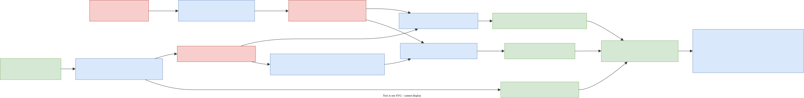

### 5.1 Public package contents and CanonicalPackage

| # | Field | Size (ν=8, nf=16, ML-KEM-768) | Description |
|---|---|---|---|
| 1 | `version` | 1 B (`0x04`) | package format version |
| 2 | `processID` | 31 B | as v2 |
| 3 | `voteID` | 8 B LE | §5.2; also the package's mask nonce (§2.2) |
| 4 | `E` | ν·nf·8 B = 1,024 B | masked shares for the **nf active fields only** (§2), row-major (warden-major, field-minor), canonical LE |
| 5 | `cts` | ν·1,088 B = 8,704 B | ML-KEM ciphertexts, warden order 1..ν |
| 6 | `h` | ν·32 B = 256 B | commitments $h_i = \mathrm{Blake3}(hCtx(i) \,\|\, s_{i,1..nf} \,\|\, K_i)$, over exactly nf canonical LE8 shares; salted unkeyed Blake3 per §2.3 (the secret $K_i$ and shares are the hiding material here) |
| 7 | `pkgCommit` | 32 B | $\mathrm{Blake3}(\mathrm{commitCtx} \,\|\, slot \,\|\, pk_{\text{voter}} \,\|\, \mathrm{sharesDigest} \,\|\, \mathrm{salt})$. Hiding comes from `salt`, an independent **256-bit CSPRNG commitment salt** kept in the package opening (share entropy alone is NOT enough: given θ−1 shares and a candidate ballot, the whole polynomial is determined) |
| 8 | `hybridSig` | 65 B or absent | hybrid mode only: ECDSA over `pkgDigest`, Ethereum personal-message format (§11); travels voter→sequencer→batch guest only, **never published** (§5.4) |

Per-package size: `72 + ν·(32 + 1088 + 8·nf)` bytes. There is no predecessor digest and no
chain counter (both existed in drafts ≤1.3 and were removed with the nullifier machinery,
§5.3). `CanonicalPackage` = the concatenation of fields 1-7 exactly as listed (fixed order,
sizes derived from the authenticated election parameters, no framing).
**`pkgDigest = Blake3(CanonicalPackage)`** is the package's identity: it is the value stored
at the vote-ID leaf and what complaints reference.
**`sharesDigest = Blake3(h_1 ‖ … ‖ h_ν)`**. Despite the name it
binds the shares *through* the per-warden commitments $h_i$ (each AIR-bound to the exact
$(s_i, K_i)$ used in masking, fixed order and count), which is equivalent binding at a
fraction of the in-circuit hashing cost. $pk_{\text{voter}}$ in `pkgCommit` is the
authenticated identity binding of §6 (`address` and `pk_PQ`), never an independent
witness-only key. The ballot STARK (~195 KB at the pinned profile) accompanies the package to
the sequencer but is **not** published in blobs.

### 5.2 Construction (browser, pseudocode)

```text
k         = fresh random scalar (CSPRNG — always; see "Client state" below)
voteID    = N + trunc63(Blake3("v3/voteid" || processID || address || k))
                                                                 # trunc63 = lowest 63 bits;
                                                                 # N = 2^63 (v2's namespace offset)
for f in 1..nf:
    poly_f = random polynomial, degree θ-1, poly_f(0) = ballot[f]   # active fields only
s[i][f]   = poly_f(i)                                            # ν shares per active field
for i in 1..ν:
    (ct[i], K[i]) = MLKEM.Encaps(pk_warden[i])                   # fresh randomness per package, NEVER reused
    stream = Blake3.keyed(K[i], streamCtx(i)).xof(16·nf bytes)   # ONE mask stream per warden (§2.2);
                                                                 # UNCHANGED per-field offsets — field f
                                                                 # always uses bytes [16(f-1),16f)
    for f in 1..nf: e[i][f] = s[i][f] + LE128(stream[16(f-1)..16f]) mod p
    h[i]  = Blake3(hCtx(i) || s[i][1..nf] || K[i])
salt        = fresh 256-bit CSPRNG value                         # hiding salt, kept in the opening
sharesDigest = Blake3(h[1] || .. || h[ν])
pkgCommit   = Blake3(commitCtx || slot || pk_voter || sharesDigest || salt)
ctsDigest   = Blake3(ct[1] || .. || ct[ν])                       # binds the ciphertext bytes (§6)
proof       = BallotSTARK.prove(...)                             # §6
```

ML-KEM encapsulation costs ~1-2 ms per warden in browser WASM [KEMB]; the dominant client
cost is the STARK (§6). **Freshness warning:** encapsulations are fresh per package and per
attempt, including candidate packages that are never admitted. Reused KEM randomness yields
identical ciphertexts (publicly linkable); actual *pad* reuse (same key AND same stream
context) would publish the difference of two sharings, which interpolates to the ballot
difference. Distinct voteIDs give distinct stream contexts for admitted packages, but
clients must keep freshness across retries and rejected submissions too.

**Client state: losing it never blocks voting.** All package randomness (`k`, the polynomials,
the KEM randomness, the salt) is **independent CSPRNG randomness, always**. Because a
revote is just a fresh package for the same slot (§5.3), **no predecessor opening is ever
needed again**: a voter who loses every bit of client state simply casts a new package from
any device holding their census secret, and it overwrites the slot. Drafts ≤1.3 had a
deterministic "recovery mode" (deriving randomness from `sk`) to restore revoting after
device loss; with its only justification gone, it is **removed**, which also closes two
coercion channels it created (an `sk` holder could enumerate the voter's voteIDs and
reconstruct their historical ballots). This matches v2 exactly: v2's `voteID` also uses
fresh, underivable randomness per ballot. One thing is worth keeping, though: the client
MUST retain the `voteID` of every package it has ever released to a sequencer and report
a vote as "finally counted" only if it is the **latest admitted** of them. A sequencer
that holds an older authorized package can still settle it later and roll the slot back
(last settled write wins, §5.3); the voteID leaf of that package then appears in the
state, which is how the voter sees it and casts again. A client that lost this list
cannot notice such a rollback.

**Cast-as-intended (Benaloh audit, a normative client flow).** Before submitting, the client
MUST offer an *audit-or-cast* choice: the voter may demand the candidate package's **full
opening** (ballot values, polynomials, `k`, salt, KEM coins) and verify on a second device
that the package encodes the intended ballot. That package is then **permanently
discarded** (its secrets are exposed; the §5.2 freshness rule already forces completely new
randomness per attempt) and the client builds a fresh one, which the voter either audits
again or casts *unaudited*. Any number of audit rounds is allowed; an audited package MUST
never be submitted (and since its secrets left the device, its voteID belongs on the
watch list above). This is the standard Benaloh challenge: the client cannot predict which
candidates will be audited, so a cheating client is caught with probability growing in the
number of audits. v2 left cast-as-intended entirely to applications; v3 makes the client
obligation normative.

### 5.3 Revoting: slot overwrites, hidden

v2 overwrote the voter's slot and subtracted the stored ciphertext homomorphically. v3
keeps the rule and drops the bookkeeping: **a revote is an ordinary fresh package for the
same slot**. The batch program checks that the package belongs to that slot and records
the pair in the batch's encrypted write log (§8.4, §8.5). Nothing else happens: no stored
value is replaced, nothing is subtracted, and nothing public names the slot. The voter's
proof authorizes writing *their own slot* (identity + census binding, §6/§8.2), nothing
more.

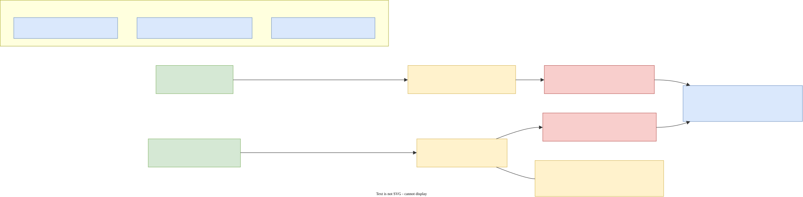

- **No nullifiers, no predecessor consumption, no chain counter, no revote budget.** Drafts
  ≤1.3 enforced a "one-live-chain" rule through published revocation nullifiers; adversarial
  review established that any public, voter-derivable (or finite, demandable) spend object
  re-creates a coercion test: a coercer holding the token, or demanding the remaining
  posting rights, detects replacement. The slot-overwrite model has **no
  predecessor-status spend object at all**. The only public effects of a revote are a new
  voteID receipt and one more overwrite in the batch's public count.
- **No refreshes.** v2 re-encrypted a random sample of other slots in every batch so that
  an overwritten slot would not stand out, and drafts ≤1.5 imitated that with re-blinded
  slot vectors. Both needed the cover only because an overwrite left a public mark on its
  slot. Here it leaves none, so there is nothing to cover: the sample, its sizing rule and
  the trust in the sequencer's sampling randomness are gone, and a revote hides among
  every slot that has already voted, not among a sample (§12.1).
- Invariants enforced by the batch program: a slot's **first write** inserts its marker
  and is counted (`votersCount ≤ maxVoters`); a slot admits **at most one ballot per
  batch** (the structural rate limit); exclusions never reset occupancy (§9.2).
- **No lifetime cast cap: a deliberate decision, as in v2** (which never bounded revotes).
  Review rejected both alternatives. A flat global cap is capturable by an attacker with
  enough admissions ($\min(s,b)\cdot m \ge T$), and a two-pool cap (first-votes vs
  overwrites) is worse: exhausting the overwrite pool would permanently block every later
  escape vote and complaint recovery while casting is still open. Deliberate cast inflation
  is instead bounded structurally (≤1 per slot per batch ⇒ a lone voter adds at most $M$
  casts), priced by admission (STARK proving + sequencer fees + DA per cast; sequencers
  are free to rate-limit, v2's exact posture), and provisioned by the **adaptive
  workload-derived deadlines** of §2.3/§9.2. If a deployment needs a hard ceiling, it
  SHOULD be a per-block settlement rate limit in the profile, never a lifetime admission
  budget. The cost shift is real: v2 wardens did O(1) work regardless of casts; v3 warden
  work is linear in admitted casts, so a funded processing commitment sized by the adaptive
  formula is a real liveness requirement (§9.3), and "admission is priced" is not a
  substitute (an attacking sequencer pays itself).

Ordering: within a slot, the **last settled write wins**, v2's exact semantics, including
its caveat that ballots sent to different sequencers have no common order (voters should
revote through one sequencer, as v2 advises, and clients watch their own voteIDs, §5.2).

**What the voter can and cannot check.** v2 let a voter see that their slot had not been
touched since their last vote. With hidden writes that signal is gone, by design: it is
the same signal a coercer would use. What remains is enough for an honest voter. Nobody
can write a slot without that voter's own authorization proof, every package the voter
ever authorized has a voteID the voter knows, and admissions are public and ordered. So
the voter always knows which of *their own* packages was admitted last. What they can no
longer observe is an overwrite by a package they did not build, which takes their
identity key (or, for CSP censuses, a CSP that issued the same index twice; or, for
address-derived slots, a census that admitted two addresses with the same slot, which
v2 requires census contracts to reject and which anyone can check on a public census list).

### 5.4 Submission interface (voter → sequencer)

The voter submits to one sequencer, over an encrypted channel as in v2:
`{CanonicalPackage, hybridSig?, ballotProof, censusProof?}`. A revote is byte-identical in
shape to a first vote. The sequencer (and its prover) still **learns which slot each
package it seals belongs to, hence which are overwrites** (it sees the census-derived slot
and its occupancy, the same boundary as v2, where the sealing sequencer learns which
updates are overwrites). It never learns ballots, shares,
masks, or `sk`: those stay inside the STARK witness.

**What never enters public data availability:** `hybridSig` (a recoverable signature would
link the package to its Ethereum address), the ballot proof, and the inner proof's public
vector all stop at the voter→sequencer→guest boundary.
Blobs carry only `CanonicalPackage` and the batch-level data of §8.6.

---

## 6. The ballot proof (Plonky3 STARK)

The Groth16 circuit is replaced by a STARK over Goldilocks, proven in the browser via WASM:
the production descendant of the davinci-stark prototype [DST], minus its elliptic-curve
section. No trusted setup.

**Public inputs: the raw public vector.** There is no binding hash (v1.0's `inputsHash` is
removed): the proof exposes the public statement **directly as a pinned, ordered vector of
Goldilocks elements/limbs**, exactly these elements, in this order (the byte/limb layout is
part of the complete proof profile fixed before `ballotVKHash` is pinned, end of this
section): `version` · `chainID` · `registry` · `processID` · `wardenEpoch` · `ν` · `θ` ·
`nf` · `packedBallotMode` · `voteID` · the identity binding (`address` limbs and `pk_PQ`) ·
`slot` · `authMode` · `weight` · all `E` coordinates (ν·nf elements) · all `h_i`
(ν × 8×32-bit limbs) · `pkgCommit` limbs · `ctsDigest` limbs. Everything the relation
depends on is in this vector or fixed by the pinned verification key: in particular the
share polynomials' degree bound comes from the **public θ**, and `pkgCtx` (§2.2) is derived
from the public context values. (Drafts ≤1.5 listed neither θ nor the context parameters;
with θ free, a voter could have proven a degree-2 sharing in a 2-of-3 election, whose
three warden pairs interpolate to three different values.) The package's `version` byte
is the `protocolVersion` of `pkgCtx`: one value. `nf` MUST equal the field count unpacked
from `packedBallotMode`. There is no `isRevote` flag, no predecessor digest
and no nullifier in the publics: the guest determines first write vs overwrite from slot
occupancy alone (§5.3). The vector layout is
length-prefixed per (ν, nf) and never truncates. `ctsDigest = Blake3(cts)` is computed *outside*
the circuit and enters as opaque limbs, which **binds** the ciphertext bytes without proving
anything about ML-KEM.

**Statement contract (normative).** The batch program **constructs the expected public
vector itself**, from the canonical package it admits, the authenticated election
parameters (ν, θ and `wardenEpoch` by opening `wardenSetHash`; `chainID` and `registry`
from the registry-checked batch statement), and the authenticated census and key-map data
(§8.2), and
verifies the proof against *that* vector. It never verifies a supplied vector and then
processes different package data. Inside the AIR, every value used by ballot validation,
share generation, masking and commitments is constrained equal to
these publics, so an admitted package is byte-for-byte the one the voter's proof authorized.
`censusRoot` is **not** a ballot public input: membership is the batch program's job (§8.2).
Privacy note: the inner proof's public inputs live at the voter→sequencer/guest boundary;
they are **not** published in blobs beyond what the package itself already publishes.

**The proof shows:**
1. **Ballot validity** — v2's ballot protocol (ranges, uniqueness, cost sum vs
   `maxValueSum`/weight, `ballotMode` unpacking), with three normative strengthenings over
   the v2-era prototype: the weight bound is enforced when `maxValueSum = 0`; all comparisons
   use sound borrow-checked integer gadgets (no Goldilocks wraparound); and the cost sum is
   computed overflow-safe under the enforced integer-cost profile (§2.3).
2. **Share consistency** — for every active field, the ν shares lie on one polynomial of
   degree ≤ θ−1 whose constant term is the ballot value (inactive fields simply don't exist
   in the package, §2 zero extension). Cost: ν·nf·(θ−1) multiplications, trivial for the
   AIR.
3. **Mask consistency** — $e_{i,f} = s_{i,f} + \mathrm{mask}_{i,f}$ where the nf masks of
   warden $i$ are the LE128-mod-$p$ slices of the single keyed XOF stream
   $\mathrm{Blake3.keyed}(K_i, \mathrm{streamCtx}(i))$ (§2.2, fixed per-field offsets), with
   the same $(s_i, K_i)$ committed in $h_i$.
4. **voteID derivation** from `(processID, address, k)` (Blake3, §5.2), with all of these
   bound in the public vector.
5. **Authentication** (§11): knowledge of `sk` with `H(sk) = pk_PQ`, where `pk_PQ` is a
   public input that the **batch program** binds to the voter's address through the
   election's PQ key map (§8.2); neither census membership nor the key lookup is proven in
   the ballot AIR. For an unenrolled voter in a hybrid-legacy election (`pk_PQ = 0`, with
   the address proven **absent** from the key map), identity rests on `hybridSig` alone
   (§11).
   **There is no revote clause**: first votes and revotes prove the identical statement
   (drafts ≤1.3 had predecessor-opening, nullifier and counter clauses here, removed with
   §5.3's redesign, which also removes their witnesses and hashing from the AIR; the
   instrumented-count gate (§15) measures the net shrink, which must be confirmed, not
   assumed, since fewer constraints need not cross a trace-padding boundary). Authentication
   relies on the proof system's **knowledge soundness**: the proof must establish that the
   prover *knows* the preimage/witness (bound to this entire authorized package), not merely
   that one exists.

**The in-AIR Blake3 section.** All in-circuit hashing runs in a **re-laid Blake3 section**
(~25-32 rows per compression at the circuit's width). Compression budget under the
§2.2 stream-masking definition: per warden ≈ 1 context block + ⌈nf/4⌉ XOF output blocks for
the masks + ≈4 for $h_i$ at nf=16 (its input is 32 + 8·nf bytes plus context fields; 4.00 measured in the tally kernel, Annex A.2); plus ≈ 8 for
`pkgCommit`, `sharesDigest` and voteID (the `NULL`/counter hashing of drafts ≤1.3 is gone).
That is **provisionally ≈ 53 compressions at ν=5/nf=16** (5 × (1 + 4 + 4) + 8), **fewer at smaller nf**, to be fixed by
instrumented counts of the exact canonical encodings (first votes and revotes prove the
same statement). Earlier drafts said ~45/~110 against a per-field masking rule that would
actually have needed ≥ 80/256; the stream rule above is what makes counts this low possible.
It MUST constrain full standard-Blake3 semantics, not merely a compression gadget:
canonical input bytes, exact lengths and zero padding; correct IV / keyed / `derive_key`
initialization per mode; the full 7-round schedule with both feed-forward halves; the
64-byte-block and 1024-byte-chunk structure with correct counters and
`CHUNK_START`/`CHUNK_END`/`ROOT` flags; correct chaining between compressions; XOF
output-block counters (an XOF is a seekable stream, not repeated hashing); outputs
constrained equal to the values consumed elsewhere in the AIR; and selector/phase
constraints that cannot skip or disconnect any check. (The instrumented-count gate of §15
re-counts the budget against the final relation.) Negative test vectors regenerate
otherwise-correct traces with wrong flags, counters, lengths or chaining values.

What the proof deliberately does **not** show: that `ct_i` decapsulates to the committed
$K_i$. Proving ML-KEM in-circuit would drag SHAKE through the AIR. Instead, mismatched
transport is *harmless to integrity* (no tally proof ever runs Decaps, §10.2) and *publicly
excludable* (complaints, §9.2). Proving the encapsulation **in-AIR** (§15 item 1) removes this
trade-off entirely and is the main tracked upgrade.

**Indicative numbers.** Measured on the prototype [DST]: the Blake3 Merkle/challenger profile
proves in **0.69 s native** (vs 3.2 s for the old Poseidon2 profile) with **~324 KB proofs**;
a standalone Blake3 compression AIR costs ≈3.4 ms/compression at its wide layout. The
full-Blake3 ballot (re-laid in-AIR section) is a **projection, not a measurement**:
**~2-4 s native (ν-dependent; the blowup-32 profile costs ≈2.45× the old blowup-8 prover time, bought back for the batch guest, §8.1)**, ~195 KB proofs, to be re-benchmarked once the
re-laid AIR exists (equal cell counts do not guarantee equal proving cost; the degree and
quotient profile must be recomputed). Browser proving is expected at a few × native (mobile
slower, to be benchmarked; the proof uploads once to one sequencer and is never stored
on-chain). Annex A.4 measures the proof-system side at the pinned profile on the prototype
circuit: 1.7 s native single-thread, 4.5-5.2 s in WASM at 478 MiB peak, WASM ≈2.6-3.0×
native, with a blowup-8 → 32 multiplier of 2.45× (2.0× in WASM). Benchmark provenance: all prototype figures in this document come from internal
prototype commits; exact commits, hardware, compiler flags and proof settings will be
published with the reference implementation. Standing adoption gates (from review): fix the
vendored challenger's wasm32 query-sampler bug; production hiding CSPRNG; implement full
Blake3 chunk/tree semantics over the `blake3f` precompile with boundary-length test vectors
(0/63/64/65/1023/1024/1025 B); measure real browser and whole-batch guest costs before
deployment guarantees. Before `ballotVKHash` is pinned, the **complete proof profile** must
be fixed and published: the challenge extension field and its defining polynomial; trace
shapes, maximum constraint degree and quotient construction; FRI folding and final-polynomial
parameters; hiding dimensions and the blinding-randomness source; the complete Fiat–Shamir
transcript (observe/sample schedule, domain-separated initialization, the Merkle-commitment (MMCS) matrix layout and shape
checks, serialization); and the knowledge-soundness assumptions with the claimed quantum
security model.

---

## 7. State tree changes

Same sparse-Merkle-tree structure, depth 64, same namespaces as v2, now hashed with
**Blake3** (leaf: `Blake3(key_LE8 ‖ value_32 ‖ 0x01)`, node: `Blake3(left ‖ right)`), plus
four changes:

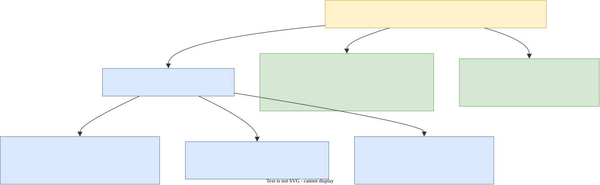

1. **Vote-ID leaves carry the package digest**: `voteID → pkgDigest` (v2 stored 0). This is
   the voter's immutable inclusion receipt, and what complaints authenticate against.
   Vote-ID leaves are never removed, so a state root never recurs.
2. **Slot leaves hold a constant marker.** A slot's leaf is absent until its first write,
   which inserts the fixed 32-byte value `OCCUPIED = Blake3("davinci-slot-occupied-v3")`.
   The leaf never changes again and is **never package-derived**: nothing in the state
   says which package a slot currently counts, so there is nothing to compare a published
   package against. Occupancy is all a sequencer needs from the state to seal the next
   batch, so **any sequencer can admit a write to any slot without any earlier sealer's
   secret** (permissionless sequencing preserved; a vanished sequencer blocks nothing).
   Drafts ≤1.5 stored a blinded vector of the slot's masked shares here; v1.5's tally
   stopped reading it, and it is removed (§8.4).
3. **Config namespace**: `0x3` = `wardenSetHash` (§4) instead of an encryption key; `0x4`
   and `0x5` **reserved under this version** (drafts ≤1.5 kept the accumulator digest at
   `0x4`, drafts ≤1.3 the revocation-nullifier SMT at `0x5`). **`0x8` (reserved in v2) =
   `viewsRoot`, the per-warden column-view commitment of §8.7**, updated by every
   transition (`0x6` is `censusOrigin`, inherited from v2 and not reusable).
4. **Genesis predicate replaces on-chain genesis computation.** The EVM has no Blake3
   precompile, so the registry no longer computes the genesis root itself. Instead it stores
   the election parameters and an **initialization flag**, and the **first transition's batch
   proof constructs the genesis tree deterministically in-guest** from the registry-supplied
   parameters: the canonical empty tree plus *exactly* the prescribed config leaves, **the
   pinned empty-view encoding of leaf `0x8` (per-warden `viewAcc[i, genesis]`, §8.7)**, no
   slots, no packages, correct initial counters. It then proves `oldRoot` equals that
   construction.
   Membership proofs under a prover-chosen root are **never** accepted as a substitute (they
   show presence, not absence of extra state). Registry rules: the genesis branch is
   selected by the stored initialization flag (never caller input); parameters come from
   registry storage, not calldata; the first transition and initialization are recorded
   atomically; thereafter `oldRoot == storedRoot` always, and re-initialization is
   impossible; the outer proof binds the full `(chainID, registry, processID)` (not just
   v2's 4-byte prefix). There is **no zero-ballot transition**: an election with zero
   accepted transitions never initializes and finalizes by the §9.1 short-circuit (the
   canonical genesis and empty-view encodings stay pinned here; the first real transition
   still constructs them).

---

## 8. The batch program (ZisK guest)

In one line: the batch program is the referee. It re-checks every vote package, applies the
state updates, and seals the record of which slot each package wrote.

Same role, same settlement flow, same public-output pattern (`ok`/`failMask`, old/new roots,
counters, census root, blobs digest) as v2, plus `pqKeyRoot` (§8.2). The constraint groups change as follows.

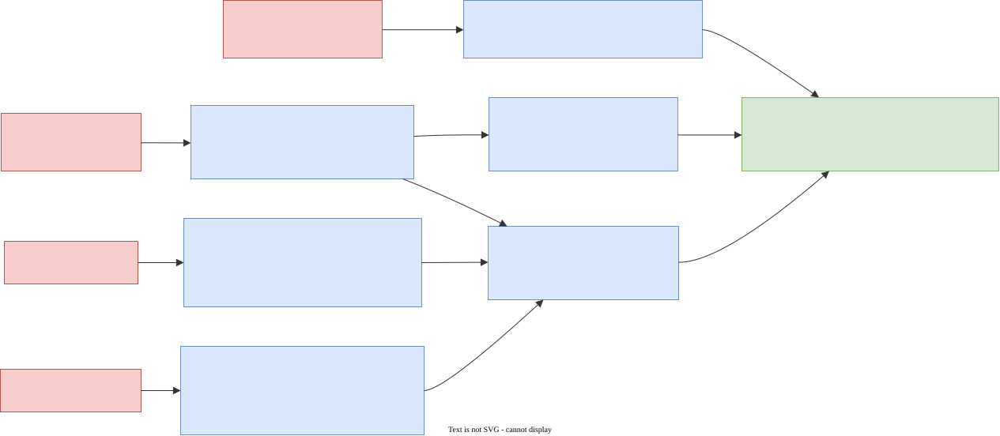

### 8.1 Ballot proof verification: measured cost
The program verifies the K ballot STARKs of a batch **in-guest**, and this is the dominant
cost of the v3 batch program. It has been measured on the real emulator and proven on a
GPU (a ZisK guest running the Plonky3 verifier at the pinned profile of §2.3; internal
prototype, with exact commits, hardware and flags to be published with the reference
implementation, §6). Two caveats apply to every number here. The proofs being verified
come from the **prototype ballot circuit** (2,048 × 379 trace, 123 public values), not the
final §6 AIR, whose trace width and public vector differ; verification cost depends on
both, so these figures are a measured baseline, not the final number. And the times are
the STARK stage only; the wrap that makes a proof verifiable on-chain is priced separately
in Annex A.1.

Unoptimized, one verification costs ≈14.5M guest steps (22.1M at the former
blowup-8/34-query profile), of which hashing through the `blake3f` precompile is only
~1.5M (4,681 compressions); the rest is FRI field arithmetic, Merkle path bookkeeping, the
symbolic constraint rebuild and proof deserialization. A reviewed optimization pass with
no new precompile brought that to **2.53M steps per additional proof plus ≈2.7M once per
batch** (2.62M averaged over a 32-proof batch): the symbolic rebuild is hoisted to once
per batch since all proofs share one AIR; Goldilocks inversions use the existing
`uint256_inv_mod` `fcall` hint (hint plus multiply check, the mechanism ZisK already uses
for secp256k1 and BN254 inverses); opened rows are hashed as words, not byte streams; and
a differentially-tested fork of the FRI verifier factors query-independent sums. The
first two are **normative implementation requirements**.

On one RTX 5090 (cargo-zisk 1.3.0-alpha), verification proves at **0.333 s per proof once
the GPU is saturated** (K ≥ 64; small batches measured 0.30 s and understate it), on top
of a ≈10 s fixed proving pipeline per batch. A **combined guest** running this
verification together with the per-package state work of §8.2-§8.7 has been proven end to
end up to K = 256: 2.71M steps per package, 104 s for a 256-ballot batch, 1.4 to 2.5
votes per second per GPU for K = 32 to 256 (Annex A.1, which also states what that guest
does not yet include). For comparison, v2's production benchmark on the same class of machine (one RTX 5090,
ZisK 1.3.0 against 1.3.2 here)
proves a 256-vote, 16-field batch in 76.7 s including its wrap, and v3's combined guest
takes 107 s including its wrap: v3's post-quantum ballots cost roughly 1.3 to 1.4× v2's
proving per vote at 16 fields (2.3× against v2's cheapest 2-field ballots), not the 25×
that pre-optimization drafts of this section reported. Practical batch sizes: 32-128 ballots for v2-like
latency, 256 for throughput; in native settlement mode the 6-blob limit binds first
(§8.6). Throughput scales across provers as in v2. The price of post-quantum ballots is
paid in parallelizable sequencer GPU time, not voter experience.

The guest implements Blake3's chunk/tree layout over the compression syscall; Merkle
parents are `BLAKE3(left ‖ right)`. The ballot verifier configuration (AIR identity, FRI
profile, transcript and hash profile) is pinned via `ballotVKHash` at config leaf `0x7`,
as in v2, and the guest constructs each proof's expected public vector per the §6
statement contract.

### 8.2 Census, authentication, binding
Census membership is verified **here**, as in v2 (not in the ballot AIR), and **the census
itself is v2's, byte for byte**. For Merkle origins 1-3 that is the Keccak lean-IMT the
v2 batch program verifies (davinci-zkvm source, commit ef07474): node hash `keccak256(be32(l) ‖ be32(r))` (Solidity's
`keccak256(abi.encode(l, r))`), leaf `address·2^88 + weight`, the `leaf < 2^248` rule,
v2's per-batch duplicate-leaf check, and each origin's root-acceptance policy. The guest
checks the path with the keccak precompile, as v2 does today. Existing censuses, census
contracts and census tooling work unchanged. (The v2 paper describes this tree as
Poseidon-hashed and drafts ≤1.5 followed it, specifying a Blake3 census format reached
through conversion proofs. The program's source verifies Keccak, the hash contracts compute
natively, so there is nothing to convert and both conversion proofs are removed; gate 9
re-checks this against the deployed contracts and bytecode.)

**The slot rule is v2's too.** For origins 1-3 the slot is derived from the address by
v2's rule (§2.2). v2 requires on-chain censuses to refuse a registration whose slot is
already taken under that rule (gate 9 confirms the deployed contracts do); deriving slots any other way would leave collisions unchecked, and
a member could grind an address that collides with a victim's slot and overwrite their
ballot. Off-chain census lists MUST be checked for duplicate slots by sequencers and
clients, which anyone can do from the public list.

**PQ keys come from a separate key map.** A census leaf says who may vote and with what
weight. Which post-quantum key authenticates an address is a different fact with a
different owner (the voter), so it lives elsewhere: each election over a Merkle census
(origins 1-3; CSP credentials carry the key themselves, §11) pins, at creation, a
`pqKeyRoot`, the root of a **sparse Merkle map keyed by the 160-bit address** with value
`pk_PQ ≠ 0`, where a missing key means "not enrolled". The map is Keccak-hashed with
distinct leaf and node tags and fixed encodings (it is maintained by a contract, the
island rule of §2; the byte-exact structure is a gate-3 item). For every admitted package
of such an election the guest proves the address's **value or absence** under `pqKeyRoot` (at most 160 node
hashes, fewer with compressed empty siblings) and proves the **join equality**:

$$\text{ballot publics } (address,\, pk_{PQ},\, weight,\, slot,\, authMode) \;=\; \text{census leaf, key-map lookup, slot rule and policy for the same } address$$

One `address` runs through the census leaf, the key lookup and the ballot's public vector;
the guest hashes the key-map leaf itself and never accepts a supplied leaf value.
`authMode` is derived from the immutable election auth policy plus the lookup result
(§11) and compared against the proof's public input, never prover-chosen. Authentication
then follows the policy: `pq-only` requires a present key equal to the public `pk_PQ` and
relies on the in-STARK preimage proof alone; `hybrid` requires the same and *additionally*
verifies `hybridSig` (ECDSA over `pkgDigest`, secp256k1 precompile, recovered address =
census address); `hybrid-legacy` dispatches on the lookup: a present key means both
authenticators, **proven absence** means `pk_PQ = 0` and `hybridSig` alone. Absence is
what makes that branch safe: without it, someone holding only an enrolled voter's wallet
key could claim the voter was unenrolled and skip the post-quantum check. The census
root and `pqKeyRoot` are both bound in the **batch statement** and must be the values the
registry holds for the election, never chosen by the prover. The program recomputes
`ctsDigest` and `pkgDigest` from the package body and constructs the proof's full expected
public vector from that body (§6 statement contract), so an admitted package is
byte-for-byte the one the voter's proof authorized.

A census leaf is not domain-separated from an inner node: about one inner node in 256
would pass the `leaf < 2^248` rule. v2 is safe because the resulting "address" is a hash
output nobody holds a wallet key for. v3 keeps that safety wherever a wallet key is still
needed (`hybrid`, `hybrid-legacy`) and wherever the key map is the address-authorized
registry (§11), since no entry can exist there for an address nobody controls. It does
**not** hold for a `pq-only` election over an **organizer-published** key map: the
organizer could assign a key to such a pseudo-address and vote through it. That is inside
the organizer trust §11 declares for that configuration, not a new power (the organizer
already controls who is in the census), but it is the reason that trust has to be stated.

### 8.3 State transitions
In fixed order, each proven against the previous root, as v2: (1) insert
`voteID → pkgDigest` for every admitted package; (2) insert the `OCCUPIED` marker for every
first-write slot (§8.4); (3) update `0x8` with the new `viewsRoot` (§8.7), atomically with
the rest of the batch state. Every accepted transition admits at least one package (§2.3),
so every transition inserts at least one never-removed leaf and the root always changes.

### 8.4 Hidden writes
A batch makes exactly this public about slots: **the slots written for the first time**,
as a list strictly increasing by slot. For every admitted package the guest:

1. derives the package's slot from the authenticated census data (§8.2);
2. checks that the batch's K slots are **pairwise distinct**: at most one ballot per slot
   per batch (an explicit check over the private slot list);
3. if the slot's marker is absent, treats the package as a **first write**: inserts the
   marker, increments the occupancy counter (`votersCount ≤ maxVoters`,
   registry-enforced), and lists the slot;
4. if the marker is present, treats it as an **overwrite**: proves the marker's presence
   under the old root and publishes nothing about the slot;
5. appends the slot to the batch's **write log** (§8.5), one entry per package.

Admitted packages are published **strictly increasing by voteID**, checked in-guest. No
order in a batch is chosen by the sequencer: with arrival order or slot order, a party
holding the openings of a few packages could count how many writes fall between its own.
A voteID is a hash of the voter's secret `k` (§5.2), so its rank says nothing about the
slot. A package's **admission ordinal** is its batch number followed by its position in
that order.

The public counters are as in v2: admitted packages, first writes (hence overwrites, their
difference) and the total `votersCount`. That is all. There is no refresh, no decoy and no
per-slot value: drafts ≤1.5 published for every touched slot a blinded vector of the
voter's masked shares plus two blinding layers, kept a public accumulator of those
vectors, and touched a random sample of other slots as cover. v1.5's tally stopped
reading any of it, and without a per-slot value there is no mark for a cover to hide, so
the vectors, the blinding layers, the accumulator and the sample are all **removed**.

What this hides, precisely. Per batch the public learns how many overwrites happened and
nothing about which already-occupied slots received them; an overwrite's anonymity set is
every occupied slot, where v2's was its refresh sample. Compared with drafts ≤1.5 and
with v2's slot activity, explicit overwrite-location leakage is never greater and can be
strictly smaller. It is a computational claim (the write log is a ciphertext, §8.5), and
it has edges, listed in §12.1: degenerate batches, counts in small elections, and batches
that were published but re-sealed with different contents.

### 8.5 The warden payload (KEM-DEM, proven)
Per batch, the guest takes a fresh secret 256-bit batch seed (drawn by the sealing
sequencer from its CSPRNG, **fresh for every sealing**) and computes
$\sigma = \mathrm{Blake3.keyed}(\text{seed}, \texttt{sealCtx})$ with the `sealCtx` of §2.2,
which contains the old root and the ordered digests of the admitted packages. **All
payload randomness derives from σ and nothing from the raw seed**: the batch key $k_b$,
the Shamir coefficients, the ML-KEM encapsulation coins and the commitment salts, each
under its own domain. So a sequencer that seals twice from the same seed gets either the
identical payload (same contents) or unrelated keys (different contents); no key or nonce
ever covers two different plaintexts. `sealCtx` is also part of every batch DEM AAD.

The guest then: DEM-encrypts (§2.1) the **write log** under $k_b$, one 8-byte slot per
admitted package in voteID order (fixed length 8·K; K is public); Shamir-shares $k_b$
**coordinate-wise over its 32-bit limbs** θ-of-ν; and for each warden $i$: one in-guest
ML-KEM encapsulation to $pk_i$ → wrapping secret → DEM-encrypts share $i$, and publishes a
salted Blake3 **commitment to each recipient's share** (opening salts travel inside the
respective DEM ciphertexts; these commitments are what lets tally participants validate
forwarded shares in §10.4 without decapsulating each other's ciphertexts). The proof binds
every log entry to its package's census-derived slot, every ciphertext to its registered
recipient key and context, and the share commitments to the shared $k_b$. **Unlike voter
transport, a malformed batch payload is unprovable, not merely complainable**: it would
hide which slot an accepted package wrote from the tally. All of it is published in the
batch's blobs.

The write log is the **only** record of which package is a slot's current one. That is
deliberate (any public record would be a revote detector) and it is why the log is
escrowed to the committee and not to the sequencer. Two alternatives were considered.
Keeping a second, public witness of each write is what drafts ≤1.5 did with blinded
vectors; the tally never read it. Delivering the slot to each warden inside the voter's
package would delete $k_b$, the in-guest encapsulations and a whole ceremony stage, but
every single warden would then see every voter's write history as it happens, and a
coercer with one corrupt warden could re-coerce before the election ends. The θ gate is
worth its cost.

### 8.6 Blob layout v3 and DA numbers
Blob cells carry 31 payload bytes each (a v3 codec choice; v2 packed typed values, v3 packs
an opaque byte stream per section), 4096 cells per blob ⇒ 126,976 B per blob. Sections, in
order: header · admitted packages (CanonicalPackage bytes, voteID order) · first-write
slots (8 B each, ascending) · warden payload (§8.5: the encrypted write log at 8 B per
package plus a 32-B tag, and per warden one ML-KEM ciphertext, one wrapped share and one
share commitment, ≈1.2 KB). An overwrite adds its package and its 8-byte log entry and
nothing else.
Byte-exact cell maps live in the davinci-zkvm normative docs, as in v2. One divergence from
v2's blob flow: the evaluation point becomes
$z_b = \mathrm{keccak256}(\text{processID} \,\|\, \text{stateRoot}^{old} \,\|\, \text{blobCommitment}_b) \bmod q_{BLS}$,
keccak because the **registry contract** computes it (Solidity-native; the guest recomputes
it via the keccak precompile, one call per blob, a §2 island).

Per-package size: `72 + ν·(32 + ct_len + 8·nf)` bytes ⇒ at nf=16: 10,056 B at ν=8, the
v3.0 maximum; 6,312 B at ν=5; 3,816 B at ν=3; 1,320 B at ν=1 (all ML-KEM-768, the only
allowed transport, §2). nf-sizing: 9,096 B at ν=8/nf=1. Packages are 99% of a batch.

| Profile (256 votes, nf=16) | batch bytes | blobs (126,976 B each) | drafts ≤1.5 (with 256 refreshes) | vs v2 (5 blobs) |
|---|---|---|---|---|
| **ν=8, ML-KEM-768 (v3.0 max)** | ≈ 2.59 MB | **21** | 25 | ~4× |
| ν=5 | ≈ 1.63 MB | 13 | 16 | ~2.6× |
| ν=3 | ≈ 0.98 MB | 8 | 10 | ~1.6× |
| ν=1 (sequencer mode) | ≈ 0.34 MB | 3 | 4 | ~0.6× |
| ν=16 (future profile) | ≈ 5.15 MB ⇒ over the 32-blob cap: smaller batches, or the tracked multi-recipient-Kyber transport (§15 item 5: package 5,640 B ⇒ ≈ 1.47 MB ⇒ 12 blobs) | — | — | — |

A batch costs the same whether its packages are first votes or revotes: there is no
refresh cover to pay for. (In drafts ≤1.5 an overwrite-heavy batch grew to 27 blobs at
ν=8, because every overwrite dragged two refreshed slot vectors with it.)

**Settlement modes.** **L1-blob mode** (v2's production path, the OP-Stack flow) posts
blobs across multiple Ethereum transactions and proves their chain inclusion on the rollup;
the 32-blob batch cap is inherited from v2's batch program and applies here. **Native blob
mode** is limited to the settlement transaction's own blobs (≤ 6 under EIP-7594), exactly
v2's flow: for every blob the registry reads its own transaction's versioned hashes via the
`blobhash` opcode (the only trustworthy on-chain binding between a versioned hash and an
actually-published blob) and preserves the binding chain stored versioned hash → commitment
via the point-evaluation precompile → $z_b$ as above → the proof-bound ordered blob digest.
Native deployments use correspondingly smaller batches: six blobs hold **≈119 votes at
ν=5, ≈74 at ν=8, ≈197 at ν=3**, and all 256 at ν=1. L1-blob mode is not an automatic
escape hatch on a chain lacking the rollup inclusion-verification path: pick the mode at
deployment. Drafts
≤1.4 specified a multi-transaction native registration subsystem (`registerBlobs` manifests
with freshness, merge and cleanup rules) so native mode could also reach 32 blobs; it is
**removed from v3.0** and tracked in §15 in a simplified fold-hash form, to be reinstated
only if a native deployment demonstrably needs larger batches. Ceremony and complaint
publications ride their own transactions' blobs, `blobhash`-bound like every blob here.

**The archive manifest chain.** On every accepted transition the registry folds the batch
into a contract-side running value,
`archiveAcc' = keccak256(archiveAcc ‖ batchNumber ‖ stateRoot_new ‖ blobsDigest)` (keccak: it
is contract-computed, the island rule), and stores `(archiveAcc, batchNumber)`. At the
exclusion freeze this pair is frozen with the tally snapshot. It authenticates the ordered
batch **manifest**; actual blob bytes are authenticated by their commitment/versioned-hash
bindings (§4), and the §8.7 views are bound transitively through each `stateRoot`.

DA is v3's main cost regression and is linear in ν: size committees to the election's
stakes. The tracked reduction path is **multi-recipient Kyber** (§15 item 5): one shared 960 B
component plus 128 B per warden ⇒ transport 1,984 B at ν=8 (vs 8,704 B), package
10,056 → 3,336 B, a ~3× DA cut with ML-KEM security assumptions (a 256-vote batch at ν=8
would fit 7 blobs). (v1.2 tracked Classic
McEliece here; withdrawn, since BSI's 2026-09 guidance advises against it in new
developments and 2026 cryptanalysis reduced its margins, while its 0.26-1 MB public keys
were a poor browser fit anyway.)

### 8.7 Per-warden column views (normative)

The batch guest already touches every admitted package; this section makes that work
reusable so warden tally proofs never re-hash full `CanonicalPackage` bytes and never re-fold
the full blob archive. For each warden $i$ and each admitted package $v$, in admission
order (§8.4), the `(104 + 8·nf)`-byte

```text
ColumnRecord(v, i) = voteID (8 B) ‖ pkgDigest (32 B) ‖ E[i][1..nf] (8·nf B, canonical LE)
                     ‖ h[i] (32 B) ‖ Blake3(ct[i]) (32 B)
```

(`pkgDigest` is load-bearing: the exclusion set $X$ identifies packages by
digest, so the record certifies the join between identity and row.)

Per batch $b$ the guest computes the domain-separated commitments of §2.2's `viewCtx`
family (view encoding version 2):

- `rowsDigest[b,i]` — hash of the batch's K ordered ColumnRecords for warden $i$, with K;
- `firstWritesDigest[b]` — hash of the batch's ordered first-write slot list, with its
  count (the same bytes the blobs publish);
- `payloadDigest[b]` — hash of the batch's **complete encrypted §8.5 payload envelope**,
  which carries its own encoding version (version 2 from v1.6: a write log of 8-byte
  slots)
  (write-log ciphertext, tag, context, per-share commitments, wrapping material). So that
  tally proofs need not re-hash ν wrapped shares they never open, the envelope is hashed
  as `Blake3(logPart ‖ commitments ‖ Blake3(wraps))`, with the wraps pre-digested.
  **Never a digest of the plaintext log: a deterministic plaintext fold is enumerable and
  would leak which slots were overwritten;**
- `viewAcc[i,b] = Blake3(viewCtx_acc ‖ i ‖ b ‖ viewAcc[i,b−1] ‖ admittedCount[b] ‖
  firstWriteCount[b] ‖ rowsDigest[b,i] ‖ firstWritesDigest[b] ‖ payloadDigest[b])`;
- `viewsRoot[b] = Blake3(viewCtx_root ‖ batchCount ‖ totalAdmitted ‖ totalFirstWrites ‖ ν ‖
  ordered (i, viewAcc[i,b]))`, stored at config leaf `0x8` (§7).

Guest obligations: every projected value is derived from the **same** `CanonicalPackage`
the guest admits and publishes; it computes `pkgDigest` and each ciphertext digest itself;
every admitted package appears exactly once, in voteID order, with ordinals identical in
all ν views; the batch's ColumnRecords and its write log cover exactly the same K packages
in the same order, superseded and later-excluded ones included; every accepted batch folds
its canonically encoded digests (the pinned empty-view encoding exists only inside the
genesis predicate, §7); the `0x8` update is atomic with the rest of the batch state. Cost:
≈ ν·(18 + 3.9) Blake3 compressions per admitted package (~110 at ν=5, ~175 at ν=8) plus
bounded per-batch work. The ciphertext digests (18 compressions each) dominate.

No new blob bytes are required: observers and archive providers reconstruct every
`ColumnRecord` deterministically from the published `CanonicalPackage` bytes, so views are a
*commitment layout*, not extra published data. The registry retains the per-batch
`(batchNumber, viewsRoot)` checkpoints it has accepted (one new storage slot per batch,
retained until election finalization plus the complaint window, then permissionlessly
cleanable), because early complaints (§9.2)
prove against historical accepted checkpoints, not the moving current root.

Regression tests (normative, from review): omit/duplicate/reorder/substitute one record,
one first-write slot or one batch; change `pkgDigest` keeping the row; substitute another
warden's row or ciphertext digest; replay a view across
elections/epochs/profiles/recipient indices; omit a payload; admit packages out of voteID
order; put two packages of one slot in a batch; write a log entry that differs from the
package's census-derived slot; list a first-write slot that is already occupied or omit
one that is not; seal twice from one seed with different contents and check that no key,
coin or nonce repeats; verify no plaintext log digest and no unsalted slot-map digest
appears in any public transcript or continuation state; and
check, for all θ-subsets through overwrite chains and exclusions, that the §10.1 direct
share sum $\sum_{s:\,P_s \notin X} s_{P_s,i,f} + G_f(i)$ interpolates at 0 to the per-field
tally.

---

## 9. End of election: freeze, complaints, exclusions

The v2 timeline (end → grace window) gains two phases before results:


### 9.1 Casting freeze
When the grace window closes the registry stops accepting transitions (as v2). The state
root at that moment is the frozen final root $R_{\text{cast}}$; with it freeze the terminal
view checkpoint `(batchCount, viewsRoot)` and the counters.

**Zero-transition short-circuit.** If no transition was accepted by the freeze
(`batchNumber = 0`: the election never initialized, §7), anyone MAY call `finalizeResults`
after the freeze; the registry checks the freeze status and `batchNumber = 0` atomically,
records the zero vector as the result, and no exclusion freeze, tally session, complaint or
warden action ever occurs ($R_{\text{cast}}$ and $X$ are undefined and
never referenced; `submitComplaint` and session opening revert at `batchNumber = 0`;
`archiveAcc` stays at its initial value 0). Zero accepted transitions is not the same thing
as zero *counted* ballots: an election whose every final base lands in $X$ still runs the
ordinary tally.

### 9.2 Complaints and the exclusion set X, open from admission
**Complaints may be filed from the moment a package settles**, throughout the voting period
and until the complaint deadline after the casting freeze (the deadline's *coefficients and
margins* come from the named deadline profile referenced at creation, §2.3; the deadline
itself is computed once at the freeze, below). This is safe because $X$ is **idempotent and append-only** and complaints
**change no election state**: no complaint needs to know whether its package is still its
slot's current one, and ordering cannot matter. The payoff is voter recovery. An honest voter whose
package carried broken transport (a buggy client) learns while casting is still open and
simply **revotes**, an ordinary slot overwrite (§5.3) with no special path (the excluded base is
then no longer any slot's final base, and §10.1's direct sum omits a slot's share only when
its *final* base is excluded). In
v1.2 the same voter discovered the exclusion only after casting closed, unrecoverable.

Mechanics: anyone may relay
`submitComplaint(processID, pkgDigest, publicValues, proof)`; only a warden of the election
can produce the proof, a ZisK proof showing
`Decaps(sk_i, ct_i)` yields a key inconsistent with the package's admitted $h_i$ (witness:
the warden's registered key seed; statement bound to the admitted `pkgDigest` and a
**registry-retained accepted checkpoint**, §8.7, never the moving current root, so settled
batches cannot invalidate a complaint in flight). The decapsulation is fully constrained
in-guest, including implicit rejection and the full-ciphertext constant-time FO comparison
(§2); host-provided hints are not acceptable. A complaint proof MAY cover **many packages at
once** (chunkable under the §2.5 contract; chunking is for adversarial scale, and the
single-package complaint is the expected common case); it proves
that **every reported package is malformed toward the complaining warden, never that
unreported transports are valid** (that would force decapsulation proofs over honest
packages; the final contribution proof independently requires valid openings for everything
it counts). The submitter pays gas.

Normative exclusion semantics: **exclusion never resets slot occupancy and never restores an
earlier package**: $X$ is applied only after each slot's final package has been selected
(§10.1). A voter whose slot's *final base* package ends up in $X$ after casting closes
is not counted. A deliberately malformed last cast is a
provable self-abstention, and a voter+warden coalition retains a bounded post-close
withdrawal option for that voter's own ballot. A package malformed toward warden $i$ that is
*not* excluded still tallies correctly from wardens that can open it (§10.2); a voter may
even re-supply the opening out-of-band; warden $i$ either complains in time or sits out.

The timing channel, stated openly: early complaints **improve recoverability without
creating any false-exclusion capability** (a complaint against well-formed transport cannot
be proven), but they add observable signals. Complaint timing and the voter's reaction are
public, and a malicious warden can deliberately delay a valid complaint past the point of
recovery or use its timing as a side channel. This is documented leakage, not an integrity
risk (§12.3).

**Capacity is sized to the actual workload via the adaptive deadline of §2.3**: at casting
freeze the registry computes $d_{\text{complaint}} = t_{\text{freeze}} + d_0 + \alpha C +
\beta M$ from the authenticated terminal counts (admitted casts $C$, batches $M$), with
coefficients and margins fixed by the deadline profile referenced at
creation (§2.3). The per-warden budget
it must cover: one scan/decapsulation pass over up to $C$ packages, column-view
authentication, **a proven decapsulation per reported fault**
(worst case $q_i = C$, up to $νC$ across wardens; batching removes per-complaint
transaction and verification overhead, not the decapsulations), plus proof generation,
publication, inclusion, archive catch-up and reorg margin. Subsequent complaints never
extend a computed deadline. There is no per-voter cast bound (§5.3): the provisioning
scales with what was actually admitted, and deliberate inflation pays for its own admission
while linearly growing a deadline fixed by pinned coefficients. This remains an explicit
liveness assumption (§9.3), not an exceptional path. **Early close:** each pinned warden MAY
signal **scan-complete** on-chain from its snapshot-pinned settlement account (§4;
`msg.sender` is the authorization, and `processID` scoping makes signals inherently
replay-safe). A warden MUST NOT signal before completing its scan with all its complaints
settled (an honest-warden obligation the signal does not prove). When all ν wardens have
signaled, the registry atomically executes the ordinary exclusion freeze with the
then-current $X$. Signals assert closure authorization, never that $X$ is empty, and never
remove exclusions; θ signals or the tally roster are not sufficient; all complaint paths,
including open chunks (§2.5), reject after closure; one missing signal means no
acceleration, and the computed deadline stands. This is the one deliberate **classical
downgrade** in the warden message layer: forging a signal needs a warden's Ethereum account
and can only accelerate closure, a liveness and timing lever, never an integrity or
confidentiality one (§12.5; drafts ≤1.4 used SLH-DSA waiver certificates here, which no
contract could affordably verify). At the deadline (or all-ν early close) $X$
freezes on-chain, as its running digest `xDigest` (§2.2); every tally proof binds the frozen
snapshot `snap` $= (R_{\text{cast}}, \text{xDigest}, \text{batchCount}, \text{viewsRoot})$.

### 9.3 Liveness
The tally needs at least θ wardens (the tally threshold) that complete the scan (and any
complaints) inside the window, complete the ceremony (§10.3-10.4), and publish proven
contributions, and someone (anyone) to submit each attempt's roster proof. It also needs, as in v2, timely inclusion of their transactions, **plus a funded
processing commitment covering the adaptive workload-derived deadlines (§2.3/§9.2: warden
work is linear in admitted casts, and "admission is priced" is not a substitute, since an
attacking sequencer pays itself)**, **plus at least one complete, available archive of the
election's published history** (§4). Blobs prune after ≈18 days, so the history must be
captured live (L1-blob-mode blobs from their publication transactions, §8.6); providers are
untrusted, since all
data is authenticated against the chain commitments, but a sole provider can halt progress by
withholding, so redundancy is operational prudence. Availability must span the casting
period, the complaint deadline, **every** tally attempt, and the declared retention period,
and must include ceremony and complaint publications; reorganizations and archive catch-up
time eat into deadlines and must be budgeted. Missing payload history means the tally cannot
complete. Compared with v2: v2 also requires post-pruning archival for anyone replaying
the election, but v2 wardens tally from one authenticated final accumulator, so **v3's
dependence of tally completion on the complete history is strictly stronger**.
With fewer than θ such wardens the results are lost, exactly as with v2's "θ of ν wardens
take part in decryption".

---

## 10. Tally: warden sums and Lagrange

In one line: this is where the wardens' recovered shares become the election result, in
public, with proofs, and without any decryption key.

### 10.1 What each participating warden computes
After the exclusion freeze, each participating warden $i$:
1. holds its complete **column view** (§8.7) and the batch payload history, fetched from any
   untrusted archive provider and authenticated against the chain commitments, or retained
   locally (§4; work is linear in *total casts*, not final voters, and decapsulation/share
   recovery MAY run incrementally during the voting period);
2. decapsulates its per-package ciphertexts (full-ciphertext constant-time FO comparison,
   §2), regenerates each package's mask stream
   ($\mathrm{Blake3.keyed}(K_{v,i}, \mathrm{streamCtx}(i))$, §2.2), recovers shares
   $s_{v,i,f} = e_{v,i,f} - \mathrm{mask}_{v,i,f}$, and checks each against
   the admitted $h_{v,i}$;
3. joins the **tally ceremony** (§10.3-§10.4): the participants exchange batch-key shares
   in signed, encrypted bundles on the public DA path (plaintext shares are never public),
   reconstruct each $k_b$ from θ shares, decrypt the **write logs** and so learn which slot
   every admitted package wrote, all verified against the batch proofs that committed them,
   and run the zero-blinding round producing $G_f$;
4. selects each occupied slot's **final base package** $P_s$: the package the logs assign
   to slot $s$ in the highest-numbered batch (a batch holds at most one package per slot,
   so there is never a tie). Only then applies the exclusion set: a slot whose final base
   is in $X$ counts nothing; an earlier package is never restored. Then computes the
   **direct share sum**:

$$S_{i,f} = \sum_{s:\,P_s \notin X} s_{P_s,i,f} \;+\; G_f(i)$$

In words: sum your recovered share of every counted ballot, add your blinding share, done.
The shares come from opening the admitted commitments $h_{P_s,i}$, each AIR-bound at
admission to the exact $(s_i, K_i)$ used in masking (§5.1, §6). Each counted term is an
evaluation of one degree-(θ−1) ballot polynomial, so the sum is an evaluation of their
aggregate; adding $G_f(i)$ (with $G_f(0)=0$) keeps the interpolation at 0 equal to the
exact tally. Exactly one contribution program is pinned per registry deployment: a θ-set
of contributions computed under two different equations would interpolate garbage that
still verifies on-chain.

5. publishes $S_i$ with a **ZisK proof** whose statement binds: the election context, the
   frozen snapshot `snap` (§2.2; the proof opens `xDigest` to the exclusion set it applies),
   registry-selected and never warden-supplied (consistency with a chosen list is not
   completeness), its recipient index, the session id, the attempt and the frozen dealer
   set (§10.3-§10.4); and whose witness contains its KEM key seed (authenticating it as
   warden $i$ against the registered commitment), the $(s, K)$ openings **for every
   counted slot's final base package** (each checked against its admitted $h_{v,i}$), the
   reconstructed payload keys and log openings, and its dealer-delivered blinding
   evaluations (opening the $cm_{k,i}$ of §10.3). The program processes warden $i$'s
   **column records, the first-write lists and the authenticated batch payloads**, never
   full `CanonicalPackage` bytes, and never a re-fold of the blob archive (the chain of
   accepted batch proofs already certifies view completeness; the registry's `archiveAcc`
   binds the views transitively through each `stateRoot`). It enforces **complete,
   exactly-once processing** of the whole history (every admitted package: final base,
   superseded, or excluded, with nothing skipped), reaching the frozen terminal
   `viewsRoot` and counts. Payload keys are authenticated by reconstruction from
   **θ distinct original committed share openings** (§8.5) followed by DEM verification
   (successful decryption under an arbitrary supplied key proves nothing); recovered key
   limbs must satisfy the 32-bit limb encoding; and the slot of every package comes from
   the authenticated logs, never from host-supplied values. As an internal cross-check
   the program asserts, per batch, that the slots the log shows written for the first
   time are exactly that batch's public first-write list, and at the end that the number
   of distinct slots equals `votersCount`. These are assertions, **never outputs**: no public value
   may expose how many final bases were counted or excluded, nor any unsalted digest of
   slot data. (A tally proof opens $h_{v,i}$; it never hashes actual ciphertext bytes;
   only complaint proofs do.) For scale, chunked proving follows the §2.5 contract.
   Sizing: total authentication work is $O(C + M\nu)$, history-linear rather than
   active-voter-only; the secret opening work scales with counted final bases.
6. `submitTallyShare(processID, i, S_i, publicValues, proof)`; after θ verified shares,
   anyone calls `finalizeResults(processID)`: **the registry performs the Lagrange
   interpolation on-chain** (θ ≤ 8 points over Goldilocks in v3.0, a few u64 mulmods per
   field; measured gas in Annex A.3), records the per-field results, and emits
   `ProcessResultsSet`.

Wardens run their **own provers**: the witness contains their secrets, and a shared proving
service used by θ wardens would itself hold reconstruction capability. One operator MAY
serve wardens of *different* elections on shared infrastructure, provided its aggregate key
inventory stays below θ **for every election it touches**: job separation alone is not
enough, since epoch keys reused across elections can silently hand one operator θ keys of
some committee. Untrusted public
*preparation* is fine: anyone may pre-build columns, manifests and lookup structures, since
the proof authenticates their use against the frozen commitments, but nothing holding secret
witnesses may be outsourced. Proving cost scales with total casts. The inner loop (column
record folding, $h_{v,i}$ opening, share accumulation, per-batch key reconstruction and
log decryption) has been measured: **9.4 Blake3 compressions and ≈2,000 guest steps per
counted package**, about 3.9 of them public view authentication and 4.0 the opening
(Annex A.2), against the >10^8 compressions per million casts of v1.2's full-package
re-hashing. What that measurement does not yet contain is the slot → latest-package map
across batches; Annex A.2 says so.

### 10.2 Why malformed voter transport cannot corrupt anything
**Decapsulation never appears in any tally proof.** Contributions open the admitted
commitments $h$ instead, and under commitment binding every accepted $S_i$ lies on the same
aggregate polynomial. A voter publishing a bad `ct_i` only deprives warden $i$ of its opening
witness (warden $i$ complains or sits out; the voter could even re-supply the opening
out-of-band, which is safe because correctness is tied to $h$, not to the transport). Every clean
θ-subset interpolates the same tally, because the ballot STARK proved all ν shares lie on one
valid polynomial. Malformed transport is an availability lever against one warden, never an
integrity lever against the election.

### 10.3 The zero-blinding ceremony
In plain terms: before publishing their partial sums, the participating wardens jointly add
noise that cancels out exactly at the finish line (x = 0), so the published sums reveal the
result and nothing else. Why it's needed: published raw, θ sum-shares determine the aggregate
polynomial $F$; any single warden, participant or not, could evaluate it at its own index,
compare with sums of its decoded per-package shares, and fingerprint which packages are
final bases (hence which slots were overwritten). The
ceremony prevents that:

1. A tally attempt has three sets (§10.4). The **roster $\Pi$**: the wardens whose join
   was proven valid, frozen by the roster proof, $|\Pi| \ge \theta$; it MAY exceed θ, and
   should, because extra members are failure margin. The **accepted dealer set
   $D \subseteq \Pi$**: frozen at the dealer deadline, $|D| \ge \theta$ required so at
   least one accepted dealer is honest under the $f < \theta$ corruption bound. The
   **contributors $\Gamma \subseteq \Pi$**: any θ roster members with valid contributions.
   The registry computes the **session id** when $\Pi$ freezes,
   `sessionId = keccak256("v3/session", ectx, snap, attempt, Π)` (§2.2), where `attempt` is a
   registry-controlled monotonic nonce incremented on every restart, so the id changes
   even with an identical roster and snapshot; the registry tracks exactly one active
   attempt and rejects anything bound to a stale one. Candidate dealers are the roster;
   blinding evaluations are delivered **only to the frozen roster, never pre-dealt to all
   ν wardens or to future replacement candidates** (pre-dealing would hand every warden
   its $G(i)$, letting any single non-participant strip the blinding at its own index and
   fingerprint which packages are final bases, a confirmed attack).
2. Each dealer $k$ samples a seed and derives, per field, blinding coefficients
   $c_{k,f,1..\theta-1}$, defining $g_{k,f}(x) = \sum_j c_{k,f,j} x^j$. **The constant term
   is structurally absent, so $g_{k,f}(0) = 0$ by construction** (this is the
   "zero-certificate": the dealer proof's coefficient witness simply has no degree-0 entry).
3. Dealer $k$ publishes (in a session blob): **per-recipient hiding evaluation commitments**
   $cm_{k,i} = \mathrm{Blake3}(g_{k,1..16}(i) \,\|\, r_{k,i})$; the KEM-DEM ciphertexts to each
   co-participant $i \in \Pi$ encrypting $(g_{k,1..16}(i), r_{k,i})$, after the dealer has
   re-run the roster check itself (§10.4);
   and a **ZisK dealer proof** over one coefficient witness showing that the degree-0 term
   is structurally absent and that every $cm_{k,i}$ and every ciphertext is consistent with
   that witness, under the recipients' **ephemeral session keys** (§10.4) and this session's
   context. The dealer proof also **authenticates the dealer**: its statement carries the
   full canonical envelope digest and the `cerCtx` tuple as public inputs, constrained
   in-circuit against the dealer's witnessed registered key seed (proving key possession
   without binding the whole message would permit envelope substitution under a replayed
   proof; `cerCtx` closes cross-attempt, cross-session and cross-election replay). There is
   no separate signature and no standalone coefficient commitment: drafts ≤1.4 had both,
   nothing ever opened the coefficient commitment, and the proof subsumes the signature,
   which also makes admission to $D$ fully objective (a valid on-chain-verified proof
   present by the deadline).
4. Contributions use $G_f(i) = \sum_{k \in D} g_{k,f}(i)$ over the **accepted dealer set
   $D$**, fixed on-chain after the dealer deadline and **immutable thereafter: a dealer
   whose publication is missing or invalid before the deadline simply doesn't enter $D$
   (margin), and once $D$ is frozen, a member's later unresponsiveness never removes its
   polynomial** (removing it would put contributions on different blinded polynomials and
   corrupt the interpolation); every contribution proof binds the same $D$ and session id,
   and **opens the evaluation commitments $cm_{k,i}$** (the recipient learned the opening by
   decapsulating off-circuit; decapsulation still never enters any tally proof). Only if
   $|D| < \theta$ at the deadline does the session restart with fresh masks.

As long as one accepted dealer is honest, no one outside the ceremony, and no
non-participating warden, learns anything about $F$ beyond what the public tally
$F(0)$ itself reveals. Under the direct share sum (§10.1), tally-time write-history
hiding rests **solely** on this one-honest-accepted-dealer property, and the committee
bound $f < \theta$ itself implies it: $|D| \ge \theta$ and $D \subseteq \Pi$, so an
all-malicious accepted dealer set would require ≥ θ corrupt roster members, and θ corrupt
roster members already hold θ shares of every batch key and know the complete write
history without touching $F$. Whenever the blinding could matter, that adversary has
already crossed the θ boundary. The blinding has nothing to do with slots or logs: it
protects the aggregate share polynomial, which is why it stays although every slot-level
blinding of earlier drafts is gone. Roster members do learn the
write history (which slot each package wrote); that is the documented
metadata leakage of §12.2.

### 10.4 The batch-key exchange and the session state machine

The batch keys $k_b$ (§8.5) are θ-of-ν shared; **reconstructing them must not leak
them**: publicly releasing enough shares of any $k_b$ reveals that batch's write log,
exactly the metadata hidden writes exist to conceal. An attempt is **five one-shot
publications** (join and share bundle SLH-DSA-signed; roster proof, dealer bundles and
contributions proof-authenticated), with no pairwise request/response on the success path:

1. **Join.** Each participating warden publishes a **fresh ephemeral ceremony ML-KEM
   keypair for this attempt** in a join envelope: the 1,184-byte encapsulation key and an
   SLH-DSA signature, under its registered signing key (§4), over `joinCtx` (§2.2), which
   **includes the ephemeral key itself**, the election context, the frozen snapshot, the
   attempt and the sender index. The join is a transaction from the warden's
   snapshot-pinned settlement account (§4) carrying the envelope as calldata; the registry
   enforces the exact envelope length, computes `keccak256` of those calldata bytes
   itself, and stores the digest at the warden's index. One join per index per attempt,
   immutable. The join stage closes at its deadline or as soon as all ν wardens have
   joined; no join is recorded after that.
   **Long-term warden keys MUST NOT be the recipients of ceremony ciphertexts**, and the
   ephemeral secret, together with every recovered bundle key, share and reconstructed
   batch key, MUST be destroyed once the tally finalizes. Why: the bundles below are
   published on a DA path and archived forever. If they were encrypted to lifetime keys, a
   *single* participant's later key compromise would reveal ≥θ shares of every $k_b$, i.e.
   the complete write history, from the public archive alone (§12.2). Ephemeral keys
   restore "steal a key later ⇒ learn nothing" for honest-deleting participants.
2. **Roster proof.** The account check says *who* joined; it says nothing about whether
   the envelope is usable. So once the join stage has closed, anyone submits one ZisK
   proof, with no secret witness, that decides it. Its statement binds the election
   context, the frozen snapshot, the attempt, the registry's indexed vector of join
   digests and the snapshot-pinned signing-key commitments. For **every** recorded join it
   computes a verdict: the signature verifies under the registered key and `joinCtx`,
   **and** the encapsulation key passes the FIPS 203 validity check. The program is
   total: malformed bytes yield "invalid", never an abort (otherwise one garbage join per
   attempt would block the tally forever). It outputs the roster $\Pi$ as the ordered
   (index, envelope digest) pairs of the valid joins. The registry requires
   $|\Pi| \ge \theta$, freezes $\Pi$, and only then computes the session id (§10.3). Every
   later message binds that id, and every delivery obligation, completion rule and
   threshold below refers to $\Pi$. An invalid join is simply not in it: one lost slot of
   margin, whoever sent it.
   **Senders re-check.** Before encrypting anything to a roster key (dealers in step 3,
   bundle senders in step 4), a sender recomputes $\Pi$ by running the same pinned roster
   program on the published envelopes. This is what keeps the authentication of ephemeral
   keys post-quantum: the registry's acceptance rests on a wrapped proof whose wrapper is
   classical (§12.5), the sender's own run rests on SLH-DSA. If the frozen $\Pi$ contains
   an envelope the sender's run rejects, the proof system or its wrapper is broken: the
   sender stops sending and contributing in this election and raises the alarm. It never
   triggers an on-chain reset. (If $\Pi$ omitted an envelope the sender's run accepts, the
   sender would simply proceed with $\Pi$; running the identical program leaves no room
   for two libraries to disagree on an edge-case key.) The stakes: a forged ephemeral key
   that senders did encrypt to would collect up to $m - 1$ shares of every batch key from
   a roster of $m$, enough to read every write log whenever $m > \theta$. That is why
   this one message keeps post-quantum authentication while §9.2's closure signals do not.
3. **Dealer bundles** (§10.3), delivered to every member of $\Pi$; $D$ frozen at their
   deadline.
4. **Share bundles.** Each roster member publishes ONE signed, authenticated logical
   bundle (context `cerCtx`, §2.2): its canonical vector of §8.5 shares and commitment
   salts for **all batches**, DEM-encrypted once under a fresh 256-bit CSPRNG **bundle key**
   (fresh per attempt, never reused), plus one KEM-DEM wrap of that bundle key to each
   other roster member's ephemeral key. The SLH-DSA envelope covers the body ciphertext
   **and the complete ordered per-recipient wraps** (stripping or substituting a wrap is
   only denial of service, since a wrong key fails the DEM tag, but binding them is free
   attribution hygiene). Every recipient receives the identical sender vector; bundle
   bytes are $O(mM + m^2)$ (at 1M casts in 256-cast batches: ≈3.1 MB for m=8, ≈1.9 MB for
   m=5; drafts ≤1.4 encrypted the vector once per recipient, 21.1 and 7.5 MB).
   Publication is on a **publicly verifiable DA path** so missing-message timeouts are
   objective ("I sent it privately" proves nothing); one logical bundle may span multiple
   transactions/blobs. A recipient **validates every recovered share against the batch's
   published per-share commitments** (§8.5) before use. An invalid opening is simply
   ignored; any θ valid distinct shares reconstruct each $k_b$ (all decapsulations follow
   the §2 full-ciphertext constant-time FO rule).
   Signatures give authorship attribution; the protocol still does **not** claim publicly
   verifiable fault attribution for encrypted contents (a signature proves who sent a
   ciphertext, not what it decrypts to; confidential ZK fault proofs are a tracked
   hardening, §15). Faults are absorbed by **margin**, and fault adjudication is never on
   the successful tally's critical path.
5. **Contributions** (§10.1 step 5): any θ valid contributions from roster members, all
   bound to the same snapshot, session, attempt and frozen $D$. No separate signature: the
   contribution proof authenticates the warden through its registered key seed, binding the
   full envelope digest and `cerCtx` exactly as dealer proofs do (§10.3).

Plaintext key shares and reconstructed keys never appear on-chain or in blobs; contribution
proofs reference the log *openings* (witness), not the keys.

**Deadlines and restarts** (contract-side). At the casting freeze the registry fixes five
stage **durations** from the deadline profile and the terminal counts (§2.3). Attempt 1
starts at the exclusion freeze; each attempt turns the durations into absolute deadlines
counted from its own recorded start, in the order join close, roster proof, dealer
bundles, share bundles, contributions. One boundary convention holds everywhere: a message
is on time if its block timestamp is at or before the deadline. A stage opens as soon as
its predecessor closes, and **every stage closes early on completion**: the join stage
when all ν pinned wardens have joined; the roster stage when the roster proof is accepted;
the dealer stage when every member of $\Pi$ has a bundle with a verifying proof on-chain;
the share-bundle stage when every member of $\Pi$ has completed authenticated DA
publication of its bundle (publication is the observable event, never the validity of
encrypted contents); the contribution stage when θ valid contributions are accepted, after
which anyone can call `finalizeResults`. Closing a stage early only opens the next one sooner; it never moves a
deadline earlier for a party that has not yet published. A fully-responsive committee
goes from exclusion freeze to results in minutes (the same rule gives §9.2 its early
exclusion freeze).

An attempt **fails** on exactly three contract-decidable conditions, and on nothing else:
no accepted roster proof with $|\Pi| \ge \theta$ by the roster deadline; $|D| < \theta$ at
the dealer deadline; fewer than θ accepted contributions at the contribution deadline.
The share-bundle deadline has no failure condition of its own: a missing or faulty bundle
is never adjudicated and shows up, if it matters, as a contribution shortfall. After a
failure anyone may call the registry to advance; that transaction records the next
attempt (attempt + 1) starting at its own timestamp, with fresh deadlines, a fresh roster
and fresh blinding and transport randomness; batch keys never change, and anything bound
to the old attempt is rejected from then on. **A missing or invalid participant reduces
margin and never by itself forces a restart**; no accusation, no claim about encrypted
contents and no early completion can trigger one. Attempts are not capped: with θ
responsive honest roster members no single participant who joins and then withholds can
make an attempt fail, and without them neither a cap nor a bond would produce a tally.
`finalizeResults` accepts θ distinct roster members' contributions bound to one accepted
session and its frozen dealer set. To be clear about what remains: **removing the
election-key DKG does not remove coordinated cryptographic ceremonies. v3 replaces it with
different (smaller, tally-time-only) coordination work**, and the exchange stays interactive
in substance (no PQ primitive lets θ parties privately reconstruct without communicating;
there is no silent-threshold shortcut; these stages are the minimum for ν ≥ 2).

**The ν=θ=1 fast path.** In sequencer mode the ceremony collapses entirely: no join, no
roster proof, no dealer bundles, no share exchange, and $G_f = 0$ (blinding only protects
against parties outside the ceremony, and there are none). The exclusion freeze, the
authenticated payload reconstruction (the single warden decapsulates its own §8.5 share,
which alone reconstructs each $k_b$) and the contribution proof remain, bound to a canonical
single-warden context and the frozen snapshot. The sole-operator privacy trust of §4
applies.

---

## 11. Census and authentication

- **Census trees are v2's, unchanged** (§8.2): the same Keccak lean-IMT, leaf packing,
  root policies per origin and slot rule. A v2 census is a v3 census; nothing is converted
  or rebuilt. What v3 adds is the voter's post-quantum key, and it lives outside the
  census.
- **The PQ key map.** `pk_PQ = H(sk)` for a CSPRNG-generated secret `sk`. Each election
  pins a `pqKeyRoot` at creation (§8.2): the root of an address-keyed sparse Merkle map
  from address to `pk_PQ`, where a missing address means "not enrolled".
  - *On-chain and token censuses* use the global **PQKeyRegistry** contract. A voter
    enrolls with one transaction, reusable across all elections. **Registration is
    authorized by the address itself**: the transaction's sender, or a relayed wallet
    signature over the domain-separated tuple `(chainID, PQKeyRegistry address, voter
    address, new pk_PQ, nonce)`, where the registry keeps a **per-address nonce** and
    increments it on *every* successful update, direct or relayed. The signature
    *authorizes* and is never key entropy, so a future ECDSA break does not reveal PQ
    secrets. As long as ECDSA holds at registration time, nobody else can enroll or squat an
    address (§12.5). A voter may replace their key the
    same way; a replacement affects only elections created afterwards, and because of the
    nonce an old authorization can never be replayed to put a replaced (possibly
    compromised) key back.
  - *Off-chain censuses* SHOULD use the global registry too. Where that is impractical
    the organizer publishes its own key map of the same structure next to the census
    list, and MUST obtain each key from the voter it belongs to (validated enrollment).
    An organizer who assigns
    keys holds **identity authority**, not only eligibility authority: in a `pq-only`
    election it could vote as a listed member. That is stronger trust than v2's off-chain
    census (where the organizer chose who may vote but could not vote as them) and
    deployments MUST say so; `hybrid` removes it, since the organizer has no wallet keys.
    The key list is published with the census, and `pqKeyRoot` is immutable for every
    origin.
  - *CSP censuses* carry `pk_PQ` in the credential (below) and use no key map.
- **Snapshot rule.** `pqKeyRoot` for an on-chain registry is the root the registry holds
  **at the moment of the election-creation transaction**, read in that transaction:
  registrations earlier in the same block count, later ones do not. A voter's key and
  enrollment status for an election never change afterwards, whichever (newer)
  eligibility root the census contract later accepts.
- **Election auth policy** (immutable registry parameter, fixed at creation):
  - `pq-only`: every package must present a key-map entry for its address; authentication
    is the in-STARK preimage proof alone; no ECDSA anywhere in the ballot path. A census
    member with no entry simply cannot vote in this election: checking enrollment coverage
    before creating a `pq-only` election is the organizer's job, and SDKs SHOULD refuse to
    create one over a census with unenrolled members without an explicit override.
  - `hybrid`: as `pq-only`, and every package is also verified on the second
    authenticator, `hybridSig` (ECDSA over `pkgDigest`, verified by the batch program).
    No OR-downgrade exists in this mode.
  - `hybrid-legacy`: an enrolled voter authenticates on **both**, exactly as in `hybrid`;
    a voter **proven absent** from the key map is admitted on `hybridSig` alone, with the
    STARK's PQ-preimage clause skipped (`pk_PQ = 0`). The batch program decides the branch
    from the key-map lookup, never from the package: an enrolled voter cannot be treated
    as unenrolled, so stealing only their wallet key is not enough to vote as them.
    Anyone can count the unenrolled census members (census and key map are public),
    though not which packages are theirs. Ballot *privacy* is fully PQ for these voters;
    the election's **integrity assumptions include ECDSA security for its unenrolled
    voters** (§12.1, §12.5). This mode is what makes existing token censuses usable before
    universal enrollment.
- **CSP censuses** (origin 4). v2 identified the CSP by its Ethereum address and recovered
  its key from each ECDSA credential; SLH-DSA has no key recovery, so the key is pinned
  directly: `censusRoot` **is** the CSP's 32-byte SLH-DSA-SHA2-128s public key
  (`PK.seed ‖ PK.root`), byte-exact, never reduced or range-checked as a field element.
  A credential is a FIPS 205 pure signature [FIPS 205], with the fixed context string
  `davinci-v3-csp`, over v2's credential message extended with the deployment and the
  voter's key: `chainID_32 ‖ registry_20 ‖ processID_32 ‖ address_20 ‖ weight_32 ‖ idx_8 ‖
  pk_PQ_32` (big-endian byte lengths, as v2). The batch guest verifies each credential
  against the registry-held key (pure hashing through the SHA-256 precompile; SLH-DSA's
  internal SHA-2 is a FIPS island, §2) and uses `slot = 16 + idx` as v2. A stable
  one-to-one mapping between addresses and indexes, and one fixed `pk_PQ` per voter per
  election, are **issuer obligations**: no single credential can prove them, and a CSP
  that signs the same index for two addresses lets the second overwrite the first.
  `pk_PQ = 0` in a credential is accepted only under `hybrid-legacy`; the hybrid modes
  keep their voter ECDSA check independently of the credential.
- Participation visibility and the census origins 1-4 mechanics: as v2, with the additions
  above. The v2 census invariants (slot uniqueness across the census; stable distinct CSP
  indexes) remain assumptions of integrity.

---

## 12. Security properties

### 12.1 What holds, under what

| Property | Holds if |
|---|---|
| **Tally integrity** | STARK/zkVM soundness (FRI + hashes) and the classical wrapper (§12.5), binding commitments, correct pinned programs, the settlement chain executes the registry, the v2 census invariants (unique slots / stable CSP indexes), and an authentic key map (§11; organizer trust where the organizer publishes it; ECDSA at registration time for the on-chain registry), plus ECDSA itself for the unenrolled voters of a `hybrid-legacy` election. Then no coalition of voters, sequencers, provers or wardens can shift a tally, including via malformed KEM transport (§10.2). |
| **Ballot privacy** | fewer than θ warden keys compromised **over their whole lifetime** (not just the active epoch), ML-KEM IND-CCA, PRF/hash security, hiding STARKs, and honest voter devices. Below θ, shares in isolation are information-theoretically independent of the ballot. **Post-quantum computational privacy, not "everlasting"**: an unbounded adversary could attack archived KEM transcripts. Claimed only beyond what the published tally and public metadata reveal: in a small electorate, or when overlapping tallies are combined, the tally itself may reveal choices (as in v2). |
| **Revote hiding (public data)** | hiding proofs + PRF/hash and DEM security + ML-KEM (the write log's key shares travel under it) + no party able to read the logs discloses them (θ colluding wardens before the tally; any single roster member after a share exchange, §12.2) + the sealing sequencer/prover keeps its batch seed and what it sealed secret. **An overwrite publishes nothing about its slot**: per batch the public learns how many overwrites occurred, never which occupied slots received them, so an overwrite hides among all occupied slots (v2: among its refresh sample), and no party's sampling randomness is trusted. This holds even for a coercer holding the voter's identity key and the coerced package's complete opening (§12.3). **Edges, all inherent to public counts and timing:** (a) degenerate batches: a single-package first-write batch links that package to its slot, and a batch with all or no first writes shows every package's status; (b) counts: zero overwrites in every later batch is a certain "nobody revoted", and in a small election a count of one narrows it to few candidates; a party that fills a batch with K−1 packages of its own learns whether the remaining one was a first write, though not an overwrite's slot; (c) re-sealing: two published versions of a batch that differ in admitted packages reveal, through their first-write lists and counts, a dropped first-write package's slot and any dropped package's status; (d) exclusion counts and (e) an active one-per-batch probe, both in §12.3. Participation per slot (first writes), turnout and complaint timing are public, as in v2. |
| **Exact tally** | unconditional arithmetic (mod-$p$ sums, Lagrange). ML-KEM's residual decapsulation-failure probability (≈2^-164 at ML-KEM-768; election-wide union bound over *all* encapsulations: per-ballot, batch shares, ceremony deliveries) is not zero even for proven-correct encapsulations. Each failure degrades gracefully: a per-ballot failure becomes a complaint (filable immediately, §9.2, so the voter can revote); a batch-key *share* failure is tolerated provided at least θ valid shares remain available (with ν=θ, or only θ responsive wardens, one failed share means that payload cannot be reconstructed and the tally cannot complete, so size ν above θ accordingly); a ceremony delivery failure reduces margin, and only a shortfall below θ at a deadline fails the attempt (§10.4). Deliberately malformed batch transport is a different thing entirely: it is unprovable (§8.5), so it cannot appear in an accepted batch. |
| **Liveness** | ≥1 honest sequencer with proving capacity and timely inclusion (as v2), plus someone submitting each attempt's roster proof (permissionless) and ≥θ responsive honest roster members through the ceremony's deadlines with θ valid accessible original shares per batch (§10.4; margins absorb individual failures), plus **≥1 complete available archive of the published history spanning casting, complaints, every tally attempt and the retention period** (blobs prune in ≈18 days; providers untrusted, data chain-authenticated; missing payload history prevents tally completion, §4/§9.3), plus a funded processing commitment for the workload-derived deadlines (§2.3/§9.2). |

### 12.2 What wardens and insiders learn
θ colluding wardens can reconstruct **every package's ballot**, exactly v2's boundary, where
θ wardens can decrypt every ballot. New, and narrower: the parties that can learn the
**write history** (which slot each package wrote, hence who revoted and when; metadata,
not contents) are defined **cumulatively**. For each
batch, that set is anyone who obtains $k_b$, receives its plaintext onward, or
**accumulates θ distinct
valid original shares of $k_b$, including shares received across different
attempts** (fresh blinding cannot revoke knowledge already obtained; two incomplete attempts
can cumulatively suffice). In a delivered share exchange to a roster of size $m$, **every
roster recipient**, not only the final θ contributors, gains reconstruction capability,
and any one of them can leak the history onward. So the precise statement is: before the
tally it takes θ colluding wardens to read a write log; after a share exchange, one
roster member suffices. Because share bundles are DA-published
(§10.4), compromise of a recipient's ceremony decryption key would reveal the complete
write history from
the permanent public archive, which is why ceremony keys are **ephemeral per attempt and
destroyed after finalization**, together with every recovered bundle key, share and batch
key (§10.4): for honest-deleting participants, a later key theft
reveals nothing. Non-participating wardens and the public learn nothing about the history
(hidden writes §8.4 + tally blinding §10.3 close those channels; tally-time hiding
rests solely on ≥1 honest accepted dealer, which the committee bound $f < \theta$ itself
implies, §10.3, with blinding delivered only to the frozen roster). The sequencer/prover that seals a
package learns its slot and whether it is an overwrite (§5.4), as in v2, and a malicious
sealer can disclose that; removing the refresh sample does not make sealers oblivious.

### 12.3 The coercion statement
v3 keeps v2's informal posture (no formal receipt-freeness; a revote is hidden) and
improves on it for public data: there is **no predecessor-status spend object**, no
nullifier, no ticket, no counter, and since v1.6 **no per-slot mark of a revote at all**.
v2's public data let anyone conclude "this slot was never touched again, so its voter did
not revote"; here that conclusion is unavailable for an individual slot, outside the
degenerate cases of §12.1 (a batch holding one vote; an election with no later overwrite
at all). Drafts ≤1.3
lacked even v2's level; the review history (a demandable-ticket attack blocked the first
quota design) is why the standing rule is: *no public, finite, voter-derivable spend
objects of any kind*. The claims below were adversarially derived; wording is deliberately
exact.

| Coercer's access | Defensible claim |
|---|---|
| Public data only | Nothing published names the slot of an overwrite, and no package-content equality test exists (there is no per-slot value). Participation, per-batch counts, timing, complaints, exclusions and tally leakage remain, with the edges listed in §12.1. |
| Captured unsubmitted authorization (a signed/proven but unsent package) | Its admission does not depend on whether an earlier package remains current: holding it reveals nothing about later revotes. Submitting it actively overwrites the voter's ballot; that is impersonation, not detection, and is not prevented (as in v2). The voter sees it happen, because they know that package's voteID (§5.2), and can cast again. |
| Identity key, or the coerced package's complete opening | Cannot derive a later-replacement status test from that material alone. A disclosed opening can still prove the historical package's admission and contents. Key possession permits impersonation, and an overwrite by a package the voter did not build is invisible to the voter (§5.3). **The v2 delta:** v2's sealer-side re-encryption meant no published ciphertext corresponded to a voter's opening, so even *historical* content was unprovable from public data; v3 publishes the voter-built package verbatim, so historical-content provability is inherent to the design. What is preserved, and is the coercion-relevant boundary, is that no material proves the package is still the *counted* ballot, and the voter can always revote after disclosure. The operational rules below (opening-export warnings; no UI claim that derivation proofs are harmless) exist for exactly this channel. |
| Identity key, used actively (a probe) | A coercer holding the key can submit a probe package for the victim's slot to the sequencer the victim uses: if the victim's own package already holds that slot's one-per-batch place, the probe is deferred a batch, which the coercer observes. This needs the key and the same sequencer, costs the coercer an overwrite of the victim's vote anyway, and exists in v2 as well; it is listed because "from that material alone" above does not cover active use. |
| A deliberately malformed coerced package | **A test exists in fixed-sum elections.** If the coercer makes the voter cast a package with broken transport, an honest warden excludes it (§9.2). Where every ballot's fields sum to a known constant, the result totals reveal how many ballots were counted, hence whether the excluded package was still its slot's final base. This is the public face of §9.2's "provable self-abstention": it lets a coercer enforce abstention, for one victim at a time, more precisely than v2's visible non-participation. Contribution proofs therefore never output counted or excluded totals, but the result itself can. |
| Adaptive demands for future authorizations | A demanded finite list is never exhaustive: the voter can always generate fresh randomness and another authorized ballot afterward. There is no committed finite universe (ticket or counter) to enumerate. |
| Full device snapshot BEFORE the escape vote | Protection requires fresh entropy after the snapshot and an uncompromised later submission path; merely continuing an extracted PRNG state is insufficient. |
| Continuous compromise, or disclosure of the escape package's opening | **Not protected**: the coercer recognizes or proves the later admission. Best achievable here is cancellation (the Hirt–Sako axiom [HS00]); the nullification failsafe is tracked (§15). |
| Sealing insider, or anyone able to read the write logs (§12.2) | **Not protected**: these parties learn the write history and can leak it. The sealing-sequencer boundary is v2's own; the log readers (θ wardens before the tally, any roster member after a share exchange) are v3's addition. |

Also unaddressed, in v2 and v3 alike: **forced abstention** (per-slot participation is
public) and first-write visibility; hiding first writes too is tracked (§15). This is **not receipt-freeness or formal coercion
resistance** in the game-based sense of [KTV]; the claims are conditional on §12.1's hiding/PRF assumptions, honest
escape-vote sealing, and independent future voter randomness (which is why deterministic
recovery derivation was removed, §5.2).

Additional documented leakage: complaint timing (§9.2; a malicious warden can time a valid
complaint as a signal or delay it past recovery) and scan-complete signal timing (§9.2's early
close is observable metadata).

**Operational requirements for clients and deployments**: fresh CSPRNG package randomness
always (§5.2); explicit warnings before exporting identity keys or package openings; **no UI
or API claim that any derivation proof is harmless**; private authenticated submission to a
sequencer the voter trusts; truthful "included" vs "finally counted" status indication (a
vote-ID receipt proves inclusion, not final counting), computed over every voteID the
client ever released (§5.2).

**Remaining roadmap** (§15 item 2): nullification failsafes (full-extraction class →
cancellation), trapdoor-chain depth precedence (last-minute coercion; protected-credential
assumptions), fake credentials (the strongest class). The literature's structural dichotomy,
recorded: duplicate resolution must either be keyed inside the batch program
(sealing-sequencer trust, v2's own posture) or moved to the θ-warden
tally (v3 since v1.6: the batch program only enforces one ballot per slot per batch, and
which package is a slot's last is resolved at the tally from the write logs); no known primitive gives public exactly-once enforcement that the involved voter
cannot be forced to re-derive.

### 12.4 Proof-system notes
The pinned ballot STARK profile targets **≈106-bit** *conjectured* FRI soundness (18 queries × log₂32 + 16 grinding bits; ethSTARK heuristic
[ETHS]). That is an explicit engineering dial (queries × log-blowup + grinding), to be raised for
high-stakes deployments, and **not** claimed as 128-bit PQ security. The Blake3
Merkle/challenger layer uses **full** Blake3 (7 rounds is the standard, not a reduction) with
256-bit digests: ~128-bit classical collision resistance, adequate for the classical target
above, while generic *quantum* collision bounds on any 256-bit hash are ~2^85 query bounds
(BHT is the generic quantum collision-search algorithm, a query-count bound under heavy memory assumptions, not a practical attack cost); the profile is therefore justified against the
classical conjectured target, not claimed as ≥102-bit end-to-end quantum security (the same
caveat applies to a Poseidon2 profile). The ~2^85 figure concerns **collision resistance:
commitments and binding**. It does not mean 256-bit *keys* have 85-bit confidentiality
(generic quantum key search is the Grover ~2^128 regime). The v2-era prototype's
three known defects (weight-bound bypass at `maxValueSum=0`; wraparound-prone comparators;
weak hiding-PCS blinding RNG with a constant fallback seed) are normatively fixed in v3
(§6, statement item 1; 256-bit CSPRNG blinding seed, fail-closed).

**Where Poseidon2 still lives.** Blake3 replaces Poseidon2 in application hashing
and the ballot proof system. Poseidon2 remains an **inherited ZisK proof-system dependency**:
a break there may compromise accepted state transitions and tally integrity, and can thereby
compromise privacy *during protocol execution* (e.g. forged transitions could overwrite
slots without authorization and mislead honest wardens into revealing a skewed aggregate).
Passive confidentiality of archived ballot transport and masking no longer relies on
application-level Poseidon2. "Repairable" means future executions can migrate to a repaired
verifier, not that past disclosures or finalized decisions can be undone. Why the move:
cryptanalysis of Poseidon2 is young and moving (round-estimate revisions [TOSC25],
the EF Poseidon attack-reward program [PINIT], and the FreeLunch family of algebraic attacks
on arithmetization-oriented primitives [FL24]), while Blake3 carries long-standing ARX
analysis. This is a conservatism call, not a response to any full-round break.

**Every published proof must be hiding, not merely sound.** The ballot STARK is not the only
proof carrying secrets: batch proofs (the batch seed, $k_b$, every package's slot and the
write-log plaintext), complaint proofs,
**including chunked complaint proofs and their authenticated continuation states** (warden
key seeds, decapsulation outputs), dealer proofs (blinding coefficients), warden
contributions **and their chunk continuations** (KEM seeds, shares, payload keys; chunking
per §2.5) and
key-registration proofs all have sensitive witnesses. Each proof
profile must therefore be verified to be **zero-knowledge/hiding**, not only sound. Known
status: the BN254 PlonK wrapper applies explicit blinding; the hiding of ZisK's *native*
VADCOP-final STARK path (ZisK's last recursion stage, the proof the wrapper wraps) is **unverified**, which makes "drop the wrapper for direct STARK
verification" (§15) a **privacy question, not only a cost change**.

### 12.5 Out of scope / inherited
EIP-4844 KZG commitments (Ethereum's own PQ roadmap), organizer/sequencer Ethereum accounts,
hybrid-mode ECDSA (by construction), the BN254 PlonK wrapper around ZisK proofs, and the
warden settlement accounts that authorize proof-less on-chain messages (§4: ceremony joins
and scan-complete signals; forging one moves closure timing and liveness only, §9.2; a
forged join cannot enter the roster without a valid SLH-DSA envelope, §10.4), and the
wallet keys that authorize PQ key registration and replacement (§11: an ECDSA forger
could enroll or replace a key ahead of a future election and then vote in it, even under
`pq-only`; elections already created are unaffected). These
classical dependencies are **integrity-critical, and an integrity failure during execution
can compromise privacy (§12.4)**. What they cannot do, provided the published proof paths
retain their required hiding and the KEM/PRF assumptions hold, is retroactively decrypt
archived ballots (breaking a proof system's *soundness* does not by itself recover
witnesses). The wrapper is replaceable by direct on-chain STARK verification (indicative public
data point: ~5-6 MGas for a WHIR/FRI verifier on the EVM [WHIR]; not a measured cost for ZisK
proofs; and a privacy-gated change, §12.4), tracked as the final migration phase.

---

## 13. Cost summary

Annex A reports the proof-of-concept measurements behind this table, and separates what
was measured from what is extrapolated or estimated.

| Metric | v2 | v3-PQ |
|---|---|---|
| Browser proving | seconds (Groth16, 35.5 MiB key download) | no key download. Final §6 circuit: projected ~2-4 s native, not yet built. Measured at the pinned profile on the prototype circuit: 1.7 s native single-thread, 4.5-5.2 s in WASM, 478 MiB peak (Annex A.4) |
| Ballot upload to sequencer | ~2 KB | 6-10 KB package at ν=5-8 + ~195 KB proof (proof not stored on-chain) |
| DA per ballot | ~2 KB, plus ~1-2 KB per refreshed slot | the package: 1.3 / 3.8 / 6.3 / 10.1 KB at ν = 1 / 3 / 5 / 8, plus 8 B of write log. A revote costs the same as a first vote; there are no refreshes (§8.6) |
| Blobs per 256-vote batch (16 fields) | 5 | 3 / 8 / 13 / 21 at ν = 1 / 3 / 5 / 8 |
| Batch proving, one RTX 5090, wrapped proof included | 76.7 s per 256-vote batch at 16 fields (0.30 s/vote); 46.2 s at 2 fields | **107 s per 256-ballot batch (0.42 s/vote), 61 s per 128, 38 s per 64**, measured (Annex A.1; verified proofs come from the prototype ballot circuit). ≈1.3-1.4× v2 at 16 fields |
| Prover hardware | one 32 GB-class GPU | the same: the wrap stage needs ≈30 GB of GPU memory and 32-38 GB of host RAM, for sequencers **and for every warden that submits a proof** (Annex A.2) |
| Tally | θ partial decryptions of one accumulator + BSGS | history-linear warden jobs over column views, $O(C + M\nu)$: inner loop measured at 9.4 compressions and ≈2,000 steps per package, ≈8 GPU-minutes per million casts by extrapolation (Annex A.2), + one ceremony + on-chain Lagrange (measured: 217-387k gas) |
| Settlement gas per batch | 498-667k for 1-4 blobs (v2 benchmark) | ≈0.41M + ≈50k per blob: 0.46M at 1 blob, 0.56M at 3, 0.71M at 6 (measured parts, Annex A.3) |
| Tally ceremony gas (fixed per election) | θ decryption transactions | ≈4.4M / 6.5M / 10.1M at ν/θ = 3/2, 5/3, 8/5; ≈1M in sequencer mode (**estimate** from measured parts: one wrapped-proof verification per roster proof, dealer and contribution; §15 item 11 tracks aggregating them) |
| Ceremony DA | — (DKG runs pre-election) | 2 signed publications per participant (join + share bundle; ~79/126 KB of SLH-DSA signatures at m=5/8) + share bundles ≈ m·96·M + m(m−1)·1152 B, ≈1.9/3.1 MB at m=5/8 for 1M casts in 256-cast batches |
| Registry tally cap | 10^12 | 2^61 |

### 13.1 Positioning against the literature

A 21-protocol, 17-property comparison against the academic and deployed state of the art
(Helios, Belenios, ElectionGuard, Civitas/JCJ, VoteAgain, DeVoS, VoteXX, MACI, Kryvos,
PQKryvos, T-EVOLVE, CRISP, Swiss Post, Estonia IVXV, and others; maintained with the research
artifacts) supports this positioning: **v3-PQ is the most complete post-quantum-private
design for permissionless on-chain voting**. As of late 2026 it is the only specified protocol
combining PQ ballot privacy, permissionless proof-enforced execution, multi-field ballots,
hidden revoting, and no shared decryption key; each near rival misses at least one pillar
(CRISP: no permissionless entry; FHE-based designs: operator consensus instead of proofs;
PQKryvos/T-EVOLVE: no revoting, trusted bulletin board; MACI: not PQ, trusted coordinator).
What the comparison does NOT support is an unqualified "top protocol" claim: the field
weights formal analysis, cast-as-intended deployment experience and audits, where v3-PQ is a
draft. Those are precisely the Phase-0 gates (§15), plus the §5.2 Benaloh flow. Known
property gaps vs specific systems, named explicitly: participation privacy (DeVoS's dummy
updates), everlasting privacy (open for the whole PQ complaint-based line), hidden tallies /
non-additive methods (PQKryvos; out of scope by design here), and formal machine-checked
analysis (Belenios, Swiss Post).

---

## 14. Errors and edge cases (normative)

- **voteID collision** (admission finds the leaf occupied): resample `k` and re-cast, as
  v2.
- **Slot-write race** (two sequencers hold packages for the same slot): the first settles;
  the loser simply seals its package in a later batch against the new root. Nothing in the
  package refers to the slot's earlier contents, so there is nothing to rebase. Last
  settled write wins (§5.3). Voters who revote rapidly should use one sequencer, as v2
  advises.
- **Re-sealing a published batch.** A batch whose data was published but which did not
  settle may be re-sealed with the same or different packages. No cover rule applies
  (v2's coverage-history rule existed to keep refresh sets consistent across retries, and
  there are no refreshes), but two published versions that differ in content do reveal
  what §12.1 edge (c) describes, so sequencers SHOULD re-seal the same package set when
  they can. Every sealing uses a fresh seed; `sealCtx` makes an accidental reuse harmless
  (§8.5).
- **Stale package settled late.** A sequencer that held one of a voter's older packages
  settles it after the voter's newer one, rolling the slot back. The voter's client sees
  that package's voteID appear (§5.2) and casts again while casting is open.
- **Slot's final base excluded** ($P_s \in X$): the client detects it (public $X$, watchable
  from the moment of casting, §9.2) and informs the voter. **While casting is open,
  recovery is an ordinary overwrite** (§5.3, no special path). After the casting freeze, no
  recovery within the election.
- **Warden key unavailable at cast time**: the client refuses to cast (it cannot build a
  complete package); election creation already requires all ν keys registered (§4).
- **Ceremony participant failure**: absorbed by margin. A missing/invalid dealer before the
  dealer deadline simply doesn't enter $D$; after $D$ freezes, failures reduce the
  contributor margin (§10.4). An attempt fails only on the three deadline conditions of
  §10.4; if no attempt ever reaches θ, the tally is lost, counted under liveness (§9.3).
- **Invalid join.** A join whose envelope fails the roster proof's checks (bad signature,
  malformed key) is not in the roster: one slot of margin, no stall (§10.4).

---

## 15. Tracked upgrades

1. **In-AIR verifiable encapsulation** — prove **FIPS 203 ML-KEM-768 `Encaps` inside the
   ballot STARK**, retiring the complaint mechanism entirely (transport correctness becomes
   part of admission). Estimated (not measured): FIPS-exact ≈ +4M trace cells, +1.5-4 s native prover;
   fallback: K-PKE-768 with Blake3-derived coins (≈ +1.2M cells, +0.5-1 s) **plus a written
   IND-CCA argument** (FIPS 203 §3.3 forbids bare K-PKE; the FO-binding lemma of
   Takahashi–Zaverucha [TZ21] supplies the key step). **Never prove encryption with non-FO-derived
   coins** (decryption-failure oracles). Batch-guest verification deltas must be recomputed
   against the measured 2.53M-step-per-proof baseline (§8.1) before choosing the variant. (v1.2
   tracked "RLWE-LPR" here; withdrawn, since Ring-LWE over Goldilocks needs n ≥ 4096 and
   ≥6 KB ciphertexts, and dedicated lattice-VE schemes carry 19 KB proofs or relaxed
   decryption.)
2. **PQ coercion-hardening ladder** (§12.3) — what remains after hidden writes
   (§5.3/§8.4; design history: a Merkle-cast-ticket quota was proposed
   and then **rejected by adversarial review**, because a coercer demands the remaining
   ticket tags and watches the public spend tree, so any public finite per-voter posting
   right is itself a coercion test; the quota-free design replaced it; v1.4 hid revotes
   behind re-blinded slot vectors, and v1.6 removed the per-slot mark altogether):
   a. **Nullification failsafe** (VoteXX-style Shamir-shared flags [VXX]): converts full key
      extraction from total loss into vote cancellation, the best achievable outcome for
      that class [HS00].
   b. **Trapdoor-chain depth precedence** [TDC] (deepest-position-wins at tally): adds
      last-minute-coercion resistance but admits a "cast at maximum depth" adaptive demand,
      presumes a protected credential store, and forces tally-time winner selection.
      Separate, deeper research.
   c. **Fake credentials** (JCJ lineage [JCJ]) with warden-held rosters: strongest target,
      heaviest machinery (deniable enrollment + a reviewed filtering trust model: insider
      secrecy, a PQ verifiable mix, or malicious-secure MPC; a zkVM proof alone does not
      hide filtering from its prover).
   d. **Hidden first writes** (participation privacy, the gap named in §13.1): drop the
      slot markers too, so that a first write is as invisible as an overwrite. The slot
      already travels only in the write log; what is missing is a replacement for the
      occupancy counter: an authenticated bound on eligible slots (the census leaf count
      for Merkle censuses, `idx < maxVoters` for CSP, append-only or excluded for dynamic
      off-chain censuses) so the tally cannot overflow, and acceptance that live turnout
      and overwrite counters disappear until the tally. It would hide participation from
      the public only: the sealing sequencer still sees the address, and roster members
      learn everything at tally. Not a small amendment; reviewed as worth tracking.
   e. **Compositional hiding argument for hidden writes** (formalization work, not
      a mechanism): a written game-based argument covering disclosed old openings, the
      encrypted write logs, per-batch counts, public proofs/continuations, and the final
      tally, feeding the ePrint submission (gate 7 below). The tally side is simple since
      v1.5 (published contributions depend only on final-base shares and $G$); the casting
      side is simpler since v1.6 (nothing per-slot is published).
3. **Locked mode** as a separately specified and reviewed extension (§4).
4. Direct on-chain STARK verification (drop the PlonK wrapper) once rollup gas permits,
   **gated on establishing the native proof path's hiding, not only its cost** (§12.4).
5. **Multi-recipient Kyber transport** (KKPP20-style FO-mKEM [MMK]): one shared 960 B
   component + 128 B per warden ⇒ package 10,056 → 3,336 B at ν=8 (~3× DA cut: a 256-vote
   batch fits 7 blobs, inside one native settlement at 6 blobs for ≈220 votes) and 5,640 B
   at ν=16 (a 256-vote batch ≈ 1.47 MB ⇒ 12 blobs, bringing the 16-warden
   profile inside the 32-blob cap, §8.6); also the cheapest
   in-AIR circuit for item 1. **Gated on**: (i) warden-key well-formedness/distinctness
   proofs covering the pinned scheme's honest-key requirements (malicious keys break lattice
   multi-recipient schemes; a 2025 proof-free fix was broken within a year; §4's
   seed-derived keygen proof is the intended vehicle), and (ii) verified **per-recipient
   shared-secret independence** (a common secret across wardens would let a single warden
   unmask every column, which is fatal). The gate review SHOULD be scheduled alongside
   Phase 0, since this transport is also the cheapest circuit for item 1. (v1.2 tracked
   Classic McEliece here; withdrawn, §8.6.)
6. **Proof-certified per-warden exclusion bitsets** for adversarial-extreme elections: each
   admission carries a public immutable **ordinal** (§8.4: settled batch number, then
   position in the batch's voteID order), bound to `pkgDigest` identically in
   every §8.7 column view; a bit never denotes different packages in different bitsets);
   per-warden bitset commitments $X_i$ updated only by their own warden's complaint proofs
   (monotone: set bits are preserved; every new bit justified), published as authenticated
   delta bitmaps; the election's $X$ = the union. Collapses 1M exclusions from a 32 MB
   digest list (≈512M gas of calldata) to a 125 KB bitmap. Deferred from v3.0: typical
   elections see ~0 exclusions, the per-package and chunked-batch complaint paths (§9.2)
   already exist, and item 1 retires the whole mechanism; adopt only if the Phase-0
   prototype shows complaint gas/DA is binding. "Normally zero complaints" never waives
   gate 8's all-malformed throughput test: if the digest representation fails it, adopt
   this item or shrink the supported workload envelope.
7. **Confidential ceremony fault proofs**: ZK proofs binding a signed ceremony ciphertext,
   the recipient's ephemeral key, correct decapsulation/DEM processing and the §8.5 share
   commitment, outputting *which envelope entry is faulty* without revealing plaintext:
   publicly attributable misbehavior for slashing/eligibility policy. Deferred from v3.0:
   margin (§10.4) already keeps faults off the tally's critical path; this is
   accountability, not liveness.
8. **Per-election warden keys** as an operational-lifecycle option: the §12.1 *lifetime*
   key-compromise assumption means rotating epochs does not protect old ballots if old
   secrets survive; per-election keys plus specified destruction (including backups) make the
   retention story auditable. (Ceremony keys are already ephemeral per attempt, §10.4.)
9. **Fold-hash native blob registration**, if a native deployment ever needs > 6-blob
   batches (§8.6): constant registry storage per `(process, sender)`, with each registering
   transaction reading its own `blobhash` values and appending
   `h' = keccak256(h ‖ index ‖ versionedHash)`; settlement re-supplies the ordered hashes as
   calldata (≤ 1 KB) and re-folds. Recorded hazards from review: the maximum-registration-age
   window anchors to the **first** registration block (appends never renew availability); any
   state-root change still kills the whole fold; indices are bound inside the fold, so gaps
   or reordering fail the settlement re-fold; a mistaken append is uncorrectable except by
   reset (sender-anytime, permissionless after expiry); `blobhash` is still read in the
   registering transaction itself, so the versioned-hash binding adds no new KZG assumption.
   This replaces drafts ≤1.4's 32-slot indexed manifests (~640k gas of fresh SSTOREs) with
   constant storage.
10. **Multi-election settlement** (`settleMany`): one batch-guest invocation proving an
   ordered table of independent transitions (unique process IDs, per-entry registry checks,
   stale entries skipped rather than poisoning the group), amortizing the measured ≈10 s
   proving pipeline and one wrapper verification across many small elections. Deferred from
   v3.0: 50 concurrent small elections need only 1-2 sustained GPUs, so the pipeline is not
   a fleet cliff; adopt if gate 8's synchronized closing-burst test shows otherwise.
11. **Aggregated ceremony proofs.** The tally ceremony's on-chain footprint is its proof
   verifications: one roster proof, one per dealer and one per contribution, each a
   separately wrapped proof (≈6.5M gas in total at ν=5/θ=3, Annex A.3, the dominant fixed
   cost of a small election). Recursively aggregating an attempt's dealer proofs, and its θ
   contributions, into one wrapped proof each would take nine verifications down to three
   and save about 2.3M of that. Moving the 9 KB join envelopes out of calldata would save
   most of another 1.9M. Deferred
   from v3.0: it changes who proves what (an aggregator needs every dealer's proof but no
   secret), and sequencer mode already pays one proof.

### Phase-0 gates (normative; pass before `ballotVKHash` is pinned)

1. Re-laid full-Blake3 ballot AIR: instrumented compression counts (first votes and revotes
   prove one statement; the net AIR shrink from removing the predecessor/nullifier clauses
   must be **measured, not assumed**, since fewer constraints need not cross a trace-padding
   boundary); measured native + browser proving (desktop and
   a 2023 mid-range phone; pass: browser p50 ≤ 10 s AND p95 peak prover memory ≤ 1.5 GiB on
   that phone, since the wasm32 address space and mobile tab limits bind before time does;
   else adopt the fallback FRI profile, whose batch-guest verification cost is pre-computed
   now so a late profile flip cannot invalidate GPU economics or deadline profiles);
   **per-nf test vectors** (packages, h_i, digests, views) for all nf = 1..16, incl.
   mask-prefix equality at nf boundaries and rejection of trailing inactive bytes.
2. wasm32 challenger query-sampler fix + production hiding CSPRNG, with negative tests.
3. **Byte-exact pinned encodings + negative test vectors** for every new structure:
   the ballot public vector including θ and the context parameters (§6; cross-threshold,
   cross-ν, cross-context and inconsistent-nf rejection); ColumnRecord, first-write lists,
   `viewAcc`/`viewsRoot` (encoding version 2) and the pre-digested payload envelope
   (§8.7); `sealCtx`, the σ derivation and the write-log envelope (§8.5; a same-seed
   re-seal with different contents must repeat no key, coin or nonce); the PQ key map
   (leaf and node tags, value encoding, membership and absence proofs, the creation-time
   snapshot, §8.2/§11; an enrolled voter presented as absent must be rejected; a replayed
   or cross-registry key authorization must be rejected after a replacement); the CSP
   credential message and context string (§11; cross-registry replay, changed index or
   key, forbidden zero `pk_PQ`); the join envelope, `joinCtx`, the roster program and the
   session id (§10.4; key substitution under a lifted signature, an omitted valid join, an
   included invalid join, a stale attempt, a wrong registered signing key, garbage bytes
   that must yield "invalid" and never abort); the ceremony bundle envelope (body + ordered
   per-recipient bundle-key wraps); scan-complete signal semantics (§9.2); the attempt
   state machine (§10.4: each of the three failure conditions, the latest permitted
   roster proof still leaving downstream time, delayed advancement creating exactly one
   new attempt); chunk continuation states (§2.5); and the §8.7 test list, which is
   normative. Also: overwrite after total client-state loss; a stale package settled
   after a newer one (the client's voteID watch must flag it); final-base exclusion with
   no occupancy reset; θ-subset tally invariance through overwrite chains and exclusions.
4. **Hiding/zero-knowledge verification for every new published proof path**: chunked
   complaint proofs and warden-contribution chunks added to the §12.4 list; every statement
   branch and continuation path of the merged warden guest audited separately (one VK is
   not one hiding analysis); the VADCOP-final
   hiding question filed upstream with ZisK (feeds item 4 above); the §2.5 shape rule,
   tested on paired histories with identical public counts but different final-base and
   exclusion assignments, including at segment boundaries; plus the §15 item 2e
   compositional hiding argument for hidden writes.
5. DEM security-argument appendix published (§2.1).
6. The named high-stakes FRI profile (§2.3) documented alongside the default; the versioned
   deadline profiles (§2.3) calibrated once from measured scan/proving rates, never per
   election, with deadline-overflow and synchronized closing-burst
   workload tests; early-close tests (scan-complete signals and stage completion, §9.2 and
   §10.4, including θ-subset insufficiency); scaled ceremony deadlines.
7. **ePrint submission of the construction** (masked Shamir shares over KEM transport +
   hidden writes with a θ-gated write log + the zero-blinded direct share-sum tally) for
   public peer review, the protocol's main novelty debt.
8. Prototype-derived deployment limits: full batch proving cost, warden tally throughput,
   complaint throughput under adversarial all-malformed load (worst case remains linear in
   reported faults, §9.2), last-minute malformed floods, synchronized closing bursts across
   many concurrent elections, ceremony wall-clock,
   electorate/committee/deadline/hardware
   envelopes, measured under funded adversarial load, not modeled. The deployment profile
   publishes a **ν-sizing table** (ν=1 ≈ v2 cost with sole-operator trust; ν=3-5 for
   routine elections; ν=8 for genuinely high stakes): DA, ceremony and warden costs are all
   linear or worse in ν, and defaulting to ν=8 triples a fleet's DA bill for no threat-model
   reason.
9. **Census compatibility, checked against deployed contracts, not the paper**: the
   batch guest's census verification is byte-compatible with the deployed v2 batch
   program (node hash, leaf packing, the `leaf < 2^248` rule, the slot rule, per-origin
   root policy); the deployed census contracts' slot-uniqueness check is confirmed to
   cover every slot v3 derives; and the PQKeyRegistry contract (address-authorized
   registration and replacement, the sparse map's on-chain update cost and behaviour under
   concurrent registrations) is built and measured.

**First implementation target (from the external design review).** The atomic cost PoCs of
Annex A are done (per-component measurements, real proofs); what follows is the
*integration* target. A complete, reproducible
**3-of-5, ML-KEM-768 end-to-end election prototype**: browser casting through settlement,
complaints, exclusions, the ceremony, warden proofs, and on-chain finalization,
with these measured gates: the complete 16-field ballot relation including overwrites,
production hiding randomness, the exact pinned proof profile verified inside ZisK, full
batch proving cost **through the wrapped proof**, complaint throughput under adversarial
load, the complete warden tally job (archive authentication and last-write selection
across batches included), and the ceremony's real gas. Browser latency/memory and deployment limits
(electorate sizes, committee sizes, deadlines, hardware) are derived from those measurements,
not from component benchmarks. Warden-side statements (key well-formedness §4, complaints
§9.2, the roster proof §10.4, dealer §10.3, contributions §10.1) SHOULD compile into **one guest binary** with a
leading statement-type tag in the public outputs; every contract entry point checks its
exact expected tag, version, output schema and registry-derived context (a valid
low-obligation statement must never substitute for a complaint or contribution). That gives
one VK to pin and one audit target, while gate 4 still audits every branch separately.

---

## 16. References

- [DAV2] Vocdoni, *DAVINCI protocol specification v2*. https://spec.davinci.vote
- [FIPS 203] NIST, *Module-Lattice-Based Key-Encapsulation Mechanism Standard (ML-KEM)*, 2024. https://doi.org/10.6028/NIST.FIPS.203
- [FIPS 205] NIST, *Stateless Hash-Based Digital Signature Standard (SLH-DSA)*, 2024. https://doi.org/10.6028/NIST.FIPS.205
- [Sha79] A. Shamir, *How to Share a Secret*, CACM 22(11), 1979.
- [DST] Vocdoni, *davinci-stark: Plonky3 ballot proof prototype*. https://github.com/vocdoni/davinci-stark
- [P3] Polygon Zero, *Plonky3*. https://github.com/Plonky3/Plonky3
- [ZISK] Polygon, *ZisK zkVM*. https://github.com/0xPolygonHermez/zisk
- [POS2] L. Grassi et al., *Poseidon2: A Faster Version of the Poseidon Hash Function*, ePrint 2023/323.
- [TOSC25] *Poseidon and Neptune: Gröbner Basis Cryptanalysis Exploiting Subspace Trails*, IACR ToSC. https://tosc.iacr.org/index.php/ToSC/article/view/12244
- [FL24] A. Bariant et al., *The Algebraic FreeLunch: Efficient Gröbner Basis Attacks Against Arithmetization-Oriented Primitives*, CRYPTO 2024 (ePrint 2024/347).
- [PINIT] Ethereum Foundation, *Poseidon Initiative — cryptanalysis attack reward program*. https://www.poseidon-initiative.info
- [B3] J. O'Connor, J.-P. Aumasson, S. Neves, Z. Wilcox-O'Hearn, *BLAKE3: one function, fast everywhere*. https://blake3.io
- [ETHS] StarkWare, *ethSTARK Documentation*, ePrint 2021/582.
- [EIP4844] V. Buterin et al., *EIP-4844: Shard Blob Transactions*, 2022.
- [IR89] R. Impagliazzo, S. Rudich, *Limits on the Provable Consequences of One-Way Permutations*, STOC 1989.
- [NOAH] M. Dahl et al., *Noah's Ark: Efficient Threshold-FHE Using Noise Flooding*, WAHC/CCS 2023.
- [TEV] J. Alizadeh, *Threshold Post-Quantum E-Voting from Lattice Commitments*, ePrint 2026/2500.
- [PQK] N. Huber et al., *PQKryvos: Post-Quantum Secure E-Voting With Flexible Ballot Formats and Public Tally-Hiding*, PoPETs 2026.
- [MMK] J. Katsumata, K. Kwiatkowski, F. Pintore, T. Prest, *Scalable Ciphertext Compression Techniques for Post-Quantum KEMs and their Applications* (multi-recipient Kyber), ePrint 2020/1107; and *mKyber* follow-ups, ePrint 2022/1046.
- [FOCT] *Careless to Compare: ML-KEM Key Recovery from Partial Fujisaki–Okamoto Re-encryption Comparison*, ePrint 2026/1682.
- [TZ21] A. Takahashi, G. Zaverucha, *Verifiable Encryption from MPC-in-the-Head*, ePrint 2021/1704 (App. B: FO binding).
- [HS00] M. Hirt, K. Sako, *Efficient Receipt-Free Voting Based on Homomorphic Encryption*, EUROCRYPT 2000 (the cancellation axiom for full extraction).
- [JCJ] A. Juels, D. Catalano, M. Jakobsson, *Coercion-Resistant Electronic Elections*, WPES 2005.
- [VXX] D. Chaum et al., *VoteXX: Extreme Coercion Resistance*, ePrint 2022/1212 (nullification).
- [TDC] J. Erdmanis, *Trapdoor-Chain Vote Precedence*, E-Vote-ID 2026 (depth-based precedence; smartcard-assisted).
- [KTV] R. Küsters, T. Truderung, A. Vogt, *A Game-Based Definition of Coercion-Resistance and its Applications*, CSF 2010 (the game-based framework a formal treatment of §12.3 would use).
- [KEMB] *ML-KEM WebAssembly implementations and benchmarks*. https://github.com/dchest/mlkem-wasm
- [WHIR] *EVM Verification of WHIR over a 31-bit Field*, ethresear.ch, 2025.

---

## Annex A: measured feasibility (proof-of-concept results)

*This annex answers one question: can this specification be implemented, at production
scale, with today's tools? The main cost drivers were built as small, self-contained
proofs of concept and measured with real GPU proving on 2026 commodity hardware. An
independent audit of the previous version of this annex found it claimed more than it had
measured, so every figure below carries one of three labels. **Measured**: a proof was
generated and verified, or gas was read from an executed transaction. **Extrapolated**:
scaled linearly from measured runs. **Estimated**: composed from measured parts plus stated
assumptions. A.6 lists what is not measured at all.*

**Method.** Eight PoCs (Rust ZisK guests, a WASM prover build, Solidity under Foundry),
each atomic: in-guest ML-KEM-768; the batch guest's per-package state work; a **combined
batch guest** running proof verification and state work in one program; the wrap that
turns a ZisK proof into one the EVM can verify; the warden tally inner loop; the voter's
ballot prover at the pinned profile, native and in WASM; the on-chain contracts; and the
on-chain verification of our own wrapped proofs. Hardware: one NVIDIA RTX 5090 (32 GB),
59 GB host RAM. Toolchain: cargo-zisk 1.3.0-alpha (GPU) for the STARK-stage figures and
the 1.3.2-alpha production GPU binaries for everything involving the wrap, with the STARK
stage re-measured the same day (within −2% to +8%); ziskemu for exact step counts, Node/V8
for WASM, Foundry for gas. Parameters: ν=8, nf=16, θ=5 for the guests (the heaviest v3.0
profile) unless stated. Guest outputs are checked byte-for-byte against independent native
recomputation, and every kernel ships negative tests (a corrupted witness share aborts the
tally guest; tampered batch inputs and corrupted ballot proofs are rejected; a tampered
ciphertext is rejected by the FO check at identical step count). Every GPU proof quoted
passed `cargo-zisk verify`. Sources, reproduction commands and raw logs will be published
with the reference implementation (§6's provenance rule applies).

**Two limits apply throughout.** The ballot proofs being verified in-guest, and proven in
the browser, come from the **prototype ballot circuit** (a v2-era circuit: 2,048 × 379
trace, 123 public values), not the final §6 circuit, which does not exist yet. And the
state-work guests implement the batch format of draft v1.5. v1.6 removes work from that
format (slot vectors, blinding derivations, refresh updates) and adds one key-map lookup
per package (§8.2, up to 160 Keccak calls) and changes the census path's hash, so the
state-work figures are expected to be close to an upper bound for v1.6. That expectation
is not a measurement.

### A.1 Sequencer: throughput and hardware

**Measured**, per component, in guest steps:

| Component | Steps |
|---|---|
| Ballot-proof verification (§8.1) | 2.53M per proof + ≈2.7M once per batch |
| State work per package (digests, census path, SMT writes, column views, the v1.5 slot updates) | 0.161M per package + 0.13M per batch |
| **Combined guest** (both of the above in one program, one proof) | **2.71M per package**, additive to within 0.4% |
| §8.5 payload: ν=8 ML-KEM encapsulations, measured in its own guest | 3.7M per batch (not in the combined guest) |

**Measured**, wall-clock on one GPU, combined guest:

| Ballots per batch | STARK stage | **Wrapped proof, ready for the chain** | Votes/s/GPU, wrapped | v2 production, wrapped, 16 fields |
|---|---|---|---|---|
| 64 | 33.0 s | **38.2 s** | 1.68 | 30.3 s (2.1/s) |
| 128 | 56.4 s | **61.1 s** | 2.10 | 45.7 s (2.8/s) |
| 256 | 103.7 s | **107.3 s** | 2.39 | 76.7 s (3.3/s) |

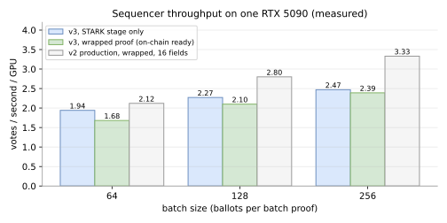

The wrap (recursion to one final STARK, then a PLONK proof over BN254) adds **≈5.2 s per
proof whatever the proof's size**; the previous version of this annex omitted it. Adding
the ML-KEM payload (≈0.4 s per batch, estimated from its own guest) changes only the last
digit of those rates. So one GPU sustains **1.7 to 2.4 votes per second with on-chain-ready
proofs**, 145k to 206k votes a day, and v3 costs **1.3 to 1.4× v2's proving per vote** at
16 ballot fields.

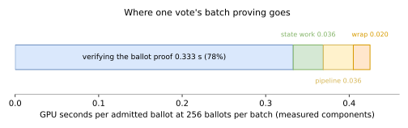

Verifying the voter's proof is 78% of a vote's proving time at 256 per batch; all state
work is 8%; the rest is fixed cost per batch. The marginal cost is 0.37 s per extra ballot
at GPU saturation (0.333 s verification + 0.036 s state work); small batches measured
earlier understated it at 0.30 s.

**Hardware (measured).** The wrap stage asks for 30.05 GB of GPU memory, against 30.32 GB
available on a 32 GB card, and 32-38 GB of host RAM. A 256-ballot batch peaks at 47 GB of
host RAM, or 38 GB with the prover's low-memory flag at a 10% time cost (118 s). A
sequencer therefore needs a 32 GB-class GPU and 48-64 GB of RAM, the same class v2's prover
uses. One of three 256-ballot runs without the low-memory flag hung in the STARK stage and
was killed by the prover's own timeout; both retries passed, and production already
treats that error as transient and retries in low-memory mode.

**Extrapolated.** A 100k-voter election with 120k casts needs ≈14 GPU-hours of sequencer
proving at 256 per batch, ≈16.5 at the 119 per batch that native settlement allows at ν=5,
≈19 at the 74 it allows at ν=8 (§8.6), parallelizable across sequencers as in v2. At an
assumed USD 0.5-1.5 per GPU-hour that is USD 7-30 per election, under USD 0.0003 per voter; the rental price is an assumption, not a measurement. "Fifty concurrent small
elections on one or two GPUs" is likewise an estimate from the ≈16 s all-in cost of a
small wrapped proof, not a measured load test (gate 8).

**What the combined guest does not contain.** It verifies real ballot proofs and runs the
state work, but the proofs' public values are not yet bound to the packages (they are
hashed into the output; a real equality check would cost about the same); it has no
occupancy counter, no `hybridSig` ECDSA, no key-map lookup, and no encapsulations. All are
small next to the 2.5M steps of one verification, and the 3-of-5 prototype (§15) is where
they get measured together.

### A.2 Wardens

**Measured.** The inner loop of the §10.1 contribution was built for its hashing, against
the v1.5 log format: column-record folding, the $h_i$ opening against witnessed $(s, K)$, per-batch
key-share commitment checks and key reconstruction, log decryption, share accumulation.
It costs **1,988 steps and 9.37 Blake3 compressions per counted package** (3.85 for the
record, 4.00 for the opening, 1.52 amortized per-batch work), flat from 1k to 102k
packages. Runs: 1,024 packages in 10.9 s (15.9 s wrapped); 10,240 in 13.6 s; 102,400 in
44 s at 27.6 GiB of host RAM. Nine other tampered inputs besides the corrupted share are
each rejected by their named check.

**Extrapolated.** A million-cast contribution is ≈10 such chunks: ≈6 minutes of proving,
≈7 minutes of wall-clock, ≈8 with a wrap per chunk. No million-cast job was proven as one, and chunk
linking (§2.5) is not implemented.

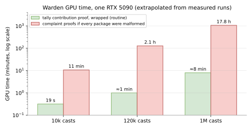

**Not in that measurement:** selecting each slot's last package across batches (the PoC
counts every package, the worst case for the secret work but with no slot map); the
exclusion set; opening the blinding commitments; the statement's bindings to snapshot,
session and dealer set. The slot map is the only one that scales with the election: a
map lookup and update per package.

**Complaints (measured unit, extrapolated totals).** One proven decapsulation with the
full FO check costs 608K steps, 0.064 s of GPU at the margin. An ordinary complaint about
one package is a small proof, ≈16 s all-in with its wrap. The funded adversarial worst
case, a complaint against every package, is ≈2.1 GPU-hours per warden at 120k casts and
≈18 at a million, which is the workload the deadline profiles (§2.3) provision for.

**Hardware: the correction that matters.** Every proof a warden submits on-chain
(contribution, dealer bundle, complaint, and the permissionless roster proof) must be
wrapped, and the wrap needs the same ≈30 GB of GPU memory and 32-38 GB of host RAM as a
sequencer's. The work is light (minutes), but the machine is not: as configured, **a
warden needs a 32 GB-class GPU**, not a laptop. Two ways around it exist and neither is
measured: a CPU wrap path, and handing the final STARK to someone else to wrap, which is
acceptable only once that proof's hiding is established (§12.4, gate 4), since it carries
the warden's secrets in its witness.

### A.3 Ethereum

**Measured** (Foundry; the Lagrange test reconstructs known tallies from Shamir sum-shares
and must match exactly; the point-evaluation precompile was exercised with a valid KZG
vector; the wrapper verifier was run on **our own** wrapped proofs with the program key
and root pinned, and rejects a flipped proof byte, a flipped public value, another
program's key and a swapped proof):

| Item | Gas |
|---|---|
| `finalizeResults`, the on-chain tally, θ = 1 / 3 / 5 / 8 (whole transaction) | 162k / 217k / 278k / 387k |
| `scanComplete` signal, middle / freeze-triggering (whole transaction) | 75k / 97k |
| Wrapped-proof verification, our batch proof / our tally proof (execution) | 271,146 / 269,898 |
| The same as a standalone transaction | 306k |
| Point-evaluation precompile, per blob | 50,461 |
| Settlement bookkeeping in a stand-in contract ($z_b$ keccaks, `archiveAcc` fold, root, counters) | 57k |

The verifier is PLONK over BN254 with a 768-byte proof and one public input, so its gas
does not depend on the guest or the batch size. Interpolating the result on-chain, the
step that replaces v2's threshold decryption, costs about as much as one DEX trade. No
contract verifies SLH-DSA, Blake3 or anything else exotic.

**Estimated: settlement per batch.** 21k base + 57k bookkeeping + ≈44k for the per-batch
view checkpoint (§8.7, a new storage slot) + 271k verification + ≈16k calldata + 50.5k per
blob: **≈0.41M + 50k per blob**, i.e. 0.46M at 1 blob, 0.56M at 3 and 0.71M at 6. v2's production
benchmark of the same flow is 498-667k for 1-4 blobs, the same shape.

**Estimated: the tally ceremony, fixed per election.** At ν=5, θ=3: creation 0.30M
(estimate), five scan signals 0.40M, five joins 1.92M (each carries a ≈9 KB envelope as
calldata, which pays the EIP-7623 floor of about 40 gas per byte: ≈0.38M per join,
computed, not measured), the roster proof 0.35M, five dealer proofs 1.83M, five
share-bundle transactions 0.35M (estimate), three contributions 1.19M, finalization
0.22M: **≈6.5M gas**, of which 3.4M is nine proof-carrying transactions and 1.9M is join
calldata. ≈4.4M at ν/θ = 3/2, ≈10.1M at 8/5, ≈1M in sequencer mode. This is the dominant
cost of a small election, it is several times what the previous version of this annex
stated (≈1M, which counted no proof verifications), and §15 item 11 tracks cutting it.

**Estimated: whole elections, native settlement** (at most 6 blobs per batch, which sets
the batch size, §8.6):

| ν / θ | Votes per batch | 500 voters: batches, execution gas, per voter | 100k voters, 120k casts: batches, execution gas, per voter | Blob gas, 100k voters |
|---|---|---|---|---|
| 1 / 1 | 256 (3 blobs) | 2, 2.1M, 4.2k | 469, 264M, 2.6k | 184M |
| 3 / 2 | 197 | 3, 6.6M, 13.1k | 610, 439M, 4.4k | 480M |
| 5 / 3 | 119 | 5, 10.1M, 20.2k | 1,009, 725M, 7.2k | 794M |
| 8 / 5 | 74 | 7, 15.1M, 30.1k | 1,622, 1,165M, 11.6k | 1,276M |

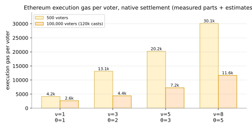

In money, at USD 3k per ETH, execution alone costs a 100k-voter election USD 0.008 to USD 0.035 per
voter at 1 gwei and ten times that at 10 gwei; a 500-voter election, where the ceremony
dominates, USD 0.01 to USD 0.09 per voter at 1 gwei. Blob gas is a separate market: priced as
high as execution gas it would roughly double the large-election figures, and it normally
trades far lower. (The previous version of this annex quoted USD 0.02-0.21 per voter for the
100k case from a model that settled 256-vote batches in 6 blobs, which only ν=1 can do;
the corrected figure for ν=5 at 10 gwei is USD 0.22 execution-only.) Two things would move
these numbers a lot and are not costed here: settling on a rollup with L1 blobs (v2's
production path, where execution gas is far cheaper; its inclusion-proof flow has no
measurement in this annex), and the multi-recipient transport of §15 item 5, which would
triple the votes per blob.

### A.4 The voter: proving a ballot in the browser

**Measured** on the prototype ballot circuit at the pinned proof profile (§2.3: blowup 32,
18 FRI queries, 16-bit grinding, hiding PCS, Blake3 transcript), natively and compiled to
WASM under Node's V8 (Chrome's engine), with the wasm32 challenger defect patched (a
one-line u64 comparison; unpatched, wasm32 proving panics at **every** profile, so the fix
is a prerequisite for any browser proving, §6). A pinned-profile proof made in WASM
verifies under the native verifier and is rejected after a one-byte flip or under the
wrong profile. "Browser" here means that engine run from the command line: no real
browser tab was measured.

| Profile | Native, 1 thread | WASM, warm (cold first proof) | Proof size | Peak WASM memory |
|---|---|---|---|---|
| blowup 8 / 34 queries (baseline) | 0.70 s | 2.3 s (2.5 s) | 324 KB | 122 MiB |
| fallback: blowup 16 / 26 queries | 1.05 s | 3.0 s (3.4 s) | 264 KB | 240 MiB |
| **pinned: blowup 32 / 18 queries** | **1.71 s** | **4.5 s (5.2 s)** | **196 KB** | **478 MiB** |

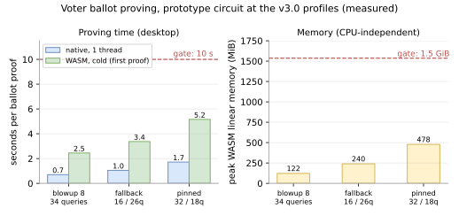

Against the Phase-0 gate (p50 ≤ 10 s and ≤ 1.5 GiB on a 2023 mid-range phone): **time
passes with ≈2× headroom on desktop hardware** (a phone more than ≈2× slower than this
desktop, or a final circuit more than ≈2× heavier, consumes it), and **memory sits at
about a third of the budget** (478 MiB of linear memory; 614 MiB for the whole Node
process). Memory does not depend on CPU speed, so that verdict carries to phones for this
circuit, with room for one doubling of the final circuit's rows but not two. Proof size
came in 39% below the blowup-8 baseline, as §2.3 states, and the blowup-8 → 32 cost
multiplier is 2.45× single-threaded, 2.0× in WASM. The essential caveat: this is the
prototype circuit, not the final §6 ballot AIR with the re-laid in-AIR Blake3 section;
these numbers are floors and scaling factors, and gate 1's phone benchmark remains the
decisive test. The fallback profile buys ≈35% of the time and half the memory for 34%
larger proofs: a real safety valve if the final circuit runs heavy. Not measured: any real
browser tab, Firefox
and Safari engines, real phones, WASM threads.

### A.5 ML-KEM-768 inside the zkVM

**Measured** (RustCrypto `ml-kem`, 24 verified proofs):

| Operation | Steps (Keccak precompile) | Steps (pure software) | GPU marginal |
|---|---|---|---|
| Encapsulation | 462K | 1.04M | 0.049 s |
| Decapsulation + full constant-time FO comparison | 608K | 1.24M | 0.064 s |

The §8.5 batch payload (ν encapsulations) is a per-batch cost of ≈0.4 s GPU at ν=8,
invisible per vote. The §2 normative FO rule is precisely what the measured implementation
does: the re-encrypted ciphertext is compared over all 1,088 bytes with no early exit,
verified in source and by a tamper test that completes in the identical step count on the
rejection path. The decapsulation guest measures the primitive; it does not yet bind the
warden's registered key seed or the package's $h_i$ as a real complaint proof must.

### A.6 What this annex establishes, and what it does not

**Established by measurement.** One guest can verify ballot proofs and do the batch's
state work, and prove 256 ballots in under two minutes on one consumer GPU, wrapped; the
64-ballot wrapped proof was verified by the production verifier contract on a local chain
for 271k gas. The per-vote proving cost is
within 1.4× of v2's. A warden's tally loop costs ≈2,000 steps per package. A WASM
build proves a ballot at the pinned profile in about five seconds and under half a
gigabyte, on desktop hardware under V8. ML-KEM inside the zkVM costs about half a million steps per operation. The
contracts need no unusual cryptography, and the on-chain tally costs a few hundred
thousand gas.

**Extrapolated or estimated, and labelled so above:** million-cast warden jobs; GPU-hours
and dollar costs per election; the ceremony's gas; whole-election gas tables.

**Not measured, and owned by the Phase-0 gates (§15):**
- the **final ballot circuit**, on which both the browser numbers and the in-guest
  verification cost (78% of sequencer time) depend;
- the v1.6 batch format itself (hidden writes, the key-map lookup, `sealCtx`, the Keccak
  census path), expected but not shown to cost no more than the measured v1.5 format;
- the complete contribution proof (slot map across batches, exclusions, bindings) and
  chunk linking;
- the roster, dealer and complaint guests as real statements, and SLH-DSA credential
  verification per package for CSP censuses;
- a CPU wrap path, or any way for a warden without a 32 GB GPU to submit a proof;
- real phones and non-V8 browser engines;
- the registry contracts themselves (creation, the key registry, the attempt state
  machine) and rollup settlement;
- anything under adversarial or concurrent load.

What moved against earlier claims: saturated verification costs 0.333 s per proof, not
0.30; the wrap adds 5 s per proof; a warden needs a large GPU; large elections cost two to
three and a half times the Ethereum gas first reported, and the ceremony's fixed gas
several times (≈6.5M against ≈1M at five wardens).
What moved in favour: v3's proving cost is close to v2's, not an order of magnitude above
it; the tally loop landed at the low end of its projection; the prover multiplier of the
pinned profile is below the assumed one; and v1.6's hidden writes cut 17 to 24% of every
batch's data.
